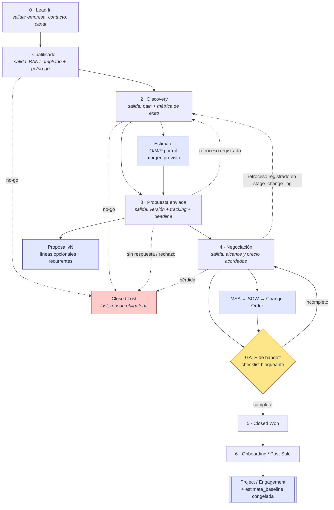
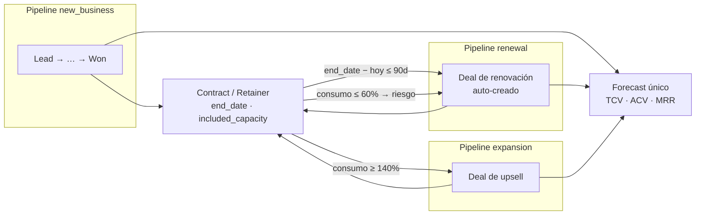
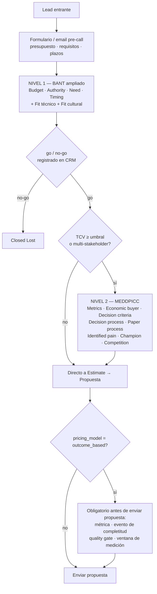
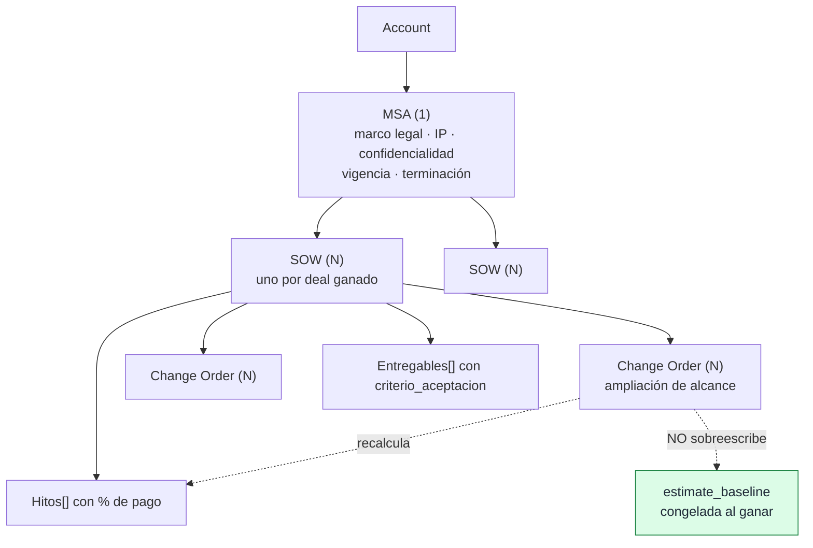
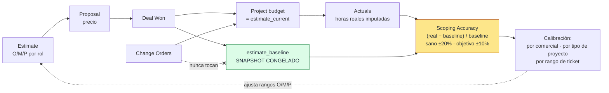
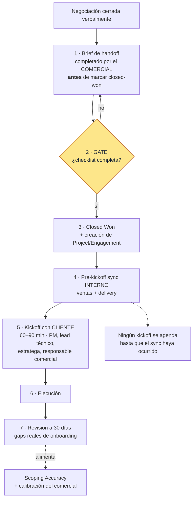

# 02 — Workflows comerciales

Documento de planificación del bloque comercial (lead-to-cash) del CRM propio para una agencia de IA. Define qué workflows debe soportar el producto: pipeline y criterios de avance, cualificación, propuestas y SOW, modelos de pricing, estimación, renovaciones de retainer, handoff a delivery y métricas.

**Base documental y calidad de la evidencia.** Procede íntegramente de `research_notes/CRM para agencias de IA/workflows_comerciales.md`. Dos advertencias que condicionan todo el documento:

1. Casi toda la literatura sobre operativa comercial de agencias es contenido de vendors con interés comercial en sus propias conclusiones (Proposify, PandaDoc, Swydo, Agiled, Scoro, BirdView, Taskip, Copper). Los únicos datos primarios sólidos son el *State of Proposals 2026* de Proposify (742.137 propuestas) y los benchmarks operativos de Parakeeto — y Proposify es juez y parte en todo lo relativo a propuestas.
2. **No existe literatura específica de agencias de IA** sobre proceso comercial. Lo que hay son blogs de 2026. Donde el documento propone estructura, la propuesta es adaptación de B2B/SaaS o diseño propio, y se marca **(criterio propio)**.

Convención de marcado usada en todo el documento:

- Sin marca: dato citado en las notas con fuente.
- **(criterio propio)**: inferencia o propuesta de diseño no respaldada por fuente.
- ⚠️ : cifra de vendor interesado, de segunda mano o no verificable.

---

## 1. Pipeline

### 1.1 Decisión de base: tres pipelines, no uno

Las fuentes describen un pipeline canónico de 5-7 etapas (lead → cualificado → discovery → propuesta → negociación → ganado/perdido → onboarding), con variantes: un servicio productizado puede operar con tres etapas y una agencia consultiva necesita cinco o más ([Agiled](https://agiled.app/hub/agencies/sales-pipeline-stages)). Taskip añade una etapa **Post-Sale** y señala que renovación de retainer y scope creep son problemas propios del mundo agencia. DreamHost termina el pipeline en **onboarding**, que es el handoff.

**(criterio propio)** El CRM debe soportar **tres pipelines paralelos** con probabilidades propias, no uno solo:

| Pipeline | Objeto que lo alimenta | Por qué separado |
|---|---|---|
| `new_business` | Lead entrante / outbound | Ciclo largo, probabilidad baja, requiere discovery |
| `renewal` | `Contract.end_date` dentro de ventana | Disparo por fecha, probabilidad estructuralmente alta |
| `expansion` | Señal de consumo o QBR | Disparo por uso, ciclo corto, sin discovery completa |

Razón: con ~80% de agencias usando alguna forma de retainer ⚠️ (Sprout Social, 220+ agencias, vía Swydo), meter renovaciones en el pipeline de adquisición falsea el *pipeline coverage* y el forecast. La renovación y el upsell deben ser **deals** con valor y probabilidad propios, no tareas, para que entren en el mismo forecast.

### 1.2 El problema real: criterios de salida explícitos

El hallazgo operativo más importante de las notas no es el número de etapas sino esto: si "qualified" significa simplemente que crees que el lead es bueno, dos personas clasifican el mismo deal en etapas distintas y **el forecast se corrompe** ([Agiled](https://agiled.app/hub/agencies/sales-pipeline-stages)). De ahí la decisión de producto:

> **(criterio propio)** Cada etapa tiene una checklist de salida (`exit_criteria[]`) de booleanos y campos obligatorios. El CRM **bloquea** el avance de etapa hasta que estén cumplimentados. El bloqueo es la funcionalidad, no la checklist.

Contrapeso: las fuentes advierten explícitamente que el proceso **no es estrictamente lineal** ([ManyRequests](https://manyrequests.com/blog/agency-sales-process)). Por tanto el retroceso de etapa debe permitirse, registrando el evento en un `stage_change_log` (`from_stage`, `to_stage`, `timestamp`, `reason`) **(criterio propio)** — que además es el único modo de calcular duración real por etapa y detectar deals que rebotan.

### 1.3 Pipeline `new_business`: etapas propuestas

Propuesta **(criterio propio)**, anclada en el set núcleo de Agiled + el Post-Sale de Taskip + el gate de handoff de BirdView/Synup. Siete etapas.

| # | Etapa | Criterio de ENTRADA | Criterio de SALIDA | Campos que pasan a obligatorios al avanzar |
|---|---|---|---|---|
| 0 | **Lead In** | Existe un contacto identificable y una señal de interés (formulario, referido, outbound respondido) | Hay empresa, contacto y canal de origen registrados; no es spam ni candidatura de empleo | `account.name`, `contact.email`, `lead_source` / `channel`, `owner` |
| 1 | **Cualificado** | Pasó el filtro pre-call (formulario o email) con presupuesto, requisitos y plazos | BANT ampliado completo y **decisión go/no-go registrada**; si es no-go → Closed Lost con razón | `budget_range`, `authority_contact`, `need_summary`, `timing`, `fit_tecnico`, `fit_cultural`, `qualification_score`, `go_no_go` |
| 2 | **Discovery** | Llamada de discovery agendada (o paid discovery firmada) | Problema, métrica de éxito y restricciones documentados; **decisión go/no-go confirmada antes de redactar nada** | `pain_identificado`, `metrica_exito`, `stakeholders[]`, `pricing_model` tentativo, `estimate_id` (borrador), si ticket > umbral: campos MEDDPICC |
| 3 | **Propuesta enviada** | Existe `Estimate` con líneas O/M/P valoradas y margen de delivery previsto calculado | Propuesta enviada, registrada con versión y tracking activo; fecha límite de respuesta fijada | `proposal_id`, `proposal_version`, `sent_at`, `deadline_respuesta`, `tcv`, `acv`, `mrr`, `deal_lines[]`, `margen_previsto` |
| 4 | **Negociación** | El cliente ha abierto la propuesta y ha respondido (objeción, contrapropuesta o petición de cambio) | Precio, alcance y condiciones acordados verbalmente; alcance final reflejado en SOW borrador | `objeciones[]`, `revision_round`, `descuento_pct`, `sow_draft_id`, `paper_process` (legal/procurement/MSA) |
| 5 | **Closed Won** | Acuerdo verbal cerrado | **Gate de handoff completo** (ver §7): contrato/SOW firmado, anticipo facturado, estimación congelada como baseline, PM asignado, promesas verbales documentadas | `contract_id`, `sow_signed_at`, `anticipo_estado`, `estimate_baseline_id`, `pm_owner`, `accesos[]`, `promesas_verbales` |
| 6 | **Onboarding / Post-Sale** | Gate superado; se crea el `Project`/`Engagement` vinculado al deal | Pre-kickoff sync interno hecho + kickoff con cliente celebrado; revisión a 30 días agendada | `kickoff_at`, `prekickoff_sync_at`, `review_30d_at` |
| — | **Closed Lost** | Desde cualquier etapa | Razón de pérdida seleccionada de catálogo + campo libre | `lost_reason`, `lost_stage`, `competidor` (si aplica) |

Dos notas sobre decisiones concretas de esta tabla:

- **Etapa 2 → 3 exige `Estimate` valorado.** Es deliberado: las peticiones genéricas de "mándame una propuesta" drenan a la agencia, y el tratamiento recomendado es no producir propuesta sin discovery previa ([Qwilr](https://qwilr.com/blog/how-send-me-a-proposal-requests-are-draining-your-agency/)).
- **Etapa 4 → 5 no se satisface con un contrato firmado.** "Cerrado" necesita definición operativa propia; un contrato firmado puede no bastar si falta el anticipo cobrado o los accesos entregados ([Enterprise DNA](https://enterprisedna.co/resources/guides/agencies-sales-to-delivery-handoff)).
- Al cerrarse, **el deal no muere**: transiciona a `Project`/`Engagement` manteniendo el vínculo **(criterio propio)**, porque el handoff es parte del workflow comercial y porque sin esa trazabilidad no hay *scoping accuracy*.

Falta de evidencia: **no hay ningún estudio con muestra de agencias que valide el número óptimo de etapas**, ni datos de duración media por etapa para agencias de software/IA. Todo lo anterior es diseño razonado, no benchmark.

### 1.4 Diagrama de flujo

Relación entre los tres pipelines:

---

## 2. Cualificación de leads

### 2.1 Advertencia de alcance, explícita

> **No encontré ninguna fuente que analice qué framework de cualificación usan las agencias de servicios profesionales.** Toda la guía disponible (BANT, MEDDIC, MEDDPICC) es literatura B2B/SaaS genérica. Lo que sigue es **adaptación**, no evidencia sectorial. Tampoco hay datos sobre el impacto cuantificado de un framework u otro sobre el win rate en servicios.

CHAMP y GPCTBA/C&I no aparecieron con contenido sustantivo comparativo en la investigación; su ausencia del debate actual sugiere que son minoritarios frente al eje BANT↔MEDDPICC, pero no hay datos para compararlos.

### 2.2 Qué framework y cuándo

El consenso de la literatura B2B es híbrido y el criterio de elección **no es el sector sino la estructura de compra**:

- BANT está diseñado para cualificación temprana en ciclos cortos; MEDDPICC es una metodología construida para deals enterprise complejos ([a79.ai](https://www.a79.ai/resources/meddic-vs-meddpicc-vs-bant)).
- Muchos equipos usan BANT en cualificación temprana y MEDDPICC una vez la oportunidad pasa el discovery inicial ([a79.ai](https://www.a79.ai/resources/meddic-vs-meddpicc-vs-bant); [Spotlight.ai](https://www.spotlight.ai/post/meddicc-vs-bant)).
- Para un deal rápido, de bajo valor y con un único firmante, BANT es exactamente lo adecuado y MEDDPICC es "teatro" ([Funnelfeedr](https://funnelfeedr.com/en/blog/sales-qualification-frameworks)). Qwilr coincide: los negocios pequeños no tienen comité de compra, así que MEDDIC no aporta.
- La calidad del pipeline (fit con el ICP, rigor de cualificación, tamaño de deal adecuado) es el determinante principal de la variación del win rate ([Data-Mania](https://www.data-mania.com/blog/it-services-firm-gtm-benchmarks-2026/)).

**(criterio propio)** Modelo de dos niveles, conmutado por umbral de ticket:

**Nivel 1 — BANT ampliado (todos los deals).** Budget/rango, Authority, Need, Timing, **más fit técnico y fit cultural**. Las dos últimas dimensiones están ausentes de los frameworks clásicos y son decisivas en servicios **(criterio propio)**. En agencia esto se materializa en preguntas pre-call sobre presupuesto, requisitos y plazos y en una decisión go/no-go registrada en el CRM ([Agiled](https://agiled.app/hub/agencies/discovery-call-qualifying-questions); [ManyRequests](https://manyrequests.com/blog/agency-sales-process)). La discovery call tiene función de go/no-go: existe para responder si deberías trabajar con este cliente, **antes** de redactar nada.

**Nivel 2 — MEDDPICC (solo sobre umbral de ticket).** Los ocho campos. En agencias de IA, **Metrics es especialmente load-bearing**: el pricing outcome-based exige un evento de completitud y una métrica medible acordada por contrato **(criterio propio, derivado de la condición de Blck Alpaca en §4)**. De ahí la regla dura del diagrama.

### 2.3 Campos en el CRM

**(criterio propio)** No usar columnas fijas. Modelar:

- `Deal.qualification_framework` — enum (`bant`, `meddpicc`).
- `qualification_answers` — tabla clave-valor **versionada por deal**. El mismo CRM soporta BANT en deals pequeños y MEDDPICC en grandes sin cambiar el esquema.
- `qualification_score` — % de campos cumplimentados; alimenta la probabilidad del forecast.
- `go_no_go` + `go_no_go_rationale` — obligatorios para salir de la etapa 1.
- Campos de agencia añadidos al BANT clásico: `fit_tecnico`, `fit_cultural`.
- Variante operativa a soportar: **paid discovery** — algunas agencias cobran la preparación como oferta inicial en lugar de regalarla ([LifterLMS Podcast](https://podcast.lifterlms.com/?p=3280)). Implica que una etapa de discovery puede tener su propio `DealLine` facturable.

---

## 3. Propuestas y SOW

### 3.1 Anatomía de una propuesta ganadora

Todos los datos de esta subsección proceden del *State of Proposals 2026* de Proposify (742.137 propuestas, ~$3,06B, 30 industrias, datos 2025). ⚠️ **Proposify es vendor de software de propuestas y los datos miden propuestas enviadas con su herramienta**: hay sesgo de selección evidente (agencias que ya invierten en proceso de propuesta) y todos los hallazgos sobre funcionalidades — pricing interactivo, e-firma, tracking — son hallazgos sobre funcionalidades que Proposify vende. Es el mejor dato disponible y aun así hay que leerlo así.

**Estructura:**

| Atributo | Ganadoras | Perdedoras |
|---|---|---|
| Secciones | **7** (portada, resumen ejecutivo, enfoque, entregables/timeline, sobre nosotros, pricing, términos/próximos pasos) | — |
| Páginas | **11** | 13 |
| Con imágenes | 83% (media 12 imágenes) | — |
| Con vídeo | 20% — quien lo ve tiene **3,3x** más probabilidad de cerrar | — |
| Vistas | 12 | 8 |
| Tiempo de visualización | 25,3 min | 15,8 min (60% menos) |

Lectura: **más corta y más visual gana**. Las perdedoras son más largas.

**Close rate y valor:**

- Tasa de cierre media vía Proposify: **34%** (36% en la edición 2024), frente a un ~20% de media de industria que citan ellos mismos ⚠️.
- Valor medio de deal ganado: **$16.388**.
- Por sector: non-profit 53%, telecomunicaciones 51%, **marketing digital 48%** (lo más cercano a agencia), contabilidad 47%. El informe **no desglosa software ni consultoría**.
- ⚠️ El "43% de win rate" que varios sitios terceros atribuyen a Proposify 2024 **contradice las cifras propias de Proposify** (34-36%): tratar como dato no fiable y no usarlo.

**Efecto del pricing interactivo** (tablas con opciones seleccionables):

- **2x** más propuestas ganadas y **+21%** de probabilidad de cierre.
- **Cuotas recurrentes: 18x de incremento en valor de deal.**
- Formularios de input del cliente dentro de la propuesta: 41% de tasa de cierre.
- Propuestas con descuento: media de $35K vs $20K sin descuento (75% superior).

**E-firma:**

- Firma electrónica: **+15% de cierre y 60% más rápido**.
- Firmar la propuesta **antes** de enviarla: **+65% de cierre y 25% más rápido**.

**Rondas de revisión** — el dato contraintuitivo más accionable:

| Rondas de revisión | Efecto sobre el cierre |
|---|---|
| 1 | +18% |
| 2 | +28% |
| **3** | **+45%** |

Implicación directa de producto **(criterio propio)**: el CRM debe **versionar** propuestas (`proposal_version`, `sent_at`, `viewed_at`, `view_count`, `time_on_doc`) y no sobreescribirlas. El número de revisiones es un predictor de cierre, no un síntoma de fracaso.

**Tiempos y engagement:**

- Crear una propuesta: 17 min de media. Envío → apertura: 34 min. **Apertura → closed-won: 2,5 días.**
- Los compradores ven el 93% de las propuestas que acaban firmando y el 80% de las que rechazan.
- **Múltiples stakeholders viendo la propuesta sube el cierre un 20%.**
- ⚠️ No hay benchmark fiable de *time-to-close desde envío de propuesta*. Una guía cita 14-30 días atribuido a Proposify pero no aparece en el informe original; los 2,5 días publicados miden otra cosa (apertura → cierre).

**(criterio propio)** Las señales de engagement (vistas, tiempo, nº de stakeholders que abren) son datos accionables: el CRM puede recalcular `Deal.probability` con ellas en vez de usar solo la probabilidad por etapa. Esto exige tracking propio de la propuesta, que es una decisión de build vs integrar a tomar (ver §9).

### 3.2 Jerarquía documental MSA → SOW → Change Order

Hallazgo legal de base: el **SOW no es contrato vinculante por sí mismo**; adquiere fuerza legal al incorporarse a un contrato o firmarse junto a un MSA. El **MSA** establece el marco y las reglas de la relación entre organizaciones, y el SOW queda subordinado a él ([PandaDoc](https://pandadoc.com/blog/statements-of-work)). El *scope statement* debe preceder al SOW ([Virginia VITA BuyIT Manual](https://www.vita.virginia.gov/procurement/buy-it-manual/chapter-25---it-contract-formation/25816-the-it-statement-of-work.html)).

**(criterio propio)** `MSA (1) → SOW (N) → Change Order (N)` es la estructura de datos correcta: una cuenta tiene un MSA; cada deal ganado genera un SOW colgado de ese MSA; cada ampliación de alcance genera un change order colgado del SOW. Esto es lo que resuelve el scope creep que las fuentes señalan como problema específico de agencias ([Taskip](https://taskip.net/sales-pipeline-stages/)). Un change order **nunca** sobreescribe la estimación baseline (ver §5).

### 3.3 Campos recurrentes de un SOW

Unión de PandaDoc + plantillas públicas GSA/DES/VITA + práctica de agencia **(criterio propio en la consolidación)**:

| Campo | Fuente | Nota |
|---|---|---|
| `background` / contexto | PandaDoc, GSA | GSA estructura: background → scope and objectives → work requirements numerados |
| `objetivos` | PandaDoc | |
| `alcance_incluido` | PandaDoc | |
| `alcance_excluido` | PandaDoc | PandaDoc subraya que definir qué **no** está incluido es "igual de importante" |
| `entregables[]` con `criterio_aceptacion`, `responsable`, `fecha` | PandaDoc | Cada entregable con su criterio de aceptación |
| `hitos[]` con `% de pago asociado` | PandaDoc | Enlaza SOW con facturación |
| `tareas_y_responsabilidades` por parte | PandaDoc, VITA | VITA: definir con precisión las obligaciones de cada parte |
| `costes` y `calendario_de_pago` | PandaDoc | |
| `estandares_y_requisitos` técnicos | PandaDoc | |
| `definiciones` | PandaDoc | Sección recomendada |
| `proceso_decisiones_no_resueltas` | PandaDoc | Decisiones pendientes antes del arranque |
| `firmantes` | PandaDoc | |
| `supuestos[]` | **(criterio propio)** | PandaDoc **no lo nombra explícitamente** |
| `dependencias_del_cliente` | **(criterio propio)** | No nombrado explícitamente |
| `proceso_control_de_cambios` | **(criterio propio)** | Lo más próximo en PandaDoc son las condiciones de sobrecoste |
| `propiedad_intelectual` / derechos de uso | PandaDoc | Como "ownership and usage rights" |
| `confidencialidad` | **(criterio propio)** | Normalmente vive en el MSA |
| `vigencia_y_terminacion` | PandaDoc | **Vive en el MSA, no en el SOW** |

Variantes a soportar **(criterio propio)**:

- **SOW de retainer/soporte**: secciones propias — acceso a instalaciones, mantenimiento de registros y reporting, interfaces entre partes, **transition-in y transition-out**, proyectos especiales ([NITAAC](https://www.nitaac.nih.gov/sites/default/files/2021-08/customerservicesowsample-508.docx)).
- **SOW ágil**: existe plantilla pública ([Scaled Agile](https://v5.scaledagileframework.com/wp-content/uploads/2019/05/Agile-SOW.pdf)), relevante si se venden iteraciones en vez de entregables cerrados.
- Las plantillas deben permitir **eliminar secciones que no apliquen** ([Washington DES](https://www.des.wa.gov/sites/default/files/2023-12/EPM-scope-of-work-framework.pdf)).

Sesgo a declarar: **todas las plantillas de SOW accesibles son de contratación pública estadounidense** (GSA, VITA, DES, NITAAC), lo que inclina los formatos hacia lo burocrático. Las plantillas comerciales (Better Proposals, Qwilr, Proposify) están tras registro. No se encontró ninguna plantilla pública de SOW de agencia privada de software o IA.

**(criterio propio)** Los campos del SOW deben modelarse como **estructura, no como texto libre**: es lo que permite generar el documento, generar el brief de kickoff sin recaptura, y detectar scope creep comparando change orders contra `alcance_incluido`.

---

## 4. Modelos de pricing

### 4.1 Tabla comparativa

Advertencia sobre toda la columna de cuota de mercado ⚠️: **no se pudo acceder a los informes primarios** de SoDA, Productive (181 agencias), Promethean Research, HubSpot Agency Pricing Survey ni 4A's. Todas las cifras llegan de segunda mano vía Swydo o Agiled. Los márgenes proceden de Agiled citando a Promethean Research sobre **muestra pequeña**.

| Modelo | Cuota de mercado | Margen neto típico | Implicación para el modelo de datos del CRM |
|---|---|---|---|
| **Time & materials** | 30% de los ingresos ⚠️ (SoDA/Productive vía Swydo). Tarifa más común $100-149/h; mediana EE.UU. $84,40/h ⚠️ (4A's, 886 rate cards, vía Swydo) | **13%** ⚠️ | `rate_card_id`, `role_rates[]`, `estimated_hours_by_role`, `cap` / not-to-exceed, `periodicidad_facturacion`. Requiere objeto **rate card** versionado y lectura de horas reales |
| **Precio fijo (proyecto)** | **~50%** de los ingresos ⚠️ — el modelo dominante. Agencias de diseño: 41% lo prefiere ⚠️ | **14%** ⚠️ | `total_amount`, `milestones[]` con `% de facturación`, `change_order_policy`. El riesgo vive en la estimación: exige `estimate_baseline` congelada |
| **Retainer** | 44% de los ingresos ⚠️; **~80% de agencias usa alguna forma de retainer** ⚠️ (Sprout Social, 220+ agencias). Marketing: 45% lo prefiere. Tamaños: pequeña $1-5K/mes, mediana $5-15K, enterprise $15-50K+ ⚠️ | **16%** ⚠️ | El más pesado: `mrr`, `fecha_inicio`, `duracion_compromiso`, `capacidad_incluida` (horas/créditos), `politica_rollover`, `tarifa_overage`, `fecha_renovacion`, `preaviso_cancelacion`, `clausula_escalado_anual`. Dispara el pipeline `renewal` |
| **Value-based** | 10% de los **ingresos** ⚠️ (Swydo) / 18% de las **agencias** en 2025 ⚠️ (MarketerHire) — métricas distintas, no mezclar | **18%** ⚠️ — el más alto declarado | `precio`, `valor_estimado_para_el_cliente`, `opciones[]` (good/better/best) con `selected_option`. Exige que la propuesta soporte **opciones seleccionables** |
| **Outcome-based** | Puro: **3,8%** de 80 empresas de agentes de IA ⚠️ (revisión de Orb, citada en blogs, **sin acceso a la fuente original**). **95% usa pricing híbrido** en esa muestra. 38% de agencias digitales de EE.UU. movió al menos una línea de servicio a retainer-plus-performance u outcome ⚠️ | Sin dato propio | El más exigente: `fee_base`, `metrica_outcome`, `evento_completitud`, `quality_gate`, `ventana_medicion`, `formula_calculo`, `cap`. **Los tres primeros obligatorios antes de enviar propuesta** |
| *(transversal)* **Pass-through de tokens/infra** | Norma emergente 2026 en agencias de IA: base fija + componente por uso/outcome + repercusión de costes de tokens ⚠️ (Blck Alpaca, blog) | — | `pass_through_costs` con `cap` y `clausula_ajuste`. Los costes de tokens son volátiles: se recomiendan caps, caching y cláusulas de ajuste |
| *(no cuantificado)* **Dedicated team / staff aug.** | **No encontré datos de adopción** | Sin dato | `FTEs`, `rate_por_FTE_mes`, `ramp_up`, `duracion_minima`, `preaviso` |

Modelo residual citado: comisión, 1% de los ingresos ⚠️.

### 4.2 Consecuencias estructurales (las tres decisiones duras)

**(criterio propio)**, derivadas de la tabla:

1. **`Deal` no puede tener un único campo `amount`.** Necesita un discriminador `pricing_model` (enum) con campos condicionales por modelo.
2. **Un deal puede tener varias líneas de distinto modelo.** Con 28% de agencias prefiriendo modelos mixtos ⚠️ (Promethean vía Swydo) y ~80% usando retainer, el caso normal es "$25K de implementación fija + $4K/mes de retainer de soporte". Se modela como `Deal` → `DealLine[]` con `pricing_model` **por línea**, no por deal.
3. **El valor del pipeline deja de ser una suma.** Un retainer de $8K/mes y un proyecto cerrado de $80K no son comparables. El CRM debe mantener **TCV, ACV y MRR en paralelo** y permitir reportar el pipeline por cualquiera de los tres. Sin esto, el forecast de una agencia con mix proyecto+retainer es inutilizable.

Convergencia que justifica la estructura de la propuesta: el dato de Proposify de **18x de valor con cuotas recurrentes**, el de **2x con pricing interactivo**, y la recomendación de Blair Enns de presentar **tres opciones** apuntan todos al mismo requisito — el objeto propuesta necesita **su propia estructura de líneas** (opcionales/seleccionables y recurrentes), no heredar el `amount` del deal.

### 4.3 La tensión no resuelta sobre value-based

Hay un conflicto real entre fuentes que **este documento no resuelve y no debe resolver**:

**A favor.** Value-based tiene el margen neto más alto declarado (18% vs 13-16%) ⚠️. La encuesta de Productive a 181 agencias sostiene que el time & materials afronta "desafíos existenciales" conforme la IA acelera la producción, y que los modelos outcome/value encajan mejor ⚠️. Jonathan Stark llega a llamar "alucinación colectiva" a la aceptación de la facturación por horas: argumenta que el abaratamiento de la mano de obra (offshore, automatización, IA) hace más arriesgado facturar por tiempo, y que ser más rápido debería hacerte más rentable en vez de penalizarte. Blair Enns (*The Four Conversations*) aporta la mecánica: anclar alto, estructurar propuestas multi-opción, usar price anchoring y decoy pricing como técnicas distintas para elevar el valor medio de propuesta — marco anclado en investigación de pricing conductual (cita *Priceless*, de Poundstone).

**En contra.** La adopción de value-based **cayó** al 18% de agencias en 2025 y ese grupo **tuvo peor desempeño** que las que usan modelos estándar ⚠️ ([MarketerHire](https://marketerhire.com/blog/marketing-agency-pricing-models)). Webtonic recomienda a los CMOs presupuestar retainers y fees basados en trabajo y ser cautos con las ofertas value-based, porque exigen una claridad de atribución de resultados "que la mayoría de relaciones cliente-agencia simplemente no tiene en la práctica". Smart Insights es escéptica sobre una migración masiva. La propia Productive reconoce que outcome-based **requiere métricas sofisticadas, atribución clara y ciclos de venta más largos**.

**Lectura propuesta (criterio propio).** El "peor desempeño" del grupo value-based huele a sesgo de selección — agencias en dificultades probando value pricing como salida — más que a refutación del modelo. Pero no hay dato para demostrarlo. **Se presenta como dato en conflicto y no se resuelve.**

Consecuencia de producto, que es lo único que debe decidirse aquí: **el CRM soporta los seis modelos sin tomar partido**, y la condición de Blck Alpaca se implementa como regla dura — "ningún outcome es facturable sin un evento de completitud, una puerta de calidad y una ventana de medición acordados". Esa regla es la defensa contra el riesgo que describen los escépticos.

---

## 5. Estimación

### 5.1 Método: bottom-up + PERT

El método estándar combina descomposición bottom-up (WBS por tarea y rol) con estimación de tres puntos sobre cada tarea:

- **Bottom-up**: se estima cada tarea individual y se agregan los resultados. Más lento de preparar pero más preciso cuando el desglose es detallado; encaja en fases tardías de planificación, una vez existe una WBS completa ([Project-Management.com](https://project-management.com/project-estimation-techniques/); [ActiTime](https://actitime.com/project-management/project-estimation)).
- **PERT / tres puntos**, aplicado a cada tarea del desglose:

$$E = \frac{O + 4M + P}{6}$$

donde O = optimista, M = más probable, P = pesimista. Da al valor más probable cuatro veces el peso de los otros dos. La desviación estándar se deriva del rango entre pesimista y optimista — convencionalmente σ = (P − O) / 6 **(criterio propio: las notas confirman que σ deriva del rango, no la fórmula exacta)** ([StarAgile](https://staragile.com/blog/three-point-estimation); [projectmanagement.com](https://www.projectmanagement.com/wikis/368763/3-Points-Estimating)).

- El patrón combinado habitual es aplicar tres puntos a cada tarea bottom-up y contrastar con un método top-down.
- El método de tres puntos facilita que **más de un experto aporte input**, lo que lo hace adecuado para estimación en grupo.
- Las estimaciones deben empezar pronto, **en fase de propuesta**, y refinarse con el tiempo ([Aspire Europe](https://www.aspireeurope.com/how-do-i-develop-project-estimates.php)). En licitación competitiva el proveedor presenta precio fijo y plazos, lo que obliga a que la estimación preceda y sustente el compromiso comercial.

Factores de carga a incorporar: un empleado a tiempo completo tiene ~**2.080 h/año** de capacidad (Parakeeto); Swydo usa **1.800 h facturables/año** como base de cálculo de tarifa y advierte que la comunicación con el cliente puede consumir **20-60% del tiempo de proyecto** ⚠️ (rango amplísimo, de blog de vendor).

### 5.2 El objeto `Estimate` en el CRM

**(criterio propio)** Cadena de objetos: `Estimate` → `Proposal` → `Deal (won)` → `SOW` → `Project budget` → `Actuals`. Un solo registro genera el precio de la propuesta **y** el presupuesto del proyecto al cerrar, sin reintroducir datos.

`Estimate.line_items[]` = `{rol, horas_optimista, horas_probable, horas_pesimista, horas_PERT, tarifa_cliente_rol, coste_interno_rol, importe}`.

Tres decisiones de diseño y por qué:

1. **Guardar las tres estimaciones (O/M/P), no solo el PERT.** Permite calcular σ y, con ella, un rango de confianza por deal que alimenta el forecast ponderado. Es una capacidad que los CRMs genéricos no tienen.
2. **Separar `tarifa_cliente` de `coste_interno` por rol.** Es lo que permite calcular el **margen de delivery previsto en el momento de la propuesta**, no después de entregar. Benchmark de referencia: 60-70% de AGI por proyecto (Parakeeto). Probablemente la funcionalidad de mayor valor diferencial frente a un CRM genérico.
3. **Para proyectos con LLMs, abrir el rango O/M/P.** La literatura de estimación encontrada no trata la incertidumbre específica de proyectos con LLMs (iteración de prompts, variabilidad de calidad). Un rango más ancho es la mitigación natural dentro del marco existente, pero es inferencia propia sin respaldo.

Gap declarado: **no se encontraron fuentes sobre cómo construir tablas de esfuerzo por rol ni cómo calcular tarifas blended para una oferta de software**, ni material sobre estimación de proyectos de IA/LLM. La mecánica de rate cards en propuestas es un hueco real en la literatura.

### 5.3 El bucle de Scoping Accuracy

**Scoping Accuracy** (métrica de Parakeeto): tiempo/coste estimado vs real. Varianza dentro del ~**±20%** se considera sana; el objetivo es un margen de error consistente en torno al **±10%**.

Es la métrica que cierra el bucle entre propuesta y proyecto entregado, y la que la literatura de estimación **no cubre** (se centra en producir la estimación, no en calibrarla).

**(criterio propio)** Requisito no negociable: la estimación original queda **congelada** (snapshot al ganar) aunque el proyecto cambie después. Modelar `estimate_baseline` vs `estimate_current`. Si los change orders sobrescriben la estimación, la métrica queda inutilizable — y con ella desaparece el único mecanismo de calibración del equipo comercial.

Esto implica una dependencia dura: **sin horas reales imputadas no hay scoping accuracy**. El CRM debe integrarse con time tracking o, como mínimo, poder ingerir horas reales por proyecto y periodo (ver §9).

No se encontraron datos sobre precisión real de estimación en agencias de software más allá del benchmark normativo de Parakeeto: el ±20%/±10% es objetivo, no media observada.

---

## 6. Renovaciones y upsell de retainers

Diagnóstico de base: las renovaciones fallan por **falta de visibilidad de fechas de fin de contrato**, no por falta de relación. Sin visibilidad de los acuerdos que terminan en los próximos 90 días, las renovaciones se convierten en una carrera de última hora ⚠️ ([Enterprise DNA](https://enterprisedna.co/resources/blog/agencies-contract-renewal-upsell-automation), blog).

### 6.1 Disparadores

| Tipo | Disparador | Umbral | Acción en el CRM | Fiabilidad |
|---|---|---|---|---|
| **Fecha** | Ventana previa a `end_date` | **90 días** (o `notice_period_days` + buffer) | Job programado crea deal en pipeline `renewal` | ⚠️ Recomendación de blog, no hallazgo medido |
| **Consumo bajo** | % de capacidad del retainer consumida | **≤ 60%** de las horas | Marcar **riesgo de churn**; crear deal de renovación con probabilidad reducida y tarea de QBR | ⚠️ Enterprise DNA, blog |
| **Consumo alto** | % de capacidad consumida | **≥ 140%** y pagando overage | Marcar **oportunidad de upsell**; crear deal en pipeline `expansion` | ⚠️ Enterprise DNA, blog |
| **Calendario** | Revisión anual de cliente | Anual | QBR para identificar oportunidades de crecimiento ([HubSpot](https://blog.hubspot.com/agency/grow-client-retainers)) | Blog de vendor |
| **Riesgo IA** | Consumo de tokens sobre `cap` | `cap` del contrato | Disparar cláusula de ajuste de precio | Blck Alpaca, blog |

```mermaid
flowchart TD
    CT["Contract / Retainer<br/>end_date · notice_period_days<br/>included_capacity · overage_rate"]
    JOB{{"Job diario"}}
    CT --> JOB
    JOB -- "end_date − hoy ≤ 90d" --> RD["Deal en pipeline renewal"]
    TT["Horas reales / consumo<br/>desde time tracking"] --> PCT["utilization_pct<br/>por contrato y periodo"]
    PCT -- "≤ 60%" --> RISK["RIESGO de churn<br/>health_score ↓ · tarea QBR"]
    PCT -- "60–140%" --> OK["Normal"]
    PCT -- "≥ 140% + overage" --> UP["Deal en pipeline expansion<br/>upsell a tier superior"]
    RISK --> RD
    UP --> CAT["ServiceCatalog<br/>stretch scopes predefinidos"]
    CAT --> CO["Change Order formalizado"]
    RD --> REN{"¿Renueva?"}
    REN -- "sí" --> CT
    REN -- "no" --> CHURN["Churn · NRR ↓"]

    classDef risk fill:#fecaca,stroke:#b91c1c,color:#1f2937
    classDef opp fill:#dcfce7,stroke:#15803d,color:#1f2937
    class RISK,CHURN risk
    class UP,CAT opp
```

### 6.2 Mecanismo de upsell

- **Retainers escalonados**: tres o cuatro niveles de servicio con diferencias de alcance claras, lo que crea una ruta de upgrade incorporada ([Sakas & Company](https://sakasandcompany.com/recurring-revenue/)).
- Diseñar **alcances "stretch" por adelantado** y **formalizar los change orders**, para que los cambios de alcance no ocurran de manera informal (Sakas). **(criterio propio)** Esto se modela como un `ServiceCatalog` con paquetes predefinidos insertables en propuestas y change orders: convierte el upsell en un flujo de datos y no en una redacción desde cero.
- Orden de prioridades del account manager: primero satisfacción y éxito del cliente, luego upsell, luego trabajo nuevo; con incentivos que premien tanto retención como expansión ([Averi](https://www.averi.ai/guides/how-to-execute-customer-retention-for-agencies)).
- Riesgo específico de agencias de IA: **un retainer sin guardrails de alcance es un pasivo**, y los costes de tokens volátiles exigen caps y cláusulas de ajuste de precio ⚠️ (Blck Alpaca, Agency Handy).

### 6.3 Objeto `Contract` y health score

**(criterio propio)** `Contract` / `Retainer` con: `start_date`, `end_date`, `auto_renew`, `notice_period_days`, `mrr`, `included_capacity` (horas o créditos), `overage_rate`, `rollover_policy`, `escalation_clause`, `token_cost_cap`.

`health_score` por cuenta **(criterio propio — ninguna fuente propone la fórmula)**, combinando: % de consumo del retainer, tiempo desde el último QBR, nº de change orders en disputa, retraso en pagos y NPS si existe.

Dependencia crítica: **las señales 60%/140% solo funcionan si el CRM lee datos de delivery**. Es el requisito de integración más importante de toda esta investigación.

Gaps: no hay evidencia sobre **cuándo** iniciar la conversación de renovación (los 90 días son recomendación de blog), no hay benchmarks de NRR medidos sobre agencias, y no hay datos sobre tasa de éxito de upsells en agencias.

---

## 7. Handoff ventas → delivery

El handoff se trata como una **puerta de validación**, no como una secuencia de pasos: BirdView lo enmarca explícitamente como herramienta de validación ([BirdView PSA](https://birdviewpsa.com/blog/sales-to-delivery-handoff-checklist-consulting/)).

### 7.1 Secuencia

Respaldo de cada paso:

- **Brief estandarizado completado por el comercial antes de marcar closed-won** ([Synup](https://www.synup.com/en/learn/how-to-improve-sales-to-delivery-handoff)).
- **Pre-kickoff sync**: Synup lo califica como la solución más eficaz a los fallos de handoff y sugiere **no agendar ningún kickoff hasta que se haya producido**. ⚠️ Synup cita un "90% de skip rate" del pre-kickoff sync que **no es verificable**.
- **Kickoff**: 60-90 minutos con PM, lead creativo/técnico, estratega y responsable comercial ([ClickUp](https://clickup.com/learn/topic/project-management/industries/agencies/kickoff-checklist/)). Contenido: resultados esperados, alcance, responsables, hitos, riesgos y plan de comunicación. Su propósito es **eliminar incertidumbre, no releer la propuesta** ([Superthread](https://superthread.com/learn/agency-project-kickoff-checklist)).
- **Revisión a 30 días** para alinear ventas y delivery sobre los gaps reales de onboarding (Synup).
- Patrón de modelado: plantilla de onboarding de 25 pasos que asigna a cada paso **un único responsable y una regla de completitud** ([Hummingdeck](https://hummingdeck.com/en/blog/client-onboarding-checklist)) → `OnboardingTask` con `owner`, `completion_rule`, `blocking` (bool) **(criterio propio en el modelado)**.

### 7.2 Qué debe estar completo antes de marcar closed-won

**(criterio propio)** El handoff **es** la exit criteria de la etapa Closed Won. Checklist bloqueante de la transición `Negociación → Won`:

| # | Ítem | Respaldo |
|---|---|---|
| 1 | Contrato / SOW firmado y adjunto | BirdView: alcance y entregables definidos |
| 2 | Cronograma e hitos confirmados | BirdView |
| 3 | Estructura financiera clara; **anticipo facturado/cobrado** | BirdView + Enterprise DNA ("cerrado" necesita definición operativa) |
| 4 | **Estimación baseline congelada** | (criterio propio) — requisito de §5.3 |
| 5 | Contactos y roles del cliente, con **quién puede aprobar el trabajo** identificado | QuietOps |
| 6 | Accesos y credenciales listados (repos, entornos, claves de API de modelos, límites de gasto en tokens) | QuietOps + (criterio propio para la parte de IA) |
| 7 | Supuestos y exclusiones del SOW marcados como comunicados al cliente | (criterio propio) |
| 8 | Riesgos conocidos | Superthread (contenido del kickoff) |
| 9 | **Promesas verbales hechas durante la venta que no están en el SOW** — campo libre obligatorio | **(criterio propio)** |
| 10 | PM asignado | ClickUp (asistentes del kickoff) |

El ítem 9 merece justificación: **no aparece en ninguna plantilla encontrada**, pero se deduce del problema que todas describen — delivery descubre expectativas que ventas creó y no documentó. Es inferencia propia y se marca como tal.

**(criterio propio)** Funcionalidad derivada: dado que el kickoff externo no debe releer la propuesta, el CRM debe **generar el brief de kickoff** desde datos ya capturados (objetivos, métrica de éxito del framework de cualificación, hitos del SOW, riesgos), eliminando la recaptura manual, que es exactamente donde se pierde el contexto.

Gaps: todas las fuentes de esta sección son blogs de vendors de PSA/CRM; **no hay evidencia empírica de que el pre-kickoff sync mejore resultados medibles**, ni datos sobre qué porcentaje de proyectos fracasa por mal handoff. Tampoco existen plantillas de handoff específicas de agencias de software o IA — justo el contenido más relevante para este caso de uso.

---

## 8. Métricas comerciales

### 8.1 Advertencia estructural

Hay dos bloques con calidad de evidencia radicalmente distinta:

- **Métricas de pipeline** (win rate, cobertura, ciclo): proceden de literatura **B2B/SaaS genérica** y de vendors de herramientas de ventas. **No existe ninguna fuente que publique win rate o ciclo de venta medidos sobre una muestra de agencias de software o IA.**
- **Métricas operativas de agencia** (AGI, delivery margin, utilización, ABR, scoping accuracy): sí tienen benchmarks específicos de agencias vía Parakeeto.

Dato revelador del estado del arte: **Parakeeto, la mejor fuente de benchmarks de agencia, no define métricas de pipeline ni de conversión de ventas.** La literatura de agencias está muy desarrollada en operaciones y rentabilidad, y prácticamente vacía en pipeline comercial. Ese hueco es, de hecho, parte de la oportunidad de este CRM.

### 8.2 Tabla de métricas

| Métrica | Fórmula | Benchmark | Fiabilidad del benchmark |
|---|---|---|---|
| **Win rate** | Deals ganados / deals cerrados | ~21% medio B2B; top performers 30-40%; SQL inbound bien cualificados 25-40% | 🔴 **B2B/SaaS genérico** (GetAccept, Spotio — vendors). No hay dato de agencias |
| **Close rate de agencia** | Propuestas ganadas / propuestas enviadas | ≥20% citado como práctico para agencias; Proposify reporta 34% sobre su base (36% en 2024) y ~20% como media de industria | 🟡 **Proposify tiene dato primario grande (742.137 propuestas) pero es vendor y su base está autoseleccionada.** El "43%" de terceros es **no fiable** |
| **Close rate sectorial** | ídem, por industria | Marketing digital **48%**; non-profit 53%; telco 51%; contabilidad 47% | 🟡 Proposify. **No desglosa software ni consultoría** — marketing digital es la proxy más cercana |
| **Valor medio de deal ganado** | Σ TCV ganado / nº deals ganados | $16.388 (todas las industrias) | 🟡 Proposify, vendor |
| **Pipeline coverage** | Pipeline abierto ponderado / objetivo del periodo | **3-4x** para el trimestre; 5-6x para el año. Relación mecánica: **cobertura necesaria = 1 / win rate histórico** | 🔴 **B2B/SaaS genérico.** La relación mecánica sí es válida universalmente; el 3-4x asume win rates de 25-33%. ⚠️ GrowthSpree afirma que la cobertura bien filtrada es 30-45% inferior a la bruta — claim de vendor |
| **Ciclo de venta** | Media de días Lead In → Closed Won (requiere `stage_change_log`) | **84 días** | 🔴 **B2B/SaaS genérico** (Spotio). Sin dato de agencias ni duración media por etapa |
| **Duración por etapa** | Media de días en cada etapa | **Sin benchmark** | ⚫ No existe dato para agencias. Medir internamente y calibrar |
| **Apertura → cierre de propuesta** | Días desde `viewed_at` hasta `won_at` | **2,5 días** | 🟡 Proposify. ⚠️ No confundir con time-to-close desde envío: ese dato (14-30 días) **no está en el informe original** |
| **Engagement de propuesta** | Vistas, tiempo en documento, nº de stakeholders | Ganadoras 12 vistas / 25,3 min vs perdedoras 8 vistas / 15,8 min. Múltiples stakeholders: **+20%** de cierre | 🟡 Proposify, vendor que vende tracking |
| **Scoping Accuracy** | (Real − `estimate_baseline`) / `estimate_baseline` | Varianza ±20% sana; **objetivo ±10%** | 🟢 **Benchmark propio de agencias** (Parakeeto). Es objetivo normativo, no media observada |
| **AGI** (Agency Gross Income) | Ingresos brutos − gastos pass-through | — (es la base de cálculo del resto) | 🟢 Definición propia de agencias (Parakeeto) |
| **Delivery Margin** | (AGI − costes de delivery) / AGI | **60-70% de AGI por proyecto**; 50%+ a nivel agencia (típicamente 10-20 pts menos agregado) | 🟢 **Benchmark propio de agencias** (Parakeeto) |
| **ABR** (Average Billable Rate) | AGI / horas de delivery | Gap de al menos **60-70%** entre coste medio/hora y ABR (coste $45/h + margen 70% → ABR ≥ $150/h) | 🟢 Parakeeto |
| **Utilización** | Horas de delivery planificadas / capacidad planificada | Semanal: 75-90% producers, 25-75% PM/account, N/A ventas y ops. Anual: 65-80% producers, 50-60%+ equipo completo. Capacidad base ~2.080 h/año | 🟢 Parakeeto |
| **CAC de agencia** | Gasto S&M del periodo / nº clientes nuevos | **La métrica sectorial es un ratio, no un absoluto: S&M = 8-14% de AGI**. Parakeeto incluye en S&M desarrollo de negocio, salarios, **herramientas de CRM**, publicidad y eventos | 🟢 El ratio sobre AGI es benchmark de agencias. 🔴 **No hay benchmark de CAC absoluto para agencias** |
| **Operating Margin** | Beneficio operativo / AGI | La mayoría logra ~10-15%; objetivo Parakeeto 25-35%, con 25% como estándar. Alternativos ⚠️: EBITDA medio 10-15% / sano 15-20% / top 25-35%; especialistas 25-40% vs generalistas 15-20% | 🟢 Parakeeto. 🟡 Los alternativos vienen vía Swydo citando a Parakeeto y Scoro |
| **NRR** | (MRR base + expansión − contracción − churn) / MRR base | **<90% problema; >110% fuerte** | 🔴 **Bandas procedentes de SaaS, aplicadas por analogía.** No hay NRR medido sobre agencias |
| **Churn de clientes** | Clientes perdidos / clientes al inicio del periodo | ⚠️ 8-10% atribuido a las mejores agencias de retainer | 🔴 **Claim de blog de vendor sin metodología publicada** |
| **Tenure de retainer** | Media de meses de vida de los contratos | ⚠️ 42% de agencias reporta tenure >2 años; un cuarto pierde al cliente típico en el primer año | 🔴 Promethean citado **sin fuente verificable** |
| **Win rate por canal** | Ganados / cerrados, segmentado por `lead_source` | Sin benchmark — **la recomendación es segmentar por canal, no por comercial** | 🟢 Recomendación específica de agencias ([GigRadar](https://gigradar.io/blog/sales-report-template)) |

Leyenda de fiabilidad: 🟢 benchmark propio de agencias · 🟡 dato primario grande pero de vendor interesado · 🔴 B2B/SaaS genérico aplicado por analogía · ⚫ sin dato.

### 8.3 El LTV no funciona como métrica de agencia

Hallazgo relevante para el diseño: **el LTV de agencia no aparece definido como métrica propia en ninguna fuente de agencias encontrada**, y tampoco hay benchmarks de CAC ni LTV en valores absolutos para agencias de servicios.

Lo que ocupa su lugar funcional **(criterio propio, derivado de Averi y Parakeeto)**: **NRR + tenure medio de retainer**. Razón estructural — el LTV de SaaS asume una suscripción homogénea con churn estimable; una agencia con mix de proyectos cerrados y retainers de tamaño variable no tiene esa base. Un proyecto fijo de $80K no tiene "vida" que descontar.

**Consecuencia de producto: el CRM debe modelar `tenure` y `NRR` en lugar de calcular un LTV teórico.** Las métricas de retención que las fuentes sí nombran son NRR, tasa de retención, churn, revenue de expansión, **fechas de fin de contrato** y un client health score (Averi).

### 8.4 Dos consecuencias adicionales para el forecast

**(criterio propio)**

- **CAC en dos vistas.** Exponer el absoluto (gasto S&M / clientes nuevos) y el ratio sobre AGI, porque el único benchmark comparable del sector es el segundo (8-14%).
- **Probabilidad por tipo de pipeline, no solo por etapa.** Un retainer renovado tiene probabilidad estructuralmente distinta de un proyecto nuevo; el forecast ponderado solo por etapa es insuficiente con mix de retainers.
- **`lead_source` / `channel` como dimensión de primer nivel** en todos los reportes, no campo secundario: GigRadar recomienda segmentar por canal y no por comercial, lo que además encaja con agencias pequeñas donde vende el fundador. Contrapunto del mismo autor: seguir **una** métrica, no quince.

---

## 9. Funcionalidades derivadas

Prioridad MoSCoW. Asignación **(criterio propio)** según dependencia estructural: es *Must* lo que, si falta, invalida otra funcionalidad.

| ID | Funcionalidad | Prioridad |
|---|---|---|
| F-COM-01 | Pipelines múltiples configurables (`new_business`, `renewal`, `expansion`) con probabilidad por pipeline y por etapa | Must |
| F-COM-02 | Exit criteria por etapa como checklist **bloqueante** del avance, con campos obligatorios configurables | Must |
| F-COM-03 | `stage_change_log` con `from`/`to`/`timestamp`/`reason`, permitiendo retroceso registrado | Must |
| F-COM-04 | Catálogo de razones de pérdida (`lost_reason`) obligatorio al cerrar perdido — **sin taxonomía estándar disponible: hay que definirla** | Must |
| F-COM-05 | Cualificación como `qualification_answers` clave-valor versionada, con framework conmutable por umbral de ticket (BANT ↔ MEDDPICC) | Must |
| F-COM-06 | `qualification_score` (% de campos cumplimentados) alimentando la probabilidad del forecast | Should |
| F-COM-07 | Decisión go/no-go registrada con justificación, obligatoria para salir de Cualificado y de Discovery | Must |
| F-COM-08 | `Deal` → `DealLine[]` con `pricing_model` **por línea** y campos condicionales por modelo | Must |
| F-COM-09 | TCV / ACV / MRR en paralelo, con reporte de pipeline por cualquiera de los tres | Must |
| F-COM-10 | Reglas duras de outcome-based: métrica, evento de completitud, quality gate y ventana de medición obligatorios antes de enviar propuesta | Must |
| F-COM-11 | `pass_through_costs` de tokens/infra con `cap` y cláusula de ajuste | Should |
| F-COM-12 | Objeto `Estimate` con líneas O/M/P por rol, cálculo PERT y σ | Must |
| F-COM-13 | `tarifa_cliente` vs `coste_interno` por rol → **margen de delivery previsto en el momento de la propuesta** | Must |
| F-COM-14 | Rate card versionada por rol, reutilizable entre estimaciones | Should |
| F-COM-15 | `estimate_baseline` congelada al ganar, separada de `estimate_current` | Must |
| F-COM-16 | Cálculo de Scoping Accuracy (baseline vs actuals) con calibración por comercial y tipo de proyecto | Should |
| F-COM-17 | Propuestas versionadas, no sobreescritas (`proposal_version`, `sent_at`, `viewed_at`, `view_count`, `time_on_doc`) | Must |
| F-COM-18 | Líneas de propuesta **opcionales/seleccionables** (good/better/best) y **recurrentes** | Should |
| F-COM-19 | Tracking de engagement de propuesta (vistas, tiempo, nº de stakeholders) | Should |
| F-COM-20 | Probabilidad del deal recalculada con señales de engagement, no solo por etapa | Could |
| F-COM-21 | Generación de propuesta desde el `Estimate`, sin recaptura de datos | Should |
| F-COM-22 | Jerarquía `MSA (1) → SOW (N) → Change Order (N)` como estructura de datos | Must |
| F-COM-23 | Campos del SOW modelados como estructura (entregables con criterio de aceptación, hitos con % de pago, supuestos, exclusiones) | Must |
| F-COM-24 | Plantillas de SOW por tipo (proyecto cerrado / retainer-soporte / ágil) con secciones eliminables | Could |
| F-COM-25 | Detección de scope creep: change orders contrastados contra `alcance_incluido` del SOW | Could |
| F-COM-26 | Objeto `Contract`/`Retainer` con fechas, capacidad incluida, overage, rollover, preaviso y escalado | Must |
| F-COM-27 | Job programado que crea el deal de renovación en ventana de 90 días (o `notice_period` + buffer) | Must |
| F-COM-28 | Ingesta de `utilization_pct` por contrato y periodo desde time tracking | Must |
| F-COM-29 | Alertas por consumo: ≤60% riesgo de churn, ≥140% oportunidad de upsell | Should |
| F-COM-30 | `ServiceCatalog` con paquetes y stretch scopes predefinidos, insertables en propuestas y change orders | Should |
| F-COM-31 | Retainers escalonados en 3-4 tiers como ruta de upgrade | Could |
| F-COM-32 | `health_score` por cuenta (consumo, días desde QBR, change orders en disputa, retrasos de pago, NPS) | Could |
| F-COM-33 | Gate de handoff: checklist bloqueante de la transición `Negociación → Closed Won` | Must |
| F-COM-34 | Campo obligatorio de **promesas verbales no recogidas en el SOW** | Must |
| F-COM-35 | `OnboardingTask` con `owner`, `completion_rule` y `blocking` | Should |
| F-COM-36 | Generación automática del brief de kickoff desde datos ya capturados | Could |
| F-COM-37 | Transición `Deal (won)` → `Project`/`Engagement` manteniendo el vínculo | Must |
| F-COM-38 | Tarea automática de revisión a 30 días que compara prometido vs entregado | Could |
| F-COM-39 | Métricas nativas: win rate global / por canal / por rango de ticket; ciclo por etapa; valor medio por `pricing_model` | Must |
| F-COM-40 | Pipeline coverage con la relación `1 / win rate histórico` | Should |
| F-COM-41 | NRR mensual sobre la base de retainers + tenure medio (**en lugar de LTV**) | Should |
| F-COM-42 | CAC en doble vista: absoluto y como % de AGI (benchmark 8-14%) | Could |
| F-COM-43 | `lead_source` / `channel` como dimensión de primer nivel en todos los reportes | Must |
| F-COM-44 | Probabilidades de forecast configurables por tipo de pipeline, no solo por etapa | Should |
| F-COM-45 | Soporte de **paid discovery** como `DealLine` facturable en la etapa de discovery | Won't (esta fase) |
| F-COM-46 | Decoy pricing / anclaje: plantillas de propuesta multi-opción con opción señuelo | Won't (esta fase) |

---

## 10. Decisiones abiertas

| # | Decisión | Opciones | Qué la bloquea |
|---|---|---|---|
| D-01 | **Build vs integrar el tracking de propuesta** | (a) Construir visor propio con tracking; (b) integrar Proposify/PandaDoc/Qwilr y consumir eventos | Todas las señales de engagement (F-COM-19, F-COM-20) dependen de ello, y es coste de desarrollo alto. Además, el dato que justifica la funcionalidad viene del vendor que la vende |
| D-02 | **Umbral de ticket que activa MEDDPICC** | Fijo (p. ej. TCV) vs regla compuesta (ticket **o** multi-stakeholder **o** procurement) | No hay ningún dato sectorial sobre dónde está el corte. Decisión puramente interna |
| D-03 | **Taxonomía de razones de pérdida** | Definirla desde cero | **Ninguna fuente propone un catálogo validado para agencias de servicios**; todas la citan como necesaria |
| D-04 | **Integración con time tracking** | (a) Construir imputación de horas dentro del CRM; (b) integrar herramienta externa; (c) ingesta mínima de `utilization_pct` | Es el requisito de integración más importante de la investigación: sin horas reales no hay scoping accuracy, ni margen de proyecto, ni señales de renovación. Determina si esto es "un CRM" o "un PSA ligero" |
| D-05 | **Postura sobre value-based** | Soportarlo como un modelo más vs promoverlo en la UI | Tensión no resuelta en las fuentes: mejor margen declarado (18%) pero adopción en caída y peor desempeño del grupo que lo usa. Recomendación: soportarlo sin promoverlo |
| D-06 | **Ventana de renovación: 90 días fijos o derivada** | 90 días fijos vs `notice_period_days` + buffer configurable | Los 90 días son recomendación de un blog, no un hallazgo medido |
| D-07 | **Fórmula del `health_score`** | Pesos a definir | Las fuentes nombran la métrica pero **ninguna propone la fórmula** |
| D-08 | **Rangos O/M/P para proyectos LLM** | Rango estándar vs factor de ensanchamiento por tipo de trabajo | No existe literatura sobre estimación de proyectos de IA/LLM. Habrá que calibrar con datos propios vía F-COM-16 |
| D-09 | **Cuántas métricas exponer por defecto** | Dashboard mínimo vs completo | GigRadar recomienda seguir una métrica, no quince; el set mínimo propuesto son ocho |
| D-10 | **Dónde vive el `health_score` y la relación post-venta** | Dentro del CRM comercial vs módulo de account management separado | Afecta al alcance de esta fase |

---

## 11. Fuentes

Todas las fuentes provienen de `research_notes/CRM para agencias de IA/workflows_comerciales.md`. Clasificadas por calidad.

**Datos primarios (los únicos sólidos)**

- [Proposify: State of Proposals 2026](https://www.proposify.com/state-of-proposals-2026) — 742.137 propuestas, ~$3,06B, 30 industrias. ⚠️ Vendor de software de propuestas; base autoseleccionada; no desglosa software/consultoría.
- [Parakeeto: Agency Metrics](https://parakeeto.com/blog/agency-metrics/) — AGI, delivery margin, utilización, ABR, scoping accuracy, overhead. Única fuente con benchmarks operativos específicos de agencias. No cubre pipeline comercial.

**Pipeline y proceso comercial de agencia** (blogs de vendors)

- [Agiled: Sales Pipeline Stages](https://agiled.app/hub/agencies/sales-pipeline-stages) · [Agiled: Discovery Call Qualifying Questions](https://agiled.app/hub/agencies/discovery-call-qualifying-questions) · [Agiled: Agency Pricing Statistics](https://agiled.app/statistics/agency-pricing-statistics)
- [Taskip: Sales Pipeline Stages](https://taskip.net/sales-pipeline-stages/) · [DreamHost: Build a Sales Pipeline for Your Agency](https://www.dreamhost.com/blog/build-sales-pipeline-agency/)
- [ManyRequests: The Complete Creative Agency Sales Process](https://manyrequests.com/blog/agency-sales-process) · [Qwilr: "Send me a proposal" requests](https://qwilr.com/blog/how-send-me-a-proposal-requests-are-draining-your-agency/)
- [AgencyAnalytics: Client Discovery Meeting](https://agencyanalytics.com/blog/client-discovery-meeting) · [LifterLMS Podcast: Agency Sales Process](https://podcast.lifterlms.com/?p=3280) · [Salesforce: Sales Pipeline Stages](https://www.salesforce.com/sales/pipeline/stages/)

**Cualificación** (todo B2B/SaaS genérico — ninguna fuente de agencias)

- [a79.ai: MEDDIC vs MEDDPICC vs BANT 2026](https://www.a79.ai/resources/meddic-vs-meddpicc-vs-bant) · [Spotlight.ai: MEDDICC vs BANT](https://www.spotlight.ai/post/meddicc-vs-bant) · [Funnelfeedr: Sales Qualification Frameworks](https://funnelfeedr.com/en/blog/sales-qualification-frameworks)
- [Qwilr: BANT vs MEDDIC](https://qwilr.com/blog/bant-vs-meddic) · [SOCO Selling](https://www.socoselling.com/comparing-sales-qualifying-methodologies/) · [Salesforce: BANT vs MEDDIC](https://www.salesforce.com/blog/bant-vs-meddic/) · [MEDDICC vs BANT](https://meddicc.com/resources/meddicc-vs-bant)
- [GigRadar: Discovery Call Questions](https://gigradar.io/blog/discovery-call-questions)

**SOW y contratación** (todo sector público estadounidense — sesgo burocrático)

- [PandaDoc: Statements of Work](https://pandadoc.com/blog/statements-of-work) — la única fuente comercial estructurada
- [Virginia VITA BuyIT Manual cap. 25](https://www.vita.virginia.gov/procurement/buy-it-manual/chapter-25---it-contract-formation/25816-the-it-statement-of-work.html) · [VITA: Preparing a quality IT SOW](https://www.vita.virginia.gov/procurement/buy-it-manual/chapter-12---statements-of-work-for-it-procurements/122-preparing-a-quality-it-statement-of-work-sow.html)
- [GSA: SOW Application Services](https://origin-www.gsa.gov/system/files/SOW_Application.Services.and.Component.Framework.pdf) · [GSA: Software Development SOW](https://origin-www.gsa.gov/system/files/SOW_Service.Access.and.Delivery.and.Service.Interface.and.Integration.Software.Development.pdf)
- [Washington DES: EPM Scope of Work Framework](https://www.des.wa.gov/sites/default/files/2023-12/EPM-scope-of-work-framework.pdf) · [NITAAC: Customer Service SOW sample](https://www.nitaac.nih.gov/sites/default/files/2021-08/customerservicesowsample-508.docx) · [Scaled Agile: Agile SOW](https://v5.scaledagileframework.com/wp-content/uploads/2019/05/Agile-SOW.pdf) · [California CDT SIMM 180](https://cdt.ca.gov/policy/simm/simm-180/)

**Pricing** (cifras de segunda mano — primarios inaccesibles)

- [Swydo: Agency Pricing in 2026](https://www.swydo.com/blog/agency-pricing/) — vehículo de las cifras de SoDA/Productive, Sprout Social, Promethean y 4A's
- [MarketerHire: Marketing Agency Pricing Models](https://marketerhire.com/blog/marketing-agency-pricing-models) · [Promethean Research: Pricing Models Follow Agency Archetypes](https://prometheanresearch.kit.com/posts/pricing-models-follow-agency-archetypes)
- [Webtonic: What CMOs Should Budget 2026](https://www.webtonic.io/blog/pricing-statistics) · [Smart Insights: Agency Pricing](https://www.smartinsights.com/digital-marketing-strategy/agency-pricing/)
- [Everything PR: The New Agency Pricing Models](https://everything-pr.com/the-new-agency-pricing-models-project-performance-and-hybrid) · [Ravetree: Top Pricing Strategies for Agencies](https://www.ravetree.com/blog/top-pricing-strategies-for-agencies)

**Pricing de agencias de IA** (todo blogs de 2026, fuente primaria de Orb no verificada)

- [Digital Applied: Agent Pricing Models, Token vs Outcome-Based 2026](https://digitalapplied.com/blog/agent-pricing-models-token-vs-outcome-based-2026) · [Digital Applied: AI Agency Pricing Models 2026](https://digitalapplied.com/blog/ai-agency-pricing-models-2026-decision-guide) · [Digital Applied: AI Agency Services Pricing](https://digitalapplied.com/blog/ai-agency-services-pricing-strategies-2026)
- [Blck Alpaca: Pricing Models Agent Infrastructure](https://blckalpaca.at/en/knowledge-base/ai-agents/ai-agents-for-marketing-agencies/pricing-models-agent-infrastructure) — origen de la condición de facturación de outcomes
- [AI Agent Rank: Outcome-Based Pricing in AI 2026](https://aiagentrank.io/blog/outcome-based-pricing-in-ai-2026) · [Agency Handy: Agency Pricing in the Age of AI](https://www.agencyhandy.com/informative/agency-pricing-in-the-age-of-ai/) · [AI Growth Agent](https://aigrowthagent.co/articles/?p=6441) · [Monetizely: What Should Companies Charge for an AI Agent's Work?](https://www.getmonetizely.com/articles/what-should-companies-charge-for-an-ai-agent-s-work)

**Value pricing (literatura)**

- [jonathanstark.com](https://jonathanstark.com/) — hourly billing como "alucinación colectiva"; vender resultados, no actividades
- [Win Without Pitching: The Four Conversations](https://www.winwithoutpitching.com/?p=53029) y [atribuciones](https://winwithoutpitching.com/?p=54579) · [Duct Tape Marketing: entrevista a Blair Enns](https://ducttapemarketing.com/the-four-conversations-blair-enns-on-leading-pricing-and-selling-expertise/) · [Consulting Success Podcast 361](https://www.consultingsuccess.com/my-entire-sales-system-is-just-these-4-conversations-with-blair-enns-podcast-361) · [Teamwork: Value Masterclass](https://www.teamwork.com/blog/value-masterclass-key-takeaways/)

**Estimación**

- [StarAgile: PERT Three Point Estimating](https://staragile.com/blog/three-point-estimation) · [projectmanagement.com: 3-Points Estimating](https://www.projectmanagement.com/wikis/368763/3-Points-Estimating) · [dsebastien: Three-Point Estimation](https://concepts.dsebastien.net/concept/three-point-estimation/)
- [Project-Management.com: Estimation Techniques](https://project-management.com/project-estimation-techniques/) · [ActiTime: Project Estimation](https://actitime.com/project-management/project-estimation) · [Forecast: Estimation Techniques 101](https://blog.forecast.it/project-estimation-techniques-101-learn-the-basics?hsLang=en)
- [WorkFusion: Estimation Approaches](https://doc.workfusion.com/platform/docs/automate/odf/estimation-approaches) · [Aspire Europe: How do I develop project estimates](https://www.aspireeurope.com/how-do-i-develop-project-estimates.php)

**Métricas** (bloque de pipeline = B2B/SaaS genérico)

- [GetAccept: Top 4 Sales Benchmarks](https://www.getaccept.com/blog/top-4-sales-benchmarks-winning-teams) · [Spotio: Sales Pipeline Metrics](https://spotio.com/blog/sales-pipeline-metrics/) · [GrowthSpree: B2B SaaS Pipeline Coverage Benchmarks 2026](https://growthspree-astro-blog.vercel.app/blogs/b2b-saas-pipeline-coverage-ratio-benchmarks-2026-by-stage-acv-win-rate-quarter-start)
- [Data-Mania: IT Services Firm GTM Benchmarks 2026](https://www.data-mania.com/blog/it-services-firm-gtm-benchmarks-2026/) · [GigRadar: Sales Report Template](https://gigradar.io/blog/sales-report-template) · [GigRadar: Sales KPIs 2026](https://gigradar.io/blog/sales-kpis) · [Synup: Marketing Agency Sales Process](https://www.synup.com/es/learn/marketing-agency-sales-process)
- [Proposify: Sales Closing Statistics](https://www.proposify.com/blog/sales-closing-statistics)

**Retención y renovaciones**

- [Averi: Customer Retention for Agencies](https://www.averi.ai/guides/how-to-execute-customer-retention-for-agencies) · [Enterprise DNA: Contract Renewal & Upsell Automation](https://enterprisedna.co/resources/blog/agencies-contract-renewal-upsell-automation) · [Sakas & Company: Grow your recurring revenue](https://sakasandcompany.com/recurring-revenue/)
- [HubSpot: Grow Client Retainers](https://blog.hubspot.com/agency/grow-client-retainers) · [Swydo: Client Churn KPIs](https://www.swydo.com/?p=21556) · [Wayfront: Recurring Services for Agencies](https://wayfront.com/blog/recurring-service) · [Teamwork: How to retain agency clients](https://www.teamwork.com/blog/how-to-retain-agency-clients/) · [Resource Guru: Agency client retention](https://resourceguruapp.com/blog/?p=5307) · [Proposify: Client Retention Strategy](https://proposify.com/blog/agency-client-retention-strategy)

**Handoff y onboarding**

- [BirdView PSA: Sales to Delivery Handoff Checklist](https://birdviewpsa.com/blog/sales-to-delivery-handoff-checklist-consulting/) · [Synup: Sales-to-Delivery Handoff](https://www.synup.com/en/learn/how-to-improve-sales-to-delivery-handoff) · [Enterprise DNA: Agencies Sales to Delivery Handoff](https://enterprisedna.co/resources/guides/agencies-sales-to-delivery-handoff)
- [Superthread: Agency Project Kickoff Checklist](https://superthread.com/learn/agency-project-kickoff-checklist) · [ClickUp: Agency Kickoff Checklist](https://clickup.com/learn/topic/project-management/industries/agencies/kickoff-checklist/) · [Hummingdeck: Client Onboarding Checklist](https://hummingdeck.com/en/blog/client-onboarding-checklist) · [QuietOps: Client Onboarding Checklist](https://tryquietops.pages.dev/blog/client-onboarding-checklist-for-agencies/) · [Productive: Agency Client Onboarding](https://productive.io/blog/agency-client-onboarding/) · [Copper: From sale to success](https://www.copper.com/sales-delivery-playbook)

---

### Gaps de evidencia que este documento arrastra

Resumen para que no se pierdan al leer solo las secciones:

1. Ninguna fuente valida el **número óptimo de etapas** ni publica **duración por etapa** para agencias.
2. No hay **taxonomía de razones de pérdida** validada para agencias de servicios.
3. No hay literatura sobre **frameworks de cualificación en agencias**: todo es adaptación de B2B/SaaS.
4. Los informes primarios de **SoDA, Productive, Promethean, HubSpot y 4A's son inaccesibles**; todas sus cifras llegan vía Swydo o Agiled.
5. El estudio de **Orb** (95% híbrido, 3,8% outcome puro) se cita en varios blogs pero **no se accedió al original**.
6. No hay datos sobre **tablas de esfuerzo por rol ni tarifas blended** para ofertas de software, ni sobre **estimación de proyectos LLM**.
7. **Win rate, pipeline coverage y ciclo de venta** proceden todos de B2B/SaaS genérico. No existe win rate medido sobre agencias de software o IA.
8. No hay **benchmarks de CAC ni LTV absolutos** para agencias; el LTV ni siquiera está definido como métrica sectorial.
9. Los claims de **churn (8-10%)** y de duración de relación son de blogs sin metodología publicada.
10. No existen **plantillas de handoff específicas de agencias de software o IA** (repos, entornos, claves de API, límites de gasto en tokens) — justo el contenido más relevante para este caso de uso.
