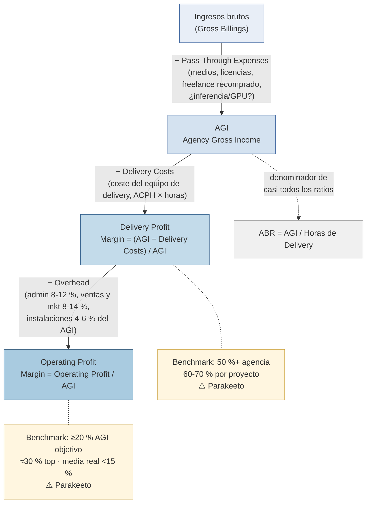
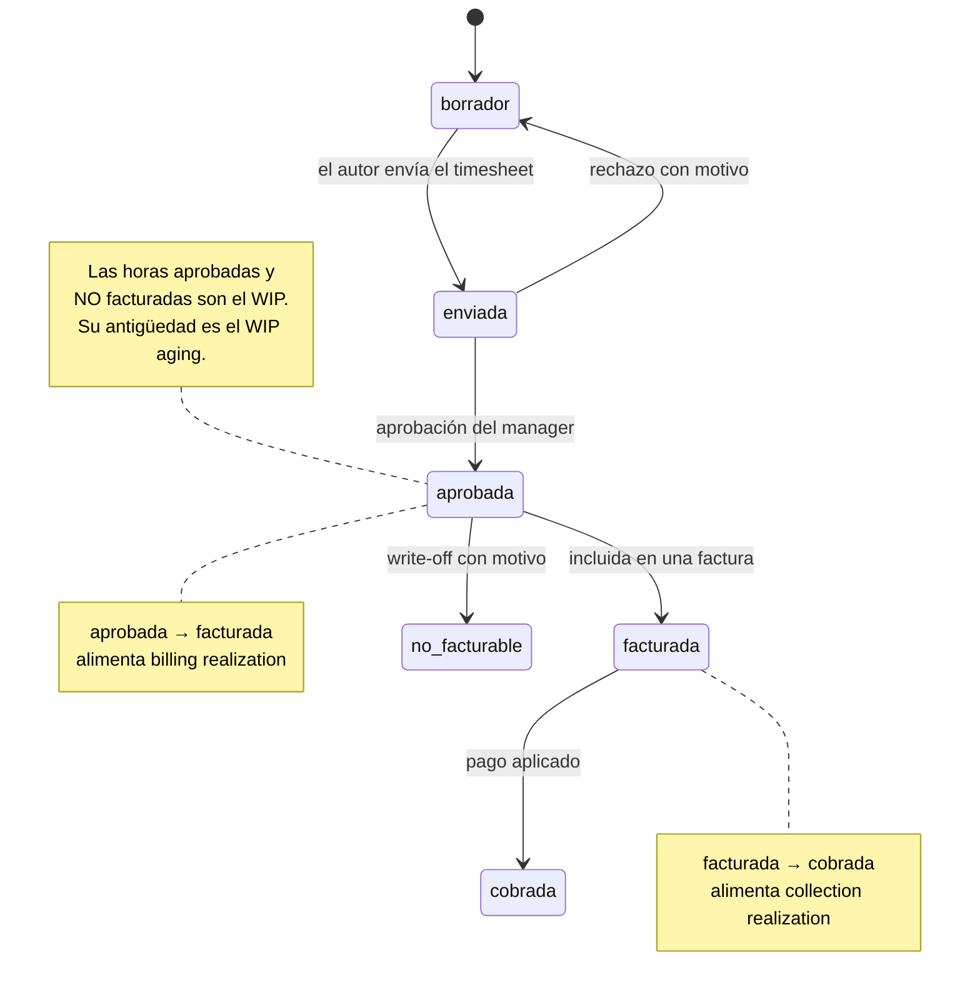

# 03 — Delivery, capacidad y rentabilidad

Documento de planificación del módulo de operación post-venta del CRM propio: qué se mide, con qué fórmula, contra qué referencia, y qué datos hay que guardar para poder calcularlo. Cubre capacidad y asignación, time tracking, retainers, scope creep, facturación y cobro, y los cuadros de mando de dirección.

Fuente única: `research_notes/CRM para agencias de IA/delivery_y_rentabilidad.md` (estado a noviembre de 2026). No se añade aquí ningún dato que no esté en esas notas.

**Convenciones de este documento**
- Dato citado = procede de una fuente identificada en las notas.
- `(criterio propio)` = inferencia o decisión de diseño nuestra, no respaldada directamente por una fuente.
- ⚠️ proveedor interesado = cifra publicada por un vendedor de software o una consultora que vende el servicio que la cifra justifica. Direccional, no auditada.

Advertencia de método que viene de la propia investigación: la mayor parte de la literatura de métricas de agencia procede de proveedores (Productive, Scoro, Harvest, Teamwork, Runn, Toggl, Everhour) y de consultoras especializadas (Parakeeto, SPI Research, Promethean Research). Se señala en línea cuando es el caso.

---

## 1. La cascada financiera de una agencia

El esqueleto financiero no es "ingresos menos costes". Son cuatro escalones, y cada uno responde a una pregunta de gestión distinta. Confundirlos es la causa habitual de decisiones de pricing equivocadas.

### Los cuatro escalones

**1. Ingresos brutos (Gross Billings)**
Todo lo facturado al cliente, incluido lo que solo pasa por la agencia.

**2. AGI (Agency Gross Income / Adjusted Gross Income)**

```
AGI = Ingresos brutos − Pass-Through Expenses
```

Ejemplo del glosario de Parakeeto: 1.000.000 $ − 50.000 $ = **950.000 $ de AGI**. Los *pass-through* son costes de proveedor repercutidos directamente al cliente: medios, licencias, impresión, freelance recomprado.

AGI es el denominador correcto de casi todos los ratios, porque neutraliza el efecto distorsionador de los costes repercutidos: dos agencias con el mismo trabajo real y distinto volumen de medios comprados tienen ingresos brutos incomparables y AGI comparables.

> **Decisión pendiente específica de agencia de IA (criterio propio).** Los costes de tokens/inferencia (OpenAI, Anthropic, Azure), GPUs y licencias de terceros deben poder marcarse explícitamente como pass-through **o** como coste de delivery. Si se deja implícito, el margen queda hinchado o deprimido según el mix de cada cuenta. Las notas confirman que **no existe ninguna fuente pública** sobre cómo tratan las agencias este coste en su cascada: la decisión es nuestra y hay que documentarla, no heredarla.

**3. Delivery Profit**

```
Delivery Profit ($) = AGI − Delivery Costs
Delivery Margin (%) = (AGI − Delivery Costs) / AGI
```

⚠️ Corrección de fuente: el texto publicado de Parakeeto escribe esta fórmula mal en ambos artículos — una vez como `AGI – Delivery Costs / AGI` sin paréntesis, otra como `Delivery Costs / AGI`, que daría un ratio de coste y no un margen. Los ejemplos numéricos del propio artículo confirman que la correcta es `(AGI − Delivery Costs) / AGI`. Implementar la versión del texto literal produciría un número sin sentido.

Vía alternativa, estimando desde tarifas en lugar de desde la P&L:

```
Delivery Margin estimada = (ABR − ACPH) / ABR
```

**4. Operating Profit**

```
Operating Profit ($) = Delivery Profit − Overhead Expenses
Operating Margin (%) = Operating Profit / AGI
```

Vista completa, sin escalones intermedios:

```
Profit = Ingresos − Pass-Through − Delivery Costs − Shared Delivery Expenses − Overhead
```

### Benchmarks por escalón

| Escalón | Referencia | Fuente y fiabilidad |
|---|---|---|
| Pass-through → AGI | Sin benchmark de proporción; depende del mix | — |
| Delivery Margin (agencia) | **50 %+** en la P&L consolidada | Parakeeto ⚠️ consultora interesada |
| Delivery Margin (proyecto) | **60-70 % del AGI** | Parakeeto ⚠️ |
| Brecha proyecto vs. agencia | Agregado **10-20 puntos por debajo** del de proyecto (utilización, no facturable, vacaciones) | Parakeeto ⚠️ |
| Overhead / AGI | Administración 8-12 %, Ventas y Marketing 8-14 %, Instalaciones 4-6 %; **total 20-30 %** | Parakeeto ⚠️ |
| Operating Margin | Objetivo **≥20 % del AGI**, top ≈**30 %**; media real del sector **<15 %**. Otro artículo del mismo autor fija 25-35 % con 25 % como estándar y sitúa a la mayoría en 10-15 % | Parakeeto ⚠️ (las dos cifras de objetivo no coinciden entre artículos) |
| Project margin | Media **37,7 %**; mínimo >35 %; **50 %+** en firmas de Nivel 5 | SPI Research 2025, vía Deltek ⚠️ resumen de partner comercial |

**Implicación de diseño (criterio propio).** Como el margen a nivel proyecto corre 10-20 puntos por encima del de agencia, cualquier dashboard que presente ambos sin etiquetar el nivel provoca decisiones erróneas de pricing. El CRM debe mostrar siempre los dos escalones juntos: delivery margin y operating margin tras overhead asignado.

### Diagrama



---

## 2. Catálogo de métricas

Todas las fórmulas aparecen tal y como se usan en el cálculo, no en prosa. "Media del sector" es la cifra publicada; "Objetivo" es el valor al que apuntan las fuentes o, si se marca, nuestro criterio.

| Métrica | Fórmula exacta | Media del sector | Objetivo | Fuente y fiabilidad |
|---|---|---|---|---|
| **Billable utilization** | `(Horas facturables ÷ Horas disponibles) × 100`, donde `Horas disponibles = horas contratadas − vacaciones aprobadas − festivos`. Ejemplo: 114 ÷ 152 = 75 % | **66,4 %** (2025, 509 firmas) | **80 %+** (Nivel 5); 70-75 %+ como buena práctica general | SPI Research 2026 Benchmark (datos 2025, >245.000 empleados, 63.000 M$) vía Deltek/Certinia ⚠️ resúmenes de partners comerciales; fórmula de Productive.io ⚠️ proveedor |
| **Resource / overall utilization** | `((Horas facturables + horas internas productivas) ÷ Horas disponibles) × 100`. Ejemplo: (114 + 20) ÷ 152 = 88,2 % | No publicada | — | Productive.io ⚠️ proveedor |
| **Utilización (definición Parakeeto)** | `Horas de Delivery ÷ Capacidad`. *Delivery Hours* = todo el tiempo trabajado para clientes que pagan, se facture por horas o no. Ejemplo: 1.350 ÷ 2.080 = 64,9 % | Ver contradicción abajo | Ver contradicción abajo | Parakeeto ⚠️ consultora interesada |
| **Billable Efficiency** (sustituto cuando no se trackea tiempo) | `Horas Facturables Estimadas ÷ Capacidad Bruta`, con `Horas Facturables Estimadas = AGI ÷ Tarifa Objetivo` | No publicada | — | Parakeeto ⚠️ |
| **Target utilization (blended)** | `Σ(headcount_rol × punto medio de su banda) ÷ headcount total`. Ejemplo: (2×70 + 6×80) ÷ 8 = 77,5 % | — | Se calcula, no se compara | Productive.io ⚠️ proveedor |
| **Realization rate (collected)** | `Ingresos cobrados ÷ (Horas facturables × Tarifa estándar)`. Ejemplo: cotiza 250 $/h, cobra 200 $/h → 80 % | Fuentes discrepan: **75-85 %** (Everhour) vs. **85-90 %** la mayoría y **95 %+** las top (Harvest) | ≥85 % *(criterio propio: punto de solape de ambas fuentes)* | Harvest, Everhour, AccountingTools ⚠️ dos de tres son proveedores |
| **Billing realization** (etapa 1) | `Valor facturado ÷ Valor facturable` | No desglosada | — | Everhour, AccountingTools ⚠️ |
| **Collection realization** (etapa 2) | `Valor cobrado ÷ Valor facturado` | No desglosada | — | Everhour, AccountingTools ⚠️ |
| **Effective billable rate** | `Honorarios recibidos ÷ Horas realmente trabajadas` (incluidas las no facturadas) | No publicada | — | Harvest ⚠️ proveedor |
| **ABR (Average Billable Rate)** | `AGI ÷ Horas de Delivery`. Versión forecast: `ABR = AGI Planificado ÷ Horas de Delivery Planificadas` | No publicada | `ABR ≥ ACPH / (1 − margen objetivo)`. Ejemplo: 45 $/h de coste con 70 % de margen → ≥150 $/h | Parakeeto ⚠️ |
| **ACPH (Average Cost Per Hour)** | `(Salario anual + beneficios) ÷ Capacidad anual`. Ejemplo: 60.000 $ ÷ 2.080 h ≈ 29 $/h. Equipo del ejemplo: media 57 $/h | No publicada | — | Parakeeto ⚠️ |
| **Delivery Margin** | `(AGI − Delivery Costs) ÷ AGI`; alternativa desde tarifas: `(ABR − ACPH) ÷ ABR` | No publicada como media auditada | **50 %+** agencia; **60-70 %** por proyecto | Parakeeto ⚠️ — y con la fórmula mal escrita en la fuente original (ver §1) |
| **Project margin** | `(Ingresos del proyecto − Coste del proyecto) ÷ Ingresos del proyecto`; con AGI: `(AGI − Delivery Costs) ÷ AGI` | **37,7 %** | >35 % mínimo; **50 %+** Nivel 5 | SPI Research 2025 vía Deltek ⚠️ partner comercial |
| **Beneficio neto de proyecto** | `(AGI − Delivery Costs − Overhead Asignado) ÷ AGI` | — | = Operating Margin objetivo (≥20 % AGI) | Birdview PSA, Parakeeto ⚠️ |
| **Contribución por cliente** | `Contribución = Ingresos del cliente − Costes directos de delivery`; `Margen = Contribución ÷ Ingresos`. Ejemplo: 9.250 ÷ 24.000 ≈ 38,5 % | No publicada | — | Enterprise DNA ⚠️. **Las fuentes discrepan** sobre si *contribution margin* y *gross margin* son lo mismo: unas los igualan, otras definen contribución restando solo costes **variables** |
| **Overhead rate / multiplier** | `Total gastos indirectos ÷ Total coste de mano de obra directa` | A/E típico **150-175 %** de la mano de obra directa; por encima de 1,75× conviene corregir | 1,30-1,50 | Monograph, Open Exam Prep ⚠️ |
| **Break-even multiplier** | `Overhead Rate + 1,00` = `(Overhead total + Mano de obra directa) ÷ Mano de obra directa` | Ejemplo trabajado: 500 K$ directa + 750 K$ overhead → overhead 1,50, break-even **2,50** | — | Monograph, Cumberland Labs ⚠️ |
| **Net multiplier** | `Ingresos netos ÷ Coste de mano de obra directa`. Debe superar `1 + overhead rate` para haber beneficio | Media del sector ≈**3,11**; firma sana 2,75-3,25; cuartil superior ≥3,0 | **2,8-3,2**; ≈3,13 con 20 % de beneficio objetivo | BCS ProSoft, Cumberland Labs, Open Exam Prep ⚠️ — **benchmarks discrepantes entre sí**, todos del mundo A/E, no de agencias digitales |
| **Revenue leakage** | Brecha entre ingresos devengados y realizados (las fuentes no publican la expresión algebraica) | ≈**4,5 %** | **<5 %**; líderes **<3 %** | SPI Research 2025 vía Deltek ⚠️ partner comercial |
| **DSO** | `(Cuentas por cobrar ÷ Ventas totales a crédito) × Días del periodo` | **45-60 días** en staffing | Retainers cobrables en 15-20 días | BigTime (fórmula); Crestmont Capital ⚠️ blog de datos de crédito, no específico de agencias; US Tech Automations ⚠️ proveedor, afirma recuperar 12-18 días de DSO con automatización — **no verificado** |
| **Project overrun** | Frecuencia con que los proyectos exceden tiempo o coste planificado | No publicada | **<10 %**; dígito simple en Nivel 5 | SPI Research 2025 vía Deltek ⚠️ |
| **Ingresos por consultor facturable** | `Ingresos ÷ consultores facturables` | **210 K$** | 200 K$+; regla práctica ≥**2× el coste totalmente cargado** | SPI Research 2025 vía Deltek ⚠️ |
| **Scoping Accuracy** | `Estimado ÷ Real` (tiempo o dinero). Ejemplo: 25 h ÷ 27 h = 0,92 → 8 % de desviación | No publicada | Desviación dentro de **±20 %** es sana; objetivo a largo plazo ≈**10 %** consistente | Parakeeto ⚠️ |
| **Capacidad bruta** | `Horas laborables/semana × Semanas del periodo`. **Sin** descontar bajas, vacaciones ni festivos | FTE ≈ **2.080 h/año** (40 × 52) | — | Parakeeto ⚠️ |
| **Capacidad de delivery** | `(Capacidad Bruta − Culture Hours) × Objetivo de Utilización Semanal` | — | — | Parakeeto ⚠️ |
| **Capacidad de ingresos / AGI** | `Capacidad Bruta × Tasa de Utilización × ABR` | — | — | Parakeeto ⚠️ — **con errata en la fuente**: en un punto escribe `Revenue = (Capacity / Utilization) × ABR`, incoherente con el resto del artículo. La prosa describe el producto, no la división |
| **Utilización prevista (forecast)** | `Horas de Delivery Planificadas ÷ Capacidad Planificada` | — | — | Parakeeto ⚠️ |

### La contradicción de benchmarks de utilización

No la escondemos porque determina si el sistema es usable o no. Las cifras publicadas para "utilización de agencia" no son comparables entre sí:

| Fuente | Cifra publicada | Ámbito |
|---|---|---|
| SPI Research 2025 (509 firmas) | **66,4 %**, la más baja en 19 años de serie | Utilización facturable, servicios profesionales |
| SPI, objetivo | 80 %+ (Nivel 5); 70-75 %+ buena práctica | — |
| Promethean Research (2021) | Producción 70-90 %; account management 60-80 %; partners y senior "mucho más bajo" (sin cifra) | Agencias |
| Parakeeto, por rol | Productores 75-90 % semanal, 65-80 % anual; PM/AM 25-75 % semanal; empresa con no facturables 50-60 %+ anual | Agencias |
| Parakeeto, guía de rentabilidad | ≈65 % semanal, ≈50 % anual a nivel agencia | Agencias |
| Parakeeto, artículo de capacidad | **"75-90 % exitosa"**, **"55-60 % anual"** con semanales 70-95 %, **"netos anuales 65-85 %"**, y en la FAQ **"50-65 % anual"** | — |
| Summit CPA (2019), citado por Parakeeto | ≈53 % media del sector | — |
| Agiled / Orangescrum / Harvest / Hubstaff | 70-85 % · 75 % · 70-80 % · 75-90 % | ⚠️ todos marketing de proveedor |

Dos observaciones:

1. **Parakeeto se contradice consigo misma dentro del mismo artículo**: 75-90 %, 55-60 %, 65-85 % y 50-65 % son cuatro rangos anuales incompatibles. No es una discrepancia entre fuentes, es una inconsistencia interna de la fuente más citada del sector.
2. **La causa estructural está identificada**: Parakeeto define capacidad bruta *sin* descontar vacaciones. Según se use denominador bruto (2.080 h) o neto (≈1.800-1.880 h tras vacaciones y festivos), el mismo equipo arroja cifras que difieren **10-15 puntos**. Esa es la razón principal de que los benchmarks del sector no sean comparables.

**Consecuencias de diseño (criterio propio):**

- No implementar "utilización" como un único número. Implementarla como función parametrizable:
  `utilizacion(numerador ∈ {facturable, delivery, productivo}, denominador ∈ {capacidad_bruta, horas_disponibles}, periodo, ámbito ∈ {persona, rol, equipo, agencia})`. Sin esto, ningún benchmark externo es utilizable.
- Toda cifra de utilización mostrada en pantalla debe llevar etiquetado su numerador y su denominador. Un "72 %" sin esa etiqueta es ruido.
- Con el mínimo histórico de SPI en 66,4 %, el 80 % es aspiracional. Una agencia pequeña debe fijar su propio *target* por rol y medir **tendencia**, no distancia al benchmark.
- Para una agencia de IA, con mucho precio fijo y retainer más I+D interno (prototipado, evaluación de modelos), la métrica de Parakeeto (`delivery hours / capacity`) encaja mejor que `billable hours`: evita el falso 0 % de utilización en proyectos sin horas facturadas.

⚠️ Advertencia adicional de sesgo, recogida en las notas: Teamwork afirma, a partir de patrones de sus propios clientes y **sin verificación independiente**, que los equipos que reportan 80 %+ de utilización suelen tener output productivo real más cercano al 60 %.

---

## 3. Time tracking

El time tracking es el cuello de botella de todo lo anterior: sin horas fiables no hay cost rate, ni margen, ni utilización, ni realization. Es el único módulo cuyo fallo invalida el resto del sistema.

### Campos de una entrada de tiempo

| Campo | Por qué | Origen |
|---|---|---|
| `persona` | Base de utilización y coste | — |
| `tarea` (no solo proyecto) | Habilita simultáneamente scoping accuracy (estimado vs. real por tarea), detección de scope creep (horas sin tarea) y facturación por hito | (criterio propio) |
| `proyecto` | Derivable de la tarea; se guarda denormalizado para entradas sin tarea | (criterio propio) |
| `fecha`, `duración` | — | — |
| `facturable` | Derivado y sobrescribible: `tarea.facturable ?? proyecto.facturable_por_defecto` | Patrón citado por FitGap; derivación nuestra |
| `motivo_no_facturable` (*reason code*) | Obligatorio solo al **sobrescribir** el valor heredado | FitGap |
| `coste` = `horas × ACPH` | Lado de coste del margen | Parakeeto |
| `importe_listado` | Horas × tarifa de lista | — |
| `importe_facturado` | Lo que realmente entró en una factura | — |
| `importe_cobrado` | Lo que el cliente pagó | — |
| `estado` | Máquina de estados explícita (abajo) | (criterio propio) |
| `aprobador`, `fecha_aprobación` | Trazabilidad del checkpoint | — |

### Por qué hay que guardar tres importes

Porque realization y effective rate no son informes: son un requisito de modelo de datos. Con un solo importe por entrada, ninguna de las dos se puede calcular jamás.

```
Billing realization    = Σ importe_facturado ÷ Σ importe_listado
Collection realization = Σ importe_cobrado   ÷ Σ importe_facturado
Realization total      = Σ importe_cobrado   ÷ Σ importe_listado
Effective billable rate = Σ importe_cobrado  ÷ Σ horas realmente trabajadas
```

Cada descuadre señala un problema distinto: listado ≠ facturado es descuento comercial, write-off o trabajo no facturado; facturado ≠ cobrado es disputa, impago o nota de crédito. Colapsarlos en un número impide saber cuál de los dos está sangrando.

Esto conecta directamente con el *revenue leakage* de SPI (≈4,5 % medio ⚠️ partner comercial), que es prácticamente la contrapartida de la realization rate. Un 4,5 % de fuga sobre el AGI es, en la mayoría de agencias, entre un cuarto y un tercio del beneficio operativo *(criterio propio)*: es el argumento económico más directo para construir este módulo.

### Máquina de estados de la entrada de tiempo



*(criterio propio: la máquina de estados concreta es nuestra; las fuentes solo documentan que debe existir un paso de revisión antes de la factura.)*

### Aprobación de timesheets

- La fricción real **no está en registrar, está en el bucle de aprobación**: entrada errónea → revisión del manager → rechazo → corrección → reenvío. Ese bucle retrasa la facturación (Kantata).
- Debe haber un paso de revisión antes de que las entradas lleguen a la factura, en lugar de auto-postear tiempo no aprobado (TimeCamp ⚠️ proveedor).
- La aprobación debe ser un **checkpoint, no un cuello de botella** (TrackingTime ⚠️ proveedor).
- Implicación: el rechazo debe llevar motivo estructurado y devolver la entrada a `borrador` con notificación, no abrir un hilo de correo *(criterio propio)*.

### Facturable vs. no facturable

- La confusión entre ambas categorías es causa habitual de inconsistencia: **la clasificación varía entre miembros del mismo equipo** y las tareas pequeñas a menudo no se registran en absoluto (Planhat).
- El trabajo facturable suele ser claro; la ambigüedad está en el **trabajo administrativo rutinario** (Clockk).
- Patrón recomendado: facturabilidad como **valor por defecto heredado del proyecto y de la tarea**, con *reason code* obligatorio solo para las excepciones (FitGap). Esto resuelve la inconsistencia entre personas sin añadir campos al formulario *(criterio propio)*.
- Umbral operativo publicado como señal de alarma: **ratio de horas no facturables por encima del 30 %** en un proyecto (Teamwork ⚠️ proveedor).
- Para una agencia de IA conviene medir **Delivery Hours** (todo el tiempo dedicado a clientes que pagan, se facture por horas o no) y no "horas facturadas", porque en precio fijo las dos cifras divergen (Parakeeto).

### El problema real de adopción

Es un problema de diseño de formulario, no de disciplina:

- **Reducir el número de campos y códigos mejora la adopción más que los recordatorios** (Kantata). Es el hallazgo más accionable de toda esta sección.
- Consecuencia de diseño *(criterio propio)*: priorizar el registro **desde el contexto donde ya está la persona** (tarea, ticket, commit, calendario) sobre un timesheet semanal en blanco. El timesheet en blanco es el formato de peor adopción.
- La tabla de campos de arriba tiene 13 columnas, pero solo 4 las teclea el usuario (tarea, fecha, duración, y el reason code cuando sobrescribe). Las otras 9 son derivadas o de sistema. Si el formulario visible crece, la adopción cae.

**Honestidad sobre la evidencia:** las cifras que circulan sobre el tamaño del problema ("30 % de horas facturables no registradas", "15-25 % del tiempo facturable perdido") son ⚠️ **marketing de proveedor** (SkillsWorkflow) y no están verificadas independientemente. Las notas registran explícitamente que **no existen estudios independientes** que cuantifiquen tasas de adopción de time tracking ni el coste de la fricción.

---

## 4. Capacidad y asignación

### El modelo de datos mínimo

Tres objetos, y todo lo demás es derivación *(criterio propio, construido sobre las definiciones de Parakeeto y las vistas de Runn)*:

```
Persona(capacidad_semanal, coste_hora/ACPH, rol, no_disponibilidades)
Proyecto(fechas, horas_estimadas_por_rol, probabilidad)
Asignación(persona|placeholder, proyecto, fecha_inicio, fecha_fin, horas/día o %)
```

El heatmap y la utilización son **derivaciones de estas tres tablas, no entidades propias**. No hay que persistirlos.

### Las fórmulas de capacidad

```
Capacidad bruta      = Horas laborables/semana × Semanas del periodo     (sin descontar ausencias)
Capacidad de delivery = (Capacidad Bruta − Culture Hours) × Objetivo de Utilización Semanal
Capacidad de ingresos ≈ Capacidad Bruta × Tasa de Utilización × ABR
Capacidad de AGI      = Capacidad × Objetivo de Utilización × ABR
Utilización prevista  = Horas de Delivery Planificadas ÷ Capacidad Planificada
```

FTE estándar: **2.080 h/año** (40 × 52).

> **Decisión obligatoria antes de implementar.** Hay que fijar explícitamente si el denominador de utilización es bruto (2.080 h) o neto (≈1.800-1.880 h tras vacaciones y festivos). Esa decisión mueve el resultado 10-15 puntos y cambia qué benchmark es aplicable. No puede quedar implícita en el código.

### Vistas necesarias y datos que consumen

| Vista | Qué muestra | Datos que necesita |
|---|---|---|
| **Timeline por persona** (*People Planner*) | Lista de personas con disponibilidad/utilización, proyectos asignados, cambio de rol | Persona + Asignación + no_disponibilidades |
| **Heatmap de carga** | Barra por persona coloreada por nivel de carga. Código de Runn: azul = totalmente asignado; azul oscuro y rojo = sobreasignado; azul claro = con disponibilidad; verde = sin asignaciones | Asignación agregada por persona/periodo contra capacidad |
| **Toggle horas ↔ % utilización** | Alterna entre horas disponibles y porcentaje | La misma agregación, dos presentaciones |
| **Weekly Summary** | Horas o % semanales | Agregación por semana |
| **Group Utilization** | Agrupación por rol, equipo u otro atributo, expandible a individuos | Persona.rol + agregación |
| **Forecast de capacidad** | Capacidad de delivery frente a trabajo planificado y pipeline ponderado | Las tres tablas + Proyecto.probabilidad |
| **Placeholders** | Asignaciones de trabajo aún sin persona asignada | Asignación con rol genérico en lugar de persona |

### Por qué el placeholder es la pieza clave

El **placeholder** —demanda asignada a un rol genérico, no a una persona— es lo que conecta pipeline comercial con capacidad: permite que una oportunidad ponderada al 60 % genere demanda tentativa en el forecast sin bloquear personas reales. Es el puente natural entre el módulo CRM y el de delivery *(criterio propio, sobre la funcionalidad documentada por Runn)*. En Runn, además, añadir un placeholder sirve para descargar a alguien sobreasignado mientras se busca cobertura.

La combinación "pipeline ponderado × horas estimadas por rol" frente a "capacidad de delivery disponible" es el informe que **ninguna de las dos categorías de herramienta (CRM comercial o PSA) resuelve bien por separado**, y por tanto la justificación más sólida para construir un CRM propio *(criterio propio)*.

### Decisión de contratar vs. vender

Parakeeto propone comparar dos pares:

- **Delivery Capacity vs. Planned Work**
- **Incoming Work vs. Delivery Capacity**

Si el trabajo entrante supera la capacidad → se contrata. Si la capacidad supera el trabajo → se invierte en ventas.

### Lo que no sabemos (y hay que decidir sin fuente)

- **Algoritmo de reparto de horas** de una asignación a lo largo de un rango de fechas: lineal, ponderado por días laborables, o curva. No existe documentación pública que lo detalle, ni cómo resuelven los PSA los solapes entre asignaciones.
- **Horizonte de forecast**: no hay benchmarks fiables sobre cuántas semanas de visibilidad de capacidad maneja típicamente una agencia.

---

## 5. Retainers

Seis modelos documentados, con mecánicas de consumo distintas. Toda la documentación de modelos procede de **PSOhub** ⚠️ proveedor de PSA; los ejemplos numéricos son los suyos.

### Los seis modelos

| Modelo | Mecánica | Ejemplo publicado | Fórmula de saldo / recarga / overage |
|---|---|---|---|
| **Prepago (drawdown)** | El cliente paga por adelantado; el proveedor consume el saldo a medida que hace trabajo aprobado | Saldo 10.000 $ a 200 $/h; 15 h en el mes 1 aplican 3.000 $ → quedan 7.000 $ | `Saldo restante = saldo inicial + nuevos pagos − honorarios y gastos aplicados` |
| **Evergreen (saldo mínimo)** | El cliente mantiene un saldo objetivo; se recarga al bajar de un umbral | Objetivo 15.000 $, recarga al caer por debajo de 5.000 $; tras 11.000 $ de trabajo quedan 4.000 $ → recarga de 11.000 $ | `Importe de recarga = saldo objetivo − saldo actual` (15.000 − 4.000 = 11.000) |
| **Recurrente mensual** | Importe fijo facturado cada periodo, con el periodo de servicio indicado en la factura | — | Sin saldo. `Importe = cuota fija` |
| **Use-it-or-lose-it** | Bloque fijo de horas por periodo; las no usadas caducan | 3.000 $ por 10 h al mes | `Saldo al cierre = 0` por definición; `rollover = 0` |
| **Rolling (bolsa con rollover)** | Horas no usadas ruedan al periodo siguiente, con ventana y tope | 20 h/mes, rollover **60 días**, **cap de 30 h** | `Horas de rollover disponibles = min(horas no usadas acumuladas, cap)`, con caducidad tras la ventana acordada |
| **Híbrido con overage** | Cuota base que cubre un volumen; el exceso se factura a tarifa de overage | Base 7.500 $ cubre hasta 30 h; extra a 175 $/h; 8 h extra → línea de 1.400 $ | `Cargo por overage = horas extra × tarifa de overage` (8 × 175 = 1.400) |
| **Basado en entregables / acceso** | Paquete mensual con límite de revisiones; peticiones extra se facturan aparte | — | `Extra = peticiones por encima del límite × tarifa` |

> Nota: PSOhub documenta siete variantes nominales, pero "basado en entregables" y "recurrente" comparten mecánica de facturación. Los **seis modelos con mecánica de consumo distinta** son los que recogen las notas: prepago, evergreen, recurrente fijo, use-it-or-lose-it, híbrido con overage, y basado en entregables.

Cita literal relevante de PSOhub sobre el disparador de recarga: *"Evergreen replenishment invoices should be triggered by balance thresholds, not only by calendar dates"*.

### Conjunto mínimo de campos que cubre los seis

*(criterio propio; derivado de la mecánica de los seis modelos documentados)*

| Campo | Dominio | Cubre |
|---|---|---|
| `unidad` | `{horas, dinero}` | Todos — TrackingTime confirma que los retainers pueden definirse en horas o en valor monetario |
| `cantidad_por_periodo` | número | Recurrente, use-it-or-lose-it, rolling, híbrido |
| `periodicidad` | `{mensual, trimestral, …}` | Todos los recurrentes |
| `rollover` | `{no, sí}` | Distingue use-it-or-lose-it de rolling |
| `rollover_cap` | número \| null | Rolling (ej. 30 h) |
| `rollover_caducidad_dias` | número \| null | Rolling (ej. 60 días) |
| `overage` | `{bloquear, avisar, facturar}` | Híbrido y los demás, según política |
| `tarifa_overage` | número \| null | Híbrido (ej. 175 $/h) |
| `disparador_recarga` | `{calendario, umbral_saldo}` | Separa prepago/recurrente de evergreen |
| `saldo_objetivo` | número \| null | Evergreen (ej. 15.000 $) |
| `umbral_recarga` | número \| null | Evergreen (ej. 5.000 $) |
| `umbrales_alerta` | lista de % configurable | Alertas de sobreconsumo (ver abajo) |

### Alertas de sobreconsumo

- TrackingTime permite alertas al **70 %, 90 % y 100 %** del consumo del retainer ⚠️ proveedor.
- Teamwork, para presupuestos de proyecto, usa **50 % / 75 % / 90 %**.
- Swydo compara horas facturables del time tracker contra los contratos de retainer y avisa por email al cruzar el presupuesto (alertas de Slack solo vía integración en beta) ⚠️ proveedor.
- Harvest ofrece alertas de presupuesto al acercarse a los límites y soporta rollover ⚠️ proveedor.
- Clientary descuenta horas registradas del saldo y lleva crédito de rollover por cliente, con portal de cliente ⚠️ proveedor.
- Teamwork posiciona la gestión de retainers como ver el *burn* y el coste **a mitad de periodo**, no solo al cierre.

Que dos proveedores usen escalones distintos (70/90/100 vs. 50/75/90) para el mismo tipo de alerta indica que **los umbrales deben ser configurables por contrato, no constantes del sistema** *(criterio propio)*.

### Dos problemas de fondo

**1. Reconocimiento de ingresos.** El dinero recibido antes de prestar el servicio es generalmente un **pasivo (ingreso no devengado)** y se reconoce como ingreso a medida que se gana (PSOhub aclara que es información general, no asesoramiento contable). Consecuencia *(criterio propio)*: si el CRM calcula margen sobre **facturado** en lugar de sobre **consumido**, el margen de los retainers será sistemáticamente erróneo en los meses de infraconsumo y de sobreconsumo. El cálculo de margen de retainer debe correr sobre consumo.

**2. Doble divisa de consumo.** Para retainers de soporte/mantenimiento de modelos en una agencia de IA, el saldo debería poder consumirse en **dos divisas simultáneas**: horas de equipo y consumo de inferencia. **Ninguna de las herramientas revisadas documenta esto** *(criterio propio)*. Es un requisito sin referencia de producto que copiar.

### Lagunas de este bloque

- No hay datos sobre qué porcentaje de agencias usa cada modelo, ni sobre tasas típicas de infraconsumo/sobreconsumo.
- No hay documentación pública de producto sobre el **orden de consumo** cuando coexisten horas de rollover (que caducan) y horas del periodo corriente: FIFO vs. LIFO. Hay que decidirlo sin referencia. *(criterio propio: consumir primero lo que caduca antes — FIFO sobre fecha de caducidad — es lo que protege al cliente y lo más defendible en una conversación comercial.)*

---

## 6. Scope creep y change requests

El scope creep es **detectable cuantitativamente** comparando tres pares: presupuesto consumido vs. avance de calendario, horas registradas vs. horas mapeadas a tareas del SOW, y margen planificado vs. margen real.

Magnitud: **52 % de los proyectos experimentan scope creep** (PMI, *Pulse of the Profession* — la única cifra sólida y no de proveedor de todo este bloque). Las cifras de coste que circulan ("20-30 % de alcance añadido en proyectos pequeños", "25.000 $ de trabajo no facturado en 10 proyectos de 50.000 $") son ⚠️ **afirmaciones no verificadas de Teamwork**, y la segunda es un cálculo ilustrativo, no una medición.

Definición operativa: expansión gradual de objetivos, tareas, entregables o funcionalidades más allá de lo acordado, **sin ajuste correspondiente de plazo, presupuesto o recursos**. Al no documentarse, el presupuesto basado en el alcance original deja de reflejar el encargo real y distorsiona toda comparación de real contra presupuesto (Parakeeto).

### Umbrales de alerta concretos

**Burn de presupuesto vs. avance de calendario** (Teamwork ⚠️ proveedor):

| Calendario completado | Presupuesto consumido | Señal |
|---|---|---|
| 25 % | <30 % | En plan |
| 25 % | 30-40 % | Vigilar de cerca |
| 25 % | >40 % | Investigar inmediatamente |
| 50 % | <55 % | En plan |
| 50 % | 55-70 % | Probable scope creep |
| 50 % | >70 % | Sobrecoste confirmado |

**Dashboard semanal de salud de proyecto — cinco umbrales rojos** (Teamwork ⚠️):

| Métrica | Umbral de alerta roja |
|---|---|
| Burn de presupuesto vs. calendario | Presupuesto **15 puntos+** por delante del calendario |
| Tareas nuevas desde la última revisión | **Cualquier** tarea sin change order |
| Horas planificadas vs. reales | Reales **20 %+** por encima de lo planificado |
| Ratio de horas no facturables | Por encima del **30 %** |
| Tasa de cumplimiento de hitos | Por debajo del **80 %** del objetivo |

**Otros umbrales publicados:**

| Umbral | Valor | Fuente |
|---|---|---|
| Alertas de presupuesto escalonadas | **50 %** aviso temprano · **75 %** punto de decisión · **90 %** todo trabajo restante requiere preaprobación | Teamwork ⚠️ |
| Log acumulado de cambios | Reevaluar el encargo cuando los cambios aprobados acumulados alcanzan el **15-20 % del presupuesto original** | Teamwork ⚠️ |
| Cláusula de buffer | Hasta el **10 % del estimado** para ajustes menores antes de activar el control formal | Teamwork ⚠️ |
| Materialidad en un caso de agencia | Peticiones dentro del **10 % del volumen contratado** pasan sin fricción; por encima se dispara change order | The Digital Project Manager |
| Scoping accuracy (preventiva) | Desviación sana dentro de **±20 %**; objetivo a largo plazo ≈**10 %** | Parakeeto ⚠️ |
| Caída de margen | Ordenar proyectos por la brecha entre margen planificado y real (ejemplo publicado: de 35 % a 22 % en dos semanas) | Teamwork ⚠️ |

**Métodos de detección adicionales:**

- **Tareas no aprobadas**: exportar la lista de tareas, ordenar por fecha de creación, marcar las añadidas después del cierre de alcance, trazar cada una a un change request aprobado. Sin rastro de aprobación, es scope creep.
- **Horas vs. completitud de tareas**: comparar horas registradas con horas mapeadas a tareas trackeadas (ejemplo: 45 h registradas, solo 30 ligadas a tareas).

### Dos datos que hay que añadir al modelo

*(criterio propio)* Todas las señales cuantitativas dependen de dos datos que un CRM comercial puro no tiene:

1. **Horas estimadas por tarea.**
2. **`scope_locked_at` en el proyecto** — la fecha de cierre de alcance. Es el cambio de menor coste y mayor retorno de todo este bloque: sin esa fecha no hay forma de saber qué tarea se añadió "después".

Y un detector implementable de forma trivial y muy potente: `horas_sin_tarea ÷ horas_totales`, por proyecto y semana.

### Proceso de change request (5 pasos)

Fuente: Teamwork ⚠️ proveedor.

| Paso | Acción | Responsable | Objetivo de tiempo | Output |
|---|---|---|---|---|
| 1. Petición | Documentar el cambio y su justificación de negocio | **Solicitante** | Mismo día | Change request escrito |
| 2. Impacto | Evaluar efectos en plazo, presupuesto y recursos, con estimación de coste | **PM** | 1-2 días hábiles | Resumen de impacto |
| 3. Decisión | Aprobar, rechazar o aplazar | **Sponsor + PM** | En 48 horas | Decisión documentada |
| 4. Actualización | Revisar plan, presupuesto y calendario | **PM** | Mismo día de la aprobación | Plan actualizado |
| 5. Cierre | Verificar implementación y registrar el resultado | **PM** | En el siguiente hito | Entrada en el change log |

**Reglas de apoyo:**

- Cláusula de buffer (10 % del estimado) antes de activar el control formal.
- Presentar los trade-offs por escrito en **24 horas**: ampliar plazo, aumentar presupuesto o quitar algo.
- **Si el cliente no responde, el default es "sin cambio"**.
- Controles complementarios de Parakeeto: alcances detallados con **exclusiones explícitas**, educación del cliente, log de change requests **incluidas las informales**, proceso formal de change order, revisiones semanales de horas/entregables/feedback, PMs empoderados para renegociar, y pricing alineado al riesgo (facturar por tiempo cuando el alcance es fluido).

**Cómo las materializa el sistema** *(criterio propio)*: el default "sin respuesta = sin cambio" y el buffer del 10 % son reglas de negocio, no de software, pero el CRM puede hacerlas efectivas: un change request pendiente **caduca automáticamente**, y los cambios por debajo del umbral se agregan a un contador acumulado que **dispara revisión al 15-20 %**.

**Forma particular en agencias de IA** *(criterio propio)*: el scope creep se manifiesta como iteraciones de prompt/modelo, reentrenamientos y cambios de criterio de evaluación, que no encajan en "tareas añadidas al SOW". La detección por **horas sin tarea** y por **caída de margen** es probablemente más fiable que el conteo de tareas nuevas. Las notas confirman que no existe literatura sobre gestión de alcance en proyectos donde el resultado del modelo es incierto por naturaleza.

---

## 7. Facturación y cobro

### Tipos de factura (cuatro disparadores)

El módulo debe soportar al menos cuatro disparadores de emisión:

| Disparador | Cuándo se emite | Nota |
|---|---|---|
| **Hito completado** | Al aceptar el hito | El hito necesita estado de **aceptación del cliente** (entregado → aceptado → facturable), no solo completitud interna *(criterio propio)*. Es el equivalente de delivery del paso de aprobación de timesheets |
| **Calendario recurrente** | Periodicidad del contrato | La factura debe indicar el **periodo de servicio** |
| **Consumo de tiempo y materiales** | Sobre entradas de tiempo aprobadas | Nunca sobre entradas sin aprobar |
| **Recarga de saldo prepago** | Calendario **o** umbral de saldo | PSOhub: la recarga evergreen debe dispararse por umbral, no solo por fecha |

**Estructura de línea obligatoria en retainer híbrido** (PSOhub): cuota base, overages aprobados, trabajo por horas, gastos, impuestos, y rollover/saldo restante — en **líneas separadas**.

**Extracto de retainer prepago** (PSOhub): saldo inicial, pagos, trabajo aplicado, saldo restante, importe de reposición.

Palanca práctica citada: pasar de facturar al final del proyecto a facturar **por hitos o quincenalmente en cualquier encargo de más de dos semanas** (BigTime ⚠️ proveedor). Y mantener las reglas de facturación de precio fijo, retainer y T&M **en un solo sistema conectado**, no en hojas de cálculo paralelas (SayAnchor).

### WIP no facturado vs. AR envejecido

El dinero se atasca en **dos sitios distintos**, y son problemas separados con soluciones separadas (Monograph):

| | **WIP / unbilled** | **AR aging** |
|---|---|---|
| Qué es | Trabajo hecho y **no facturado** | Facturado y **no cobrado** |
| En nuestro modelo | Entradas en estado `aprobada` | Facturas emitidas sin pago aplicado |
| Causa típica | No se emitió la factura: hito sin aceptar, timesheet sin aprobar, nadie la preparó | Cliente no paga: disputa, portal, PO, morosidad |
| Métrica | **WIP aging** — horas aprobadas y no facturadas, por antigüedad | **AR aging** por tramos |
| Palanca | Cerrar el ciclo de aprobación y emisión | Gestión de cobro |

```
DSO = (Cuentas por cobrar ÷ Ventas totales a crédito) × Días del periodo
```

### Por qué medir solo el AR deja dinero atascado

Porque el DSO empieza a contar **cuando se emite la factura**. Todo el tiempo que el trabajo pasa hecho-y-sin-facturar es invisible para el AR aging y para el DSO: un proyecto puede tener un DSO excelente precisamente porque factura tarde.

Tres consecuencias:

1. La métrica más útil que falta en la mayoría de CRMs **no es el AR aging, sino el WIP aging**: horas aprobadas y no facturadas, ordenadas por antigüedad *(criterio propio)*. Es la mitad del problema de caja según Monograph y es el origen directo del revenue leakage que SPI cuantifica en ≈4,5 % ⚠️.
2. El "reloj de cobro" a menudo empieza más tarde de lo que se cree por aprobaciones, portales de cliente y POs, lo que **esconde días en el DSO** (Staffing Industry Analysts).
3. Muchos controllers leen el aging como **un único número: total vencido** (Monograph). Eso es insuficiente: una sola columna de aging malinterpreta los modelos de agencia, porque una factura de retainer emitida el día 1 por trabajo de todo el mes está "vencida" de forma distinta a una factura de hito por un entregable ya aceptado (SayAnchor).

**Consecuencia de diseño** *(criterio propio)*: el aging debe segmentarse **por modelo de facturación** (retainer / hito / T&M), no solo por tramos de días, para que la lista de cobro sea accionable. Tramos estándar: **0-30, 31-60, 61-90, 90+**.

Causa habitual de pago lento documentada: las **disputas de hito** — la agencia factura cuando cree que el hito está completo y el cliente cree que no lo está, o el alcance cambió a mitad (SayAnchor). De ahí el estado de aceptación del cliente en el objeto hito.

Señal adicional: los acuerdos de retainer suelen producir **mejor aging de AR** que la facturación por proyecto (SayAnchor), lo que convierte el comportamiento de pago en un indicador adelantado de la salud de la relación.

### Purchase orders: hueco conocido

Las POs aparecen mencionadas solo como causa de retraso en el inicio del reloj de cobro. **No se encontraron fuentes fiables sobre su gestión en agencias.** Lo que la inferencia sugiere *(criterio propio)*: guardar número de PO, importe autorizado e importe consumido, y bloquear la facturación por encima del PO. No hay documentación que respalde la mecánica concreta. Ver §10.

---

## 8. Dashboards de dirección

Cuatro superficies conectadas por un mismo modelo de datos: **pipeline** (demanda futura ponderada), **capacidad** (oferta y su brecha con la demanda), **rentabilidad** (por proyecto, cliente, servicio y equipo) y **salud/caja** (aging de AR y WIP, alertas de cuenta).

Las cuatro comparten tres tablas base (personas, asignaciones, entradas de tiempo) más contratos y facturas. Un CRM de agencia bien diseñado **no necesita un "módulo de BI"**: necesita que pipeline y delivery compartan la entidad proyecto/oportunidad con un campo de probabilidad, para que la capacidad futura sea calculable *(criterio propio)*.

### Por audiencia

| Audiencia | Qué debe ver | Métricas |
|---|---|---|
| **Dueño / dirección** | Si la agencia gana dinero y si lo va a seguir ganando | Los 5 KPIs de SPI (abajo); cascada completa Ingresos → AGI → Delivery Profit → Operating Profit; margen por cliente y por servicio; brecha capacidad vs. pipeline ponderado; ingresos por consultor facturable |
| **Responsable de delivery / PM** | Si los proyectos van a cerrar en verde | Dashboard semanal de salud de proyecto (5 umbrales: burn vs. calendario, tareas sin change order, planificado vs. real, no facturable >30 %, hitos <80 %); scoping accuracy; caída de margen planificado vs. real |
| **Responsable de recursos** | Quién está sobrecargado y quién libre | Heatmap de carga; Group Utilization por rol/equipo; Weekly Summary; placeholders sin cubrir; forecast de capacidad |
| **Finanzas / cobro** | Dónde está atascado el dinero | **WIP aging** (aprobado y no facturado) y **AR aging** por tramos 0-30/31-60/61-90/90+, segmentado por modelo de facturación; DSO; realization en sus dos etapas; revenue leakage |
| **Responsable de cuenta** | Qué cuentas están en riesgo | Consumo de retainer vs. plan; alertas 70/90/100 %; aging de sus facturas; cumplimiento de hitos |

### Los 5 KPIs de SPI Research

El conjunto mínimo con benchmark publicado. ⚠️ Todos proceden de SPI Research vía resúmenes de Deltek, Certinia, Kantata y SAPinsider — **partners comerciales de SPI**. El informe completo es de pago y no se pudo consultar.

| KPI | Media 2025 | Objetivo |
|---|---|---|
| Utilización facturable | 66,4 % | 80 %+ (Nivel 5); 70-75 %+ buena práctica |
| Project overrun | — | <10 %; dígito simple en Nivel 5 |
| Project margin | 37,7 % | >35 % mínimo; 50 %+ Nivel 5 |
| Ingresos por consultor facturable | 210 K$ | 200 K$+; ≥2× el coste totalmente cargado |
| Revenue leakage | ≈4,5 % | <5 %; líderes <3 % |

Las PSOs que gestionan los cinco juntos logran más de **20 % de crecimiento de ingresos** ⚠️ afirmación del resumen de partner, no verificada de forma independiente.

Contexto: la madurez media del sector es **2,40 sobre 5** en el modelo de SPI, que evalúa cinco *Service Performance Pillars* (liderazgo, relaciones con clientes, talento, ejecución de servicio, finanzas y operaciones) con más de 165 métricas ponderadas. Lectura de mercado 2026: Certinia resume que el mercado mejora pero crece más lento de lo que querrían los directivos; Deltek señala una recuperación modesta en 2025 con terreno por recuperar.

### Cuadro de mando de forecast

```
Utilización prevista = Horas de Delivery Planificadas ÷ Capacidad Planificada
Capacidad de AGI     = Capacidad × Objetivo de Utilización × ABR
ABR                  = AGI Planificado ÷ Horas de Delivery Planificadas
```

Advertencia explícita de la propia fuente: **los forecasts son tan fiables como las estimaciones que los sustentan** (Parakeeto).

### El KPI infrautilizado

*(criterio propio)* **Ingresos por consultor facturable** (210 K$ de media) es el que mejor cierra el bucle entre comercial y delivery, porque es el único que relaciona directamente headcount con ingresos y sirve para validar decisiones de contratación contra el forecast de capacidad.

### Lo que no sabemos

- No hay acceso al desglose por cuartiles de SPI 2026 ni a las distribuciones por tamaño de firma, que serían necesarias para fijar objetivos realistas en una agencia pequeña.
- No hay fuentes que documenten con base empírica la **frecuencia de revisión** recomendada para cada dashboard (semanal, mensual, trimestral).

---

## 9. Funcionalidades derivadas

Prioridad MoSCoW *(criterio propio en todos los casos: las fuentes documentan mecánicas, no prioridades de roadmap)*.

| ID | Funcionalidad | Prioridad |
|---|---|---|
| F-DEL-01 | Entrada de tiempo contra **tarea** (no solo proyecto), con duración, fecha y persona | Must |
| F-DEL-02 | Tres importes por entrada de tiempo: listado, facturado y cobrado | Must |
| F-DEL-03 | Facturabilidad heredada y sobrescribible (`tarea.facturable ?? proyecto.facturable_por_defecto`) con *reason code* obligatorio en la excepción | Must |
| F-DEL-04 | Máquina de estados de la entrada de tiempo: borrador → enviada → aprobada → facturada → cobrada, con write-off | Must |
| F-DEL-05 | Aprobación de timesheets como checkpoint, con rechazo motivado que devuelve a borrador | Must |
| F-DEL-06 | Registro de tiempo desde el contexto (tarea, ticket, calendario), no timesheet en blanco | Should |
| F-DEL-07 | Catálogo de coste: `ACPH` por persona = (salario + beneficios) ÷ capacidad anual | Must |
| F-DEL-08 | Marcado explícito de coste como **pass-through** vs. **coste de delivery**, con categoría dedicada "consumo de modelo" (inferencia, GPU, licencias) | Must |
| F-DEL-09 | Cascada financiera calculada: Ingresos → AGI → Delivery Profit → Operating Profit, con margen en cada escalón | Must |
| F-DEL-10 | Utilización como **función parametrizable** (numerador × denominador × periodo × ámbito), nunca como número único | Must |
| F-DEL-11 | Etiquetado obligatorio de numerador y denominador en toda cifra de utilización mostrada | Must |
| F-DEL-12 | Target utilization por rol y cálculo del objetivo blended | Should |
| F-DEL-13 | Realization en dos etapas (billing y collection) y effective billable rate | Must |
| F-DEL-14 | ABR y delivery margin por proyecto, cliente, servicio y equipo | Must |
| F-DEL-15 | Modelo de recursos: Persona + Proyecto(horas_estimadas_por_rol, probabilidad) + Asignación | Must |
| F-DEL-16 | **Placeholders**: asignación a rol genérico sin persona, alimentada por oportunidades ponderadas | Must |
| F-DEL-17 | Heatmap de carga por persona, con toggle horas ↔ % utilización | Should |
| F-DEL-18 | Forecast de capacidad: capacidad de delivery vs. trabajo planificado vs. pipeline ponderado | Must |
| F-DEL-19 | Group Utilization por rol/equipo, expandible a individuos | Should |
| F-DEL-20 | Señal contratar-vs-vender (Delivery Capacity vs. Planned Work; Incoming Work vs. Delivery Capacity) | Could |
| F-DEL-21 | Parámetro global y explícito: denominador de utilización bruto (2.080 h) vs. neto | Must |
| F-DEL-22 | Contrato de retainer con los 12 campos del conjunto mínimo (unidad, cantidad, periodicidad, rollover, cap, caducidad, overage, tarifa, disparador, saldo objetivo, umbral, alertas) | Must |
| F-DEL-23 | Libro de saldo de retainer: consumo, rollover con caducidad y cap, recarga | Must |
| F-DEL-24 | Alertas de consumo de retainer con **umbrales configurables por contrato** | Must |
| F-DEL-25 | Margen de retainer calculado sobre **consumo**, no sobre facturado | Must |
| F-DEL-26 | Retainer con consumo en doble divisa: horas de equipo + consumo de inferencia | Could |
| F-DEL-27 | Campo `scope_locked_at` en proyecto y horas estimadas por tarea | Must |
| F-DEL-28 | Detector `horas_sin_tarea ÷ horas_totales` por proyecto y semana | Should |
| F-DEL-29 | Alertas de burn de presupuesto vs. calendario con la matriz de umbrales 25 %/50 % | Should |
| F-DEL-30 | Dashboard semanal de salud de proyecto con los cinco umbrales rojos | Should |
| F-DEL-31 | Objeto change request con los 5 pasos, responsables y caducidad automática del pendiente | Must |
| F-DEL-32 | Contador acumulado de cambios menores que dispara revisión al 15-20 % del presupuesto original | Could |
| F-DEL-33 | Scoping accuracy (estimado vs. real) por tarea y por proyecto | Should |
| F-DEL-34 | Hito con estado de **aceptación del cliente** (entregado → aceptado → facturable) | Must |
| F-DEL-35 | Cuatro disparadores de factura: hito, recurrente, T&M, recarga de prepago | Must |
| F-DEL-36 | Factura de retainer híbrido con líneas separadas (base, overage, horas, gastos, impuestos, saldo) | Should |
| F-DEL-37 | Extracto de retainer para el cliente (saldo inicial, pagos, aplicado, restante, reposición) | Should |
| F-DEL-38 | **WIP aging**: horas aprobadas y no facturadas, por antigüedad | Must |
| F-DEL-39 | AR aging por tramos 0-30/31-60/61-90/90+ **segmentado por modelo de facturación** | Must |
| F-DEL-40 | Cálculo de DSO | Should |
| F-DEL-41 | Campo de purchase order (número, importe autorizado, consumido) con bloqueo de facturación por encima del PO | Could |
| F-DEL-42 | Dashboard de dirección con los 5 KPIs de SPI y sus objetivos | Should |
| F-DEL-43 | Vistas por audiencia (dirección, delivery, recursos, finanzas, cuenta) sobre las mismas tablas base | Should |
| F-DEL-44 | Cuadro de forecast: utilización prevista, capacidad de AGI, ABR planificado | Could |
| F-DEL-45 | Ingresos por consultor facturable | Could |
| F-DEL-46 | Health score de cuenta compuesto y con **override manual motivado** | Won't (en esta fase) |
| F-DEL-47 | Alerta "sin QBR en más de 90 días" | Won't (en esta fase) |

> Nota sobre los dos "Won't": la salud de cliente y el QBR se tratan en su propio documento de planificación. Se listan aquí solo porque sus señales de entrada (consumo de retainer, margen real vs. objetivo, cumplimiento de hitos, aging de facturas) las produce este módulo.

---

## 10. Lagunas conocidas

Lo que la investigación **no pudo responder**. Se declara explícitamente porque cada punto es una decisión que habrá que tomar sin referencia externa.

### Purchase orders

**No se encontraron fuentes fiables sobre gestión de purchase orders en agencias**: emisión, consumo contra PO, bloqueo de facturación al superar el importe autorizado, renovación. Las POs solo aparecen mencionadas de pasada como causa de retraso en el inicio del reloj de cobro. Es un hueco relevante porque figuraba entre las preguntas clave de la investigación. La mecánica propuesta en F-DEL-41 es **íntegramente criterio propio**, sin respaldo documental.

### NPS en agencias

**No se encontraron fuentes de calidad sobre NPS aplicado específicamente a agencias de servicios**: no hay benchmarks de NPS para agencias, ni metodología establecida sobre medición post-proyecto vs. periódica. Las preguntas sobre NPS quedan **esencialmente sin responder** con fuentes fiables. Tampoco existe ningún modelo de health score publicado y validado para agencias de servicios profesionales: toda la literatura localizada es de Customer Success de SaaS y está extrapolada. Ni hay datos de churn o retención (logo retention, net revenue retention) específicos de agencias de software o de IA. Toda la evidencia sobre eficacia de health scores procede de casos de estudio de proveedor sin verificación independiente.

### Benchmarks de agencias de IA

**No existe investigación, benchmark ni documentación de producto que trate las agencias de IA como categoría diferenciada** en utilización, márgenes o modelos de retainer. Todo el material disponible a noviembre de 2026 trata de servicios profesionales, agencias de marketing/creativas, desarrollo de software y A/E. En concreto, faltan:

- Benchmarks de utilización, margen de delivery o tarifa media para agencias de IA/ML.
- Cualquier fuente sobre el tratamiento contable o de rentabilidad de los costes de inferencia/API de modelos: ¿pass-through o coste de delivery?
- Cualquier modelo de retainer que combine horas de equipo y consumo de cómputo.
- Cualquier literatura sobre gestión de alcance en proyectos donde el resultado del modelo es incierto por naturaleza.

Estas cuatro ausencias son en sí mismas un hallazgo: **un CRM propio para agencia de IA no tiene referencia de producto que copiar en estas dimensiones.**

### Otras lagunas por bloque

| Bloque | Lo que no se pudo responder |
|---|---|
| Capacidad | Algoritmo exacto de reparto de horas de una asignación a lo largo de un rango de fechas (lineal / ponderado por días laborables / curva) y resolución de solapes. Horizonte de forecast típico de una agencia |
| Utilización | El informe completo de SPI Research 2026 es de pago; los KPIs y sus objetivos proceden de resúmenes de Deltek/Certinia/Kantata, **partners comerciales de SPI** |
| Rentabilidad | Definición canónica y citable de *contribution margin* para agencias digitales que resuelva la discrepancia con *gross margin*. Benchmarks de margen por tipo de servicio (desarrollo a medida vs. implantación de IA vs. retainer de soporte) |
| Time tracking | Estudios independientes (no de proveedor) sobre tasas de adopción y coste de la fricción. Fiabilidad real del tracking automático/pasivo (calendario, actividad) en agencias |
| Retainers | Qué porcentaje de agencias usa cada modelo. Tasas típicas de infraconsumo/sobreconsumo. Orden de consumo FIFO vs. LIFO cuando coexisten rollover que caduca y horas corrientes |
| Facturación | Benchmarks de DSO auditados y específicos para agencias de software o IA (las cifras disponibles son de staffing, construcción o A/E). Tasas de adopción de pago anticipado / depósitos en agencias de desarrollo |
| Scope creep | Cuantificación del impacto económico con metodología verificable. La única cifra sólida es el **52 % de incidencia de PMI**; todas las de coste son de proveedor |
| Dashboards | Desglose por cuartiles de SPI 2026 y distribuciones por tamaño de firma. Frecuencia de revisión recomendada por dashboard con base empírica |

---

## Fuentes

Agrupadas por naturaleza, con el nivel de fiabilidad que corresponde a cada una.

### Investigación con muestra y metodología declarada

- **SPI Research — 2026 Professional Services Maturity Benchmark** (datos de 2025, 509 organizaciones, >245.000 empleados, 63.000 M$ de ingresos de servicios). Informe de pago, no consultado directamente. — https://spiresearch.com/survey-announcement-2026-ps-maturity-benchmark/
- **PMI — Pulse of the Profession** (52 % de proyectos con scope creep). — https://www.pmi.org/learning/library/forging-future-focused-culture-11908
- **HBR — Why Bad Projects Are So Hard to Kill** (sesgo de compromiso incremental). — https://hbr.org/2003/09/why-bad-projects-are-so-hard-to-kill

### Resúmenes del benchmark SPI ⚠️ partners comerciales de SPI

- Deltek — *5 KPIs from the SPI Professional Services Maturity Benchmark Report*. — https://www.deltek.com/en/resources/articles/5-kpis-from-the-spi-professional-services-maturity-benchmark-report-every-pso-must-track-for-sustainable-growth
- Deltek — *Professional Services Benchmarks*. — https://www.deltek.com/resources/articles/professional-services-benchmarks/
- Certinia — *Analyzing the 2026 SPI Research Report*. — https://www.certinia.com/blog/analyzing-the-2026-spi-research-professional-services-maturity-benchmark-report/
- Rocketlane — *Professional Services Maturity Index 2026*. — https://rocketlane.com/blogs/professional-services-maturity-index-2026
- SAPinsider — resumen de los 5 KPIs. — https://sapinsider.org/articles/5-kpis-from-the-spi-professional-services-maturity-benchmark-report-every-pso-must-track-for-sustainable-growth/

### Consultoras especializadas en rentabilidad de agencia ⚠️ venden el servicio que sus métricas justifican

- Parakeeto — *8 Vital Agency Metrics*. — https://parakeeto.com/blog/agency-metrics/
- Parakeeto — *Measuring and Improving your Agency's Profitability (2023 Guide)*. — https://www.parakeeto.com/blog/measuring-and-improving-your-agencys-profitabilty-the-2023-guide/
- Parakeeto — *Resource Utilization & Capacity Planning*. — https://parakeeto.com/blog/resource-utilization-capacity-planning-for-marketing-agency-2
- Parakeeto — *Agency Gross Income (AGI)*, glosario. — https://parakeeto.com/glossary/agency-gross-income-agi/
- Parakeeto — *Project Profit Margin*. — https://www.parakeeto.com/blog/project-profit-margin/
- Parakeeto — *Agency Profitability 2025*. — https://www.parakeeto.com/agency-profitability/
- Parakeeto — *Scope Creep*. — https://www.parakeeto.com/scope-creep/
- Promethean Research (2021), bandas de utilización por rol — citado por Productive.io.
- Summit CPA (2019), ≈53 % de utilización media — citado por Parakeeto.

> Recordatorio: Parakeeto es la fuente más citada de este documento y presenta **tres defectos identificados** — fórmula de delivery margin mal escrita, errata en la fórmula de revenue capacity, y cuatro rangos anuales de utilización incompatibles dentro del mismo artículo.

### Proveedores de software ⚠️ marketing, direccional y no auditado

- Productive.io — *What Is Billable Utilization*. — https://productive.io/blog/billable-utilization/
- Harvest — *Realization Rate vs Utilization Rate*. — https://www.getharvest.com/calculators/realization-rate-vs-utilization-rate
- Harvest — *Utilization Rate Calculator for Marketing Agencies*. — https://www.getharvest.com/calculators/utilization-rate-calculator-for-marketing-agencies
- Harvest — *Time Tracking for Retainer Clients*. — https://www.getharvest.com/time-tracking/time-tracking-app-for-retainer-clients
- Everhour — *Realization vs Utilization*. — https://everhour.com/calculators/realization-rate-vs-utilization-rate
- AccountingTools — *Realization Rate*. — https://www.accountingtools.com/articles/realization-rate
- Runn — *Resource Heatmap*. — https://runn.io/blog/resource-heatmap
- Runn — *Runn vs Float*. — https://www.runn.io/blog/runn-vs-float
- Runn — *7 Best IT Capacity Planning Tools in 2026*. — https://runn.io/blog/7-best-it-capacity-planning-tools-in-2026
- Scoro — *Professional Services KPIs*. — https://www.scoro.com/blog/professional-services-kpis/
- Kantata — *How Consulting Teams Can Simplify Timesheet Submission*. — https://www.kantata.com/blog/article/how-consulting-teams-can-simplify-timesheet-submission
- Planhat — *Time Tracking & Timesheets for Professional Services*. — https://www.planhat.com/services-automation/time-tracking-timesheets
- Clockk — *Time Tracking Best Practices for Your Agency*. — https://clockk.com/blog/time-tracking-best-practices-for-your-agency
- FitGap — *Automating Billable vs Non-Billable Classification*. — https://us.fitgap.com/stack-guides/automating-billable-vs-non-billable-classification-to-protect-margins
- TimeCamp — revisión antes de facturar. — https://www.timecamp.com/blog/?p=53510
- TrackingTime — *Building a Healthy Timesheet Culture*. — https://trackingtime.co/?p=86652
- TrackingTime — *Time Tracking for Agencies* (alertas 70/90/100 %). — https://trackingtime.co/?p=96951
- SkillsWorkflow — cifras de horas no registradas, **no verificadas**. — https://www.skillsworkflow.com/resources/blog/agency-time-tracking-billable-hours/
- Teamwork — *How to Handle Scope Creep* (umbrales, proceso de change request, advertencia 80 %/60 %). — https://www.teamwork.com/blog/handle-scope-creep/
- Teamwork — *Retainer Management Software*. — https://www.teamwork.com/blog/retainer-management-software/
- PSOhub — *Retainer Management & Invoicing* (los seis modelos y sus ejemplos). — https://www.psohub.com/blog/retainer-management-invoicing
- Swydo — *Scope Creep Cost Calculator*. — https://www.swydo.com/free-tools/scope-creep-cost-calculator/
- Clientary — *Retainer Management*. — https://ccsolutions.clientary.com/retainer-management
- Taskade — *Retainer Scope Ledger*. — https://www.taskade.com/prompts/consulting/retainer-scope-ledger
- BigTime — *How to Reduce DSO*. — https://www.bigtime.net/psa-software/faq/how-to-reduce-dso-consulting-firm/
- Monograph — *Where the Cash Gets Stuck: Unbilled WIP, AR Aging, DSO*. — https://monograph.com/blog/ae-firm-cash-flow-unbilled-wip-ar-aging-dso
- Monograph — *Overhead Rate Formula for A/E Firms*. — https://monograph.com/blog/overhead-rate-formula-ae-firms
- Monograph — *How to Calculate Overhead Rate*. — https://monograph.com/blog/how-to-calculate-overhead-rate-ae-firms
- BCS ProSoft — *Net Multiplier*. — https://www.bcsprosoft.com/net-multiplier/
- Birdview PSA — *How to Calculate Project Profitability*. — https://birdviewpsa.com/blog/how-to-calculate-project-profitability/
- Enterprise DNA — *Client Profitability for Agencies*. — https://enterprisedna.co/resources/guides/agencies-calculate-client-profitability
- Agiled, Orangescrum, Hubstaff — bandas de utilización. — https://agiled.app/hub/agencies/utilization-rate · https://blog.orangescrum.com/billable-utilization-rate/ · https://hubstaff.com/workforce-management/utilization-rate
- SayAnchor — *Invoice Reconciliation & DSO* y *What is DSO*. — https://www.sayanchor.com/post/invoice-reconciliation-dso-marketing-agency · https://www.sayanchor.com/post/what-is-dso-and-how-marketing-agencies-fix-it
- US Tech Automations — automatización de facturación de retainers, **estimación no verificada**. — https://ustechautomations.com/resources/blog/automate-retainer-billing-invoicing-agency-2026
- BuildBetter — *Customer Health*, **casos de estudio propios no confirmados**. — https://buildbetter.ai/use-cases/cs/customer-health
- Saber — *Customer Health Score*. — https://saber.app/glossary/customer-health-score
- Rework — *Health Score Models*. — https://resources.rework.com/libraries/post-sale-management/health-score-models
- SBI Growth — *Predictive Health Scoring*. — https://sbigrowth.com/churn-blog/predictive-health-scoring

### Otras

- Cumberland Labs — *The Multiplier You Quote vs. The Multiplier You Actually Earn*. — https://dancumberlandlabs.com/blog/the-multiplier-you-quote-vs-the-multiplier-you-actually-earn/
- Open Exam Prep — *Financial KPIs: Utilization & Multiplier* (A/E). — https://open-exam-prep.com/study-guides/are-pcm/chapter-3/financial-kpis-utilization-multiplier
- The Digital Project Manager — *Scope Creep* (umbral de materialidad del 10 %). — https://thedigitalprojectmanager.com/scope-creep/
- Staffing Industry Analysts — *Hidden Days in Your DSO*. — https://www.staffingindustry.com/editorial/staffing-stream/hidden-days-in-your-dso
- Crestmont Capital — *Accounts Receivable Aging Data* ⚠️ blog de datos de crédito, no específico de agencias. — https://www.crestmontcapital.com/blog/accounts-receivable-aging-data
