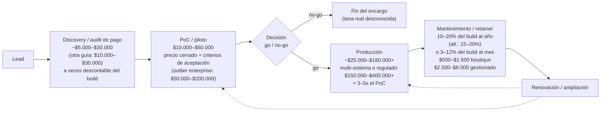

# 04 — Lo específico de una agencia de IA en el CRM, y la IA dentro del CRM

**Estado de la información: noviembre de 2026.**
Fuente única de este documento: `research_notes/CRM para agencias de IA/especificidad_agencias_ia.md`.

---

## Advertencia metodológica (leer antes que nada)

Casi toda la literatura disponible sobre economía y pricing de agencias de IA está **publicada por las propias agencias, por consultoras o por vendors**: blogs de marketing e índices de precios con intención SEO. A noviembre de 2026 **no existe un estudio independiente de mercado sobre agencias de IA** comparable a los benchmarks clásicos de agencias de software.

Consecuencias prácticas para este documento:

1. Todas las cifras de precio que aparecen abajo son **precios pedidos o práctica declarada**, no datos de mercado verificados. No sirven para dimensionar un mercado; sirven para saber **qué campos debe tener el CRM**.
2. Las definiciones de alcance difieren tanto entre fuentes que **los rangos no son comparables entre sí** (advertencia explícita del propio índice de precios de Gigabit).
3. Los márgenes autoinformados por agencias (60–80% bruto) proceden de páginas de marketing y deben tratarse con escepticismo.
4. Donde una afirmación procede de documentación de producto del fabricante (HubSpot, Salesforce, Attio) o de legislación, se señala. Donde las fuentes se contradicen, se dice.
5. Todo lo que no sea hallazgo citado va marcado con **(criterio propio)**.

El valor de diseño de estas notas no está en las cifras, sino en **qué conceptos existen en este negocio y no existen en un CRM genérico**.

---

# PARTE A — El negocio de una agencia de IA y cómo modelarlo

## A.1. El ciclo de vida del encargo

### El ciclo

La agencia de IA no vende "proyectos de software": vende una **cartera de servicios por fases** contratados por separado, más servicios gestionados recurrentes que no existen en la agencia de software tradicional (monitorización de agentes, regresiones de evals, control de coste de inferencia).

A diferencia del software tradicional, aquí **el discovery se cobra** y el PoC se contrata a precio cerrado con criterios de aceptación, precisamente porque los requisitos son difusos por naturaleza.

Rangos de retainer alternativos recogidos en otra fuente: **$100–$1.000+** solo mantenimiento y **$500–$5.000** gestionado. La categoría "Managed AI Operations" se vende como producto comercial con suscripción mensual publicada de **$1.290–$7.900/mes**, e incluye explícitamente regresiones de evaluación y monitorización.

Precio de referencia habitual para "agente con RAG" en producción: **$45K–$100K**, lo que indica que RAG se vende como línea de servicio diferenciada, no como detalle técnico.

Modelo de contratación recomendado por las fuentes: **precio fijo para PoC/prototipo** cuando los requisitos son difusos, y **pagos por hitos ligados a aceptación** y a despliegue en producción.

### Por qué esto obliga a varios deals encadenados y no a uno solo

El objeto comercial de una agencia de IA no es "una oportunidad" sino **una secuencia de contratos encadenados sobre la misma cuenta** (audit → PoC → build → retainer), cada uno con su propio importe, su propio estado y sus propias condiciones **(criterio propio)**. El "cierre" ocurre varias veces sobre el mismo cliente, y entre cierre y cierre hay un punto de decisión go/no-go que puede matar la cuenta.

Un pipeline de oportunidades plano modela esto mal por tres razones **(criterio propio)**:

- **El importe no es uno.** Si se mete todo como un deal único, se pierde el importe por fase y con él la capacidad de medir conversión entre fases y rentabilidad por fase.
- **Si se mete como cuatro deals sueltos, se pierde la relación.** No se puede responder "¿cuánto nos ha dejado este cliente en total?" ni "¿qué PoC murió antes de producción?".
- **Hay dependencias económicas entre fases.** El retainer se calcula como % del build; el discovery puede ser descontable del build. Son deals con aritmética entre ellos.

Lo que hace falta es una jerarquía: **cuenta → proyecto/engagement → fases (deals hijos)**, con un **estado de ciclo de vida propio del negocio de IA** a nivel de cuenta: `lead → discovery vendido → PoC en curso → go/no-go → producción → en retainer` **(criterio propio)**.

Dos patrones derivados que un CRM genérico no cubre **(criterio propio)**:

- **Discovery descontable del build**: un importe que es simultáneamente ingreso cobrado y **crédito aplicable a una oportunidad futura**. Requiere que el deal de discovery pueda apuntar al deal de producción y restarse de él.
- **Derivación automática del retainer**: dado que el retainer se dimensiona como % del build (3–12%/mes, o 10–20%/año), el CRM puede **proponer el MRR** desde el importe del proyecto cerrado y **alertar cuando un proyecto pasa a producción sin retainer firmado**. Esa fuga de ingreso recurrente es exactamente el riesgo que señalan las fuentes.

Como el catálogo de servicios es relativamente estable y repetible (audit, PoC, agente+RAG, integración, retainer), conviene un **catálogo de servicios/paquetes reutilizables** con presupuestos construidos por composición, en lugar de presupuestos libres **(criterio propio)**.

---

## A.2. Coste de inferencia: la particularidad económica más fuerte

### Las cuatro prácticas en conflicto

A 2026 coexisten cuatro políticas, **en conflicto abierto y sin consenso de mercado**. El artículo de referencia (Digiday) es cualitativo y con pocos casos nombrados; **no hay dato sobre qué porcentaje de agencias usa cada una**.

| Política | Práctica declarada | Quién asume la varianza |
|---|---|---|
| **1. Repercusión medida** | La agencia Merge repercute los costes de tokens caso por caso, medidos | Cliente |
| **2. Incluido a coste** | Lerma incorpora los costes de tokens en la estimación inicial a precio de coste (las fuentes describen su enfoque con matices distintos) | Agencia, hasta agotar el colchón |
| **3. Absorbido** | RPA cubre los costes de tokens y no cobra el consumo de setup y onboarding; su CEO argumenta que cobrar por uso **desalinea incentivos** | Agencia |
| **4. Pass-through sin margen** | Monks repercute vía su plataforma Monks.flow **sin margen añadido**, y declara querer vender casi todo el negocio nuevo como suscripción o por resultados | Cliente, sin margen para la agencia |

Dato adicional, **de un único blog y no verificado de forma independiente**: un markup del **30–50% sobre el coste de API** sería común en la repercusión por tokens; protege margen pero limita crecimiento.

Crítica recogida en prensa sectorial: quien repercute el coste corre el riesgo de quedar "solely focused on cost and margin" (declaración de un directivo de Crossmedia). Desde el lado comprador, las guías CFO señalan que **los clientes esperan que las bajadas de coste de inferencia se les trasladen**.

### El giro a outcome-based

Señal relevante: en **abril de 2026 HubSpot movió su Breeze Customer Agent a $0,50 por conversación resuelta**, desde $1 por conversación gestionada (confirmado en comparativas de producto como "outcome-based pricing for two agents, effective April 14, 2026"). Referencias de mercado: Intercom Fin **$0,99 por outcome**; Zendesk **~$1,50** con compromiso y **$2,00** pay-as-you-go; Salesforce Agentforce Help Agent **$2 por resolución** en packs prepago de mínimo 1.000.

El precio por resolución **traslada la varianza del coste de tokens al proveedor**, porque solo se factura cuando el agente resuelve sin humano; los compromisos mínimos lo encarecen para volúmenes bajos, y se recomienda poner cap al consumo.

Órdenes de magnitud del coste subyacente: un agente multi-paso cuesta **$0,10–$1,00 por tarea** frente a ~$0,001 por llamada de chatbot simple; los operadores cuentan **5 a 50 llamadas de modelo por tarea de agente** y advierten de que los márgenes calculados sobre una sola llamada **sobreestiman la rentabilidad**.

> **No citar precios de tokens.** Las notas no pudieron verificar tarifas públicas de APIs de modelos a noviembre de 2026 en fuente primaria; las cifras de coste por tarea vienen de análisis secundarios.

### Qué campos exige cada política

El CRM no debe imponer un modelo: debe **registrar por cliente qué política se aplicó**, porque esa decisión determina la rentabilidad del contrato y hoy se pierde en hojas de cálculo **(criterio propio)**.

| Política | Campos mínimos que exige |
|---|---|
| **Repercusión medida** | Consumo real por cuenta/proyecto y periodo; markup aplicado (%); unidad de medida; periodicidad de refacturación; conciliación consumo ↔ factura emitida |
| **Incluido a coste** | Colchón de coste presupuestado en la estimación; consumo real acumulado; **% de colchón consumido** y alerta al superarlo |
| **Absorbido** | Consumo real por cuenta; sin campo de repercusión; el consumo entra directo como COGS del contrato; alerta de margen |
| **Pass-through sin margen** | Consumo real; markup fijado a 0; traza de que la bajada de coste se traslada al cliente |
| **Outcome-based (transversal)** | **Unidad de resultado pactada literalmente** ("conversación resuelta", "lead cualificado", "factura procesada"), precio unitario, **cap**, **mínimo comprometido**, y conciliación contra consumo real |

De ahí que el CRM deba soportar como ciudadanos de primera clase **tres modelos de precio por línea de contrato**: fijo por hito, retainer recurrente y consumo, este último con cap, mínimo comprometido y markup configurable. Un CRM genérico modela bien el primero y, con esfuerzo, el segundo **(criterio propio)**.

### La guía operativa del <15% y por qué el margen está por debajo del SaaS

Guía operativa para agencias: mantener el **gasto en modelos por debajo de ~15% del ingreso del cliente** y el **COGS total de delivery por debajo del 50%**.

Los márgenes brutos de empresas de IA están **muy por debajo del ~80% del SaaS maduro**. Los datos de ICONIQ 2026 se citan con cifras discrepantes: una fuente da **52% en 2026 (vs 41% en 2024)**; otras dan **45% en 2025 con proyección de 53% en 2026**. **Ninguna fuente consultada verifica el informe ICONIQ original.** La inferencia como proporción del gasto total **sube con la madurez del producto**, del 20% al 23%, y ronda el ~23% del ingreso en empresas de IA B2B en fase de escalado.

Objetivos declarados del lado agencia: **60–80% bruto** sobre retainers (autoinformado, marketing), con orientación más conservadora de **50–70% bruto y 20–35% neto**; guía de startups: **50–70% de margen bruto después de compute**.

**Por qué el margen bruto de IA está por debajo del SaaS**: porque una parte del COGS es **variable, se devenga después de la venta y depende del uso que haga el cliente**. En SaaS el coste marginal de un usuario adicional tiende a cero; en un agente, cada tarea cuesta dinero y el número de tareas lo decide el cliente.

**Qué significa para el CRM** **(criterio propio)**:

- La rentabilidad de un proyecto de IA **no se puede calcular en el cierre**. Hay que calcularla viva, mes a mes.
- La métrica de rentabilidad deja de ser *horas facturables vs. horas incurridas* y pasa a ser **margen de contribución = ingreso recurrente − (horas de soporte + consumo de inferencia + infraestructura)**. Esto cambia el modelo de datos, no solo un informe.
- Alerta natural y directamente accionable: *"el cliente X ha superado el 15% de su MRR en consumo de modelos este mes"*. Es el equivalente de IA a la alerta de "presupuesto de horas sobrepasado" de la agencia tradicional.

---

## A.3. Costes recurrentes a seguir por cliente

Categorías de coste recurrente que corren mes a mes sobre un proyecto ya entregado:

- **Inferencia** (consumo de modelos).
- **Infraestructura / cloud** del sistema desplegado.
- **Vector DB** del índice RAG.
- **Plataforma de observabilidad**.
- **Horas de soporte** del retainer (coste de delivery, no de venta).

La telemetría recomendada en observabilidad incluye **trazas con prompt, respuesta, modelo, parámetros, latencia, recuento de tokens y correlation ID**, más desglose de **coste por feature y por modelo**. El **"cost-per-feature breakdown"** figura explícitamente entre los artefactos que un comprador debería poder auditar.

### Cómo atribuirlos a la rentabilidad del proyecto

Un CRM para agencia de IA necesita un concepto que los CRM no tienen: **coste recurrente atribuido a cuenta/proyecto**, alimentado idealmente desde las facturas o APIs de uso de los proveedores (modelos, cloud, vector DB, observabilidad), para calcular margen real por cliente en vivo y no al cierre del ejercicio **(criterio propio)**.

Reglas de atribución propuestas **(criterio propio)**:

1. **Clave de atribución explícita.** Cada coste recurrente debe llevar cuenta y proyecto. El correlation ID de las trazas y el desglose por feature son el puente natural entre la telemetría técnica y el objeto comercial.
2. **Coste directo vs. coste repartido.** Lo que es trazable por cliente (tokens, llamadas) se imputa directo; lo compartido (plataforma de observabilidad, infraestructura común) se reparte con un criterio declarado y estable, y se marca como estimado para no confundirlo con dato medido.
3. **Periodo cerrado + periodo en curso.** El margen del mes corriente es provisional; conviene mostrarlo como tal y consolidarlo al cerrar la factura del proveedor.
4. **Dos umbrales de alerta**, los dos de la misma fuente: gasto de modelo **>15% del ingreso del cliente** y COGS total de delivery **>50%**.

> **Gap.** No hay benchmarks de coste mensual de vector DB ni de plataformas de observabilidad por cliente en agencias; las fuentes mencionan las categorías pero no dan importes. El CRM debe **medirlos**, no asumirlos.

---

## A.4. Entregables propios de IA y el problema de la transferencia

Los entregables de un proyecto de IA incluyen activos que **no encajan en la categoría "código fuente"**:

- **Prompts** (registry de prompts).
- **Suites de evals** con sus datasets etiquetados. Una suite moderna se describe con **cuatro capas**: conjuntos de test held-out etiquetados, definiciones de rúbrica y prompts de juez, funciones de scoring con umbrales pass/fail, y scripts de ejecución. Buenas prácticas propuestas: evals **versionados junto al código**, ejecutables en **menos de cinco minutos**, y **atados a umbrales que el comprador aceptó antes del lanzamiento**.
- **Índices RAG**.
- **Adaptadores fine-tuned / pesos**.
- **Dashboards de observabilidad** (trazas con prompt, respuesta, modelo, parámetros, latencia, tokens, span padre y correlation ID).
- **Model/system cards**. Una propuesta académica plantea generarlas automáticamente en el pipeline CI/CD, poblándolas desde registries de modelos y resultados de evaluación.
- **Desglose de coste por feature y por modelo**.

Lista de auditoría propuesta de **seis artefactos**: ruta de evals, dashboard de observabilidad, registry de prompts, desglose de coste por feature, últimos cuatro writeups, y evals recientes de señal de producción.

### El problema

Riesgo de entrega señalado expresamente: **pesos fine-tuned, índices RAG, registries de prompts y datasets de evals no están cubiertos por las cláusulas estándar de transferencia de software**, y acaban alojados físicamente en cuentas de la agencia — un adaptador LoRA en el workspace de Hugging Face de la agencia, un eval set en un proyecto privado de W&B, una librería de prompts en el editor de alguien.

Esto es a la vez un riesgo legal (¿de quién es?) y un riesgo operativo (¿dónde está?), y la agencia de software tradicional no lo tiene porque su entregable **es un repositorio**.

### Implicación para el CRM **(criterio propio)**

- **Registro de artefactos por proyecto**, con: tipo de artefacto, **ubicación** (qué cuenta, qué workspace), **titularidad** (de quién es según contrato), y **estado de transferencia** (pendiente / transferido / retenido deliberadamente). Funciona como **checklist de cierre de proyecto**.
- Los **umbrales de evals pactados antes del lanzamiento son criterios de aceptación contractuales**. Almacenarlos junto a la oportunidad/contrato convierte el "cierre de fase" en algo **verificable**, no en una opinión.

> **Gaps.** No existe estándar ni plantilla contractual de referencia para la entrega de artefactos de IA: las listas anteriores son propuestas de consultoras, no práctica establecida. Tampoco hay evidencia de con qué frecuencia las agencias entregan realmente evals a sus clientes.

---

## A.5. Contratos y cumplimiento

> **Esto no es asesoramiento legal.** Es un inventario de qué campos debe llevar el CRM. Cualquier redacción contractual concreta debe validarla un abogado.

### Cláusulas propias de proyectos de IA

Cuatro ejes:

**1. Uso de datos para entrenamiento.**
- **No-training clause explícita y exigible**, en lugar de confiar en la política de privacidad del proveedor: los defaults de vendor suelen **permitir** el entrenamiento salvo prohibición contractual, y el lenguaje de "improving services" puede cubrir entrenamiento de forma encubierta.
- La prohibición debe extenderse a **entidades downstream** que toquen los datos.

**2. Propiedad de activos, enumerados uno a uno.**
- **IP enumerada activo por activo**, no mediante cláusula genérica de "entregables": prompts, configuraciones, eval sets, código custom y pesos fine-tuned.
- Cláusula típica: **el cliente posee los outputs** mientras el proveedor retiene el modelo subyacente.
- **Indemnidad de IP sobre outputs**: algunos términos enterprise la incluyen (se cita GitHub Copilot enterprise como ejemplo); existen cláusulas modelo con el licenciante defendiendo reclamaciones ligadas a outputs o entrenamiento.

**3. Responsabilidad por alucinaciones.**
- Los acuerdos de vendor suelen **excluir responsabilidad por output alucinado**. La recomendación al comprador es exigir representaciones de exactitud, divulgación de modos de fallo conocidos y remedios más allá de la terminación, especialmente en usos de alto riesgo.
- **Las fuentes no coinciden** en quién debe soportar el riesgo de alucinación: divergencia expresa entre Promise Legal y Cyberlaw Academy.
- **Caps de responsabilidad** ligados a honorarios anuales pueden quedarse cortos para pérdidas específicas de IA; se sugieren carve-outs para brechas de datos, discriminación e indemnidad de IP.

**4. Salida y handover.**
- Handover definido de activos, **fechas de revocación de credenciales** y **confirmación escrita de borrado de datos**.

### EU AI Act a noviembre de 2026

> **Advertencia obligatoria.** Todas las fechas de este apartado proceden de **análisis de despachos y consultoras**. **No se verificó el texto del Diario Oficial.** Trátense como "según análisis de despachos, pendiente de verificación en fuente primaria".

- El **Digital Omnibus on AI** se cita como **Reglamento (UE) 2026/1744, en vigor desde el 27 de julio de 2026**, tras adopción por Parlamento y Consejo en junio.
- **Aplazado**: los sistemas de alto riesgo autónomos del **Anexo III** (empleo, educación, etc.) pasan del 2 de agosto de 2026 al **2 de diciembre de 2027**; los integrados en productos regulados del **Anexo I** se desplazan a **2 de agosto de 2028**.
- **NO aplazado**: las obligaciones de transparencia del **artículo 50** (divulgación de chatbot, etiquetado de deepfakes) se mantienen en el calendario del **2 de agosto de 2026** para sistemas nuevos. Siguen vigentes también los requisitos **GPAI** (desde agosto de 2025) y los poderes de la AI Office.
- **Periodo de gracia inminente**: el watermarking / etiquetado legible por máquina para sistemas ya en el mercado antes de agosto de 2026 tiene gracia hasta el **2 de diciembre de 2026**.
- **Discrepancias entre fuentes**: difieren en la fecha exacta del Anexo I y en si las obligaciones de sandbox se movieron a 2027; una fuente menciona nuevas prohibiciones del artículo 5 que otras no recogen.

### Lo que esto implica para el modelo de datos

**Banderas de cumplimiento por cuenta y por proyecto** — campos del CRM, no documentos sueltos, porque condicionan si se puede vender a ese cliente y en qué términos **(criterio propio)**:

- ¿DPA firmado?
- ¿Cláusula de no-entrenamiento, extendida a downstream?
- ¿El caso de uso cae en Anexo III?
- ¿El sistema interactúa con personas? → obligación de divulgación del art. 50.
- ¿Se pactó indemnidad de IP sobre outputs? ¿Hay carve-outs al cap de responsabilidad?
- ¿Se ejecutó el handover: credenciales revocadas, borrado de datos confirmado por escrito?

**Jerarquía de riesgo, importante para no sobredimensionar** **(criterio propio)**: el aplazamiento del alto riesgo a diciembre de 2027 significa que, comercialmente, **el AI Act ya no es el bloqueador inmediato** para la mayoría de proyectos de agencia. El bloqueador vigente es el **artículo 50** y el **tratamiento de datos (GDPR/DPA)**. El CRM debe reflejar esa jerarquía: art. 50 y DPA como campos de uso diario, Anexo III como bandera de excepción.

> **Gap.** No hay material específico sobre DPA/GDPR aplicado a proyectos de agencia de IA — en concreto, **quién es encargado y quién responsable cuando la agencia opera un agente en nombre del cliente**. Es una laguna relevante y afecta directamente al diseño de las banderas.

---

## A.6. Métricas de éxito pactadas con el cliente y reporting

Las métricas de éxito en proyectos de IA son **umbrales de evals acordados antes del lanzamiento**, más métricas de negocio (resoluciones, horas ahorradas). Se reportan a través de dashboards de observabilidad.

- Los umbrales pass/fail de evals se pactan **con el comprador antes del lanzamiento**, y los evals se versionan con el código.
- **"Drift SLAs"** figura ya como criterio de comparación entre proveedores enterprise de IA, junto a evals, model-agnosticism e IP. **No hay un estándar de SLA de IA**: las menciones a "drift SLA" son de marketing y no explican el mecanismo.
- La **unidad de resultado se está estandarizando** en soporte: Intercom renombró su unidad de *resolution* a *outcome* y la amplió para incluir handoffs configurados; Zendesk, en su reestructuración de mayo de 2026, habría estrechado la facturación a **"Verified Resolutions"** únicamente (cifras no coincidentes entre fuentes).
- Ritual recomendado de reporting: **revisión semanal** sobre evals + observabilidad.
- Ejemplo de métrica de negocio reportada por un vendor: el informe de ROI de Salesforce sobre agentes de Sales Cloud afirma **~6 horas semanales ahorradas por representante** y **63% citando datos de CRM más exactos y completos**. **Advertencia crítica: la muestra es de solo 24 usuarios activos.** No usar como evidencia.

### Cómo modelarlo y cómo reportarlo **(criterio propio)**

- **Objeto "métrica pactada"** por proyecto: nombre, **umbral**, **fuente de medición**, **frecuencia de reporte**, y responsable. Alimenta a la vez el QBR con el cliente y la alerta de incumplimiento.
- **La definición de "resolución verificada" se guarda literalmente** junto al contrato, porque de ella depende la facturación. Es el equivalente de IA a la "definición de hora facturable", y es contractualmente delicada.
- **Cadencia doble**: revisión semanal interna sobre evals + observabilidad; reporte al cliente en la frecuencia pactada por métrica. El CRM debe generar el reporte desde el objeto "métrica pactada", no desde un documento manual.
- **Vincular incidentes y regresiones de evals a la cuenta**, no solo a un helpdesk separado: son el argumento de renovación del retainer y el indicador temprano de churn. El contrapunto del lado comprador es real — "$2.500/mes son $60.000 en 24 meses frente a ~$9.000 de un despliegue propio" (argumento comercial de un vendor competidor, no análisis neutral) — y solo se responde **demostrando valor de forma continua**: incidentes prevenidos, evals pasados, coste ahorrado.

> **Gaps.** No hay ningún ejemplo público de SLA de IA redactado (qué exactitud se garantiza, qué penalización hay). No hay datos independientes sobre resultados reales entregados por agencias a sus clientes. No hay datos sobre frecuencia real de incidentes, tiempos de respuesta pactados ni estructura de guardias.

---

## A.7. El gap central: la conversión PoC → producción

**No existe ninguna fuente fiable que cuantifique la tasa real de conversión de PoC a producción** en agencias de IA. El "pilot purgatory" se cita en prensa, pero las notas no localizaron un dato con muestra. Tampoco hay datos sobre duración media del retainer ni churn de clientes de agencias de IA.

### Por qué es probablemente el KPI más valioso que este CRM puede medir por sí mismo **(criterio propio)**

1. **Es el punto de decisión económico del negocio.** Producción cuesta 3–5x el PoC, y el retainer se deriva del build. Un PoC que no convierte no solo pierde el 100% del build: pierde además todo el MRR futuro que ese build habría generado. La conversión PoC→producción es el multiplicador de todo lo que viene después.
2. **Es medible internamente sin depender de nadie.** El CRM no necesita un benchmark de mercado para calcularlo: si modela las fases como deals encadenados con un estado go/no-go explícito, **el dato sale solo** de la propia operación. Es la diferencia entre un KPI que hay que comprar y uno que se genera como subproducto del modelado correcto.
3. **No lo cubre ningún CRM estándar**, precisamente porque ningún CRM estándar modela un cliente con varios cierres encadenados y un punto de decisión intermedio.
4. **Como no hay benchmark externo, el valor está en la serie temporal propia.** No sirve para compararse con el mercado — ese dato no existe —, sirve para detectar deterioro: si la conversión cae, el problema está en cómo se venden o se ejecutan los PoC, y se detecta meses antes de que se note en la facturación.
5. **Desagregado, es diagnóstico.** Por tipo de servicio, por sector del cliente, por tamaño del PoC, por si hubo discovery de pago previo o no. Ahí es donde deja de ser un número de vanidad y pasa a decidir qué PoCs aceptar.

Corolario de diseño: el estado **go/no-go debe ser un estado explícito y obligatorio**, con fecha y motivo de pérdida tipificado. Si el no-go se registra como "oportunidad perdida" genérica, el KPI no se puede calcular.

---

# PARTE B — IA dentro del CRM

## B.1. Qué ofrecen hoy HubSpot, Salesforce y Attio

A noviembre de 2026 el estado del arte en CRM ya no es "IA como asistente de texto" sino **agentes que ejecutan trabajo y se facturan por consumo o por resultado**.

### HubSpot — Agent Hub / Breeze (documentación de producto del fabricante)

La página oficial describe **Agent Hub** con: **Prospecting Agent** (monitoriza señales de compra y lanza outreach), **Customer Agent** (resuelve consultas de forma autónoma multicanal), **Content Agent**, **Data Agent** (insights desde CRM, llamadas y documentos), **Agent Builder** (agentes custom sobre una sola canvas con datos de cliente), **Smart Deal Progression** (sugiere siguientes pasos tras cada llamada), **Campaign Agent / Nurture Agent / Revenue Agent** (campañas multicanal, personalización de emails a leads, seguimiento automático de facturas) y **Breeze Assistant**.

**Precio oficial**: Agent Hub **incluido en Starter, Professional y Enterprise**; muchas funciones de IA y agentes **consumen HubSpot Credits**, comprables por adelantado en packs o pay-as-you-go; los agentes custom de Agent Builder consumen créditos. Titular de la página: "Pay when work gets done". **La página no publica el coste por crédito ni precios por tier.**

Dato de terceros: los agentes de Breeze Studio pasaron de GPT-4.1 a **GPT-5 el 12 de enero de 2026**.

> ⚠ **Advertencia sobre rebranding de HubSpot.** La página oficial consultada **no menciona** Breeze Intelligence (enriquecimiento de datos, buyer intent, acortado de formularios), ni Copilot, ni un knowledge base agent. Esto sugiere un **rebranding de la gama hacia "Agent Hub"**. **No debe afirmarse que esas funciones siguen comercializadas con ese nombre sin verificarlo** en el catálogo de productos y la página de precios de HubSpot. Además, las fuentes de terceros **se contradicen** sobre la disponibilidad por tier: una dice que Breeze está en todos los tiers incluido el CRM gratuito; otra que solo desde Pro hacia arriba. La página oficial dice "incluido en Starter, Professional y Enterprise".

### Salesforce Agentforce (página oficial de precios — precios verificados en fuente del fabricante)

- **Flex Credits a $500 por 100.000 créditos** ($0,005/crédito), consumidos **por acción**: acción estándar = **20 créditos**; acción de Agentforce Voice = **30 créditos**.
- Alternativa: **$2 por conversación**.
- **Agentforce User License $5/usuario/mes** (requiere Flex Credits).
- **Agentforce Coworker User License $50/usuario/mes**.
- Add-ons de Agentforce (Sales, Service, Field Service, Operations) **$125/usuario/mes**; add-ons de Industries **$150/usuario/mes**.
- **Max Edition desde $550/usuario/mes**, incluyendo el add-on y **2,75M Flex Credits por org y año**.
- **Salesforce Foundations a $0** incluye Agentforce Builder, Prompt Builder, Agent Script, Agentforce Coworker y Agentforce Vibes.
- Restricciones operativas: **Flex Credits y Conversations no pueden coexistir en la misma org**, y **los Flex Credits no consumidos se pierden (no roll over)**.

Datos de terceros: **18.500 clientes y más de 3.000 millones de workflows mensuales**; **Agentforce Voice en disponibilidad general en Spring '26**. El grounding completo de Agentforce depende de **Data Cloud, que es un add-on**.

### Attio (página oficial de producto)

- **Ask Attio**: asistente en lenguaje natural para buscar, actualizar y crear registros; prepara el día, redacta follow-ups, resume pain points y feature requests a través de interacciones.
- **Workflows** generados describiendo un objetivo: investigan, enriquecen y enrutan registros.
- **Web Agent** (investigación web en autopiloto), **Custom Agents**, **enriquecimiento automático de cada registro**, **Sequences**.
- **Call Intelligence**: graba, transcribe y registra llamadas en el momento; marca señales de compra, bloqueadores y peticiones **durante la llamada**; sigue action items y **redacta los siguientes pasos antes de que termine la llamada**.
- **MCP**: se conecta a Claude y ChatGPT para traer contexto vivo del CRM a los chats; los agentes tienen **acceso de lectura y escritura**, con autenticación **OAuth y permisos a nivel de usuario**.
- **La página oficial no publica precios ni detalle de créditos para IA.** Comparativas de terceros señalan que los créditos de IA son **escasos en los planes de menor tier**.

### Contexto adicional (fuentes de terceros, no verificado en páginas oficiales)

- **Pipedrive**: IA más modesta — informes con IA en el tier de entrada, recomendaciones del sales assistant y herramientas de email con IA en Premium y superiores; una comparativa sitúa las funciones de IA tras **Premium ($59/usuario/mes anual)** y las describe como "mayormente resumen, enriquecimiento básico y un asistente lateral".
- **Close**: fuentes contradictorias. Una afirma que no parece tener integración de IA; otras describen su agente **Chloe** (llamadas por lotes, enriquecimiento, chat), **medido por créditos mensuales incluidos en todos los planes**, además de dialer con grabación, coaching y resumen. La afirmación de "sin IA" es probablemente obsoleta.
- **Clay**: **no es un CRM**, sino plataforma de enriquecimiento de datos y GTM. Su agente **Claygent** usa prompts en lenguaje natural para scrapear la web y obtener datos cualitativos.

> **Gaps.** Gong, Clay y Close **no se verificaron en sus páginas oficiales**; todo procede de comparativas de terceros, varias publicadas por competidores. No hay evidencia sólida de funcionalidades maduras de **detección de riesgo de churn** en los CRM líderes a 2026.

---

## B.2. El desplazamiento: de lead scoring predictivo a agentes facturados por consumo o resultado

Las capacidades predictivas clásicas (lead scoring, churn) **aparecen notablemente menos en el marketing actual de los líderes** que los agentes. La frontera competitiva de 2026 se ha desplazado del **scoring predictivo** a **agentes que ejecutan trabajo y se cobran por uso o por resultado**.

Las tres señales que lo sostienen:

1. **HubSpot** titula su página de IA "Pay when work gets done" y mueve el Customer Agent a **$0,50 por conversación resuelta** (abril de 2026), desde $1 por conversación gestionada.
2. **Salesforce** factura **por acción** con Flex Credits (20 créditos la acción estándar), o **$2 por conversación**.
3. **Attio** vende agentes (Web Agent, Custom Agents, Workflows generados) y no scoring.

Dos implicaciones **(criterio propio)**:

- **Un CRM nuevo que presuma de "lead scoring con IA" llega tarde al discurso dominante.** No significa que el scoring no sirva; significa que no es el argumento, y que gastar el esfuerzo de producto ahí es gastarlo en la frontera de 2022.
- **El modelo de créditos es ya el estándar de facturación de IA en CRM** (HubSpot Credits, Flex Credits, créditos de Attio y Close), con sus asperezas: créditos que caducan sin roll over, planes de bajo tier con créditos escasos, modos de facturación mutuamente excluyentes en la misma org. **Un CRM propio evita ese COGS variable, y eso es un argumento económico sustantivo, no solo de personalización.**

---

## B.3. Captura automática de actividad: los dos polos de diseño

El patrón dominante es **notetaker de reuniones → extracción de campos → escritura en el CRM**. La captura por sync de email/calendario está asumida como base; la novedad de 2026 es la **escritura de campos estructurados**, no solo de notas.

Los dos polos están encarnados por dos productos concretos:

| Polo | Producto | Comportamiento |
|---|---|---|
| **Borrador con aprobación humana** | **Fireflies — Autofill CRM** | Redacta actualizaciones de campos de Contact, Company y Deal (planes Business y Enterprise) y **espera revisión humana antes de escribir**. Una fuente indica **1 crédito de IA por extracción** |
| **Escritura automática** | **Fathom — CRM field sync** | Plan Business. Una comparativa dice que actualiza campos mapeados automáticamente tras la reunión; otra matiza que **solo escribe texto procedente de los encabezados del resumen y lo sobrescribe en cada reunión**. Precio citado: **$25/usuario facturado anualmente (a octubre de 2026)** |

Resto del panorama:

- **Gong**: fuentes contradictorias y **no resuelto**. Una página de competidor afirma que sigue siendo líder en conversation analytics pero **se queda en el insight: los comerciales siguen actualizando el CRM a mano**; otra afirma que su extracción configurada sí puede rellenar campos de CRM.
- **Granola**: una comparativa afirma que **no escribe campos**; otra que el sync con Salesforce requiere Enterprise. Al ser bot-free, no encaja directamente en el patrón de auto-fill.
- **Attio** incorpora el patrón **nativamente**, sin herramienta externa.
- **HubSpot** lo incorpora vía Data Agent y Smart Deal Progression.

### Cuál conviene **(criterio propio)**

**Decisión: híbrido, partido por tipo de campo.**

- **Escritura automática para notas, transcripciones y resúmenes.** Son contenido, no decisión; su coste de error es bajo y revisarlos a mano anula el ahorro.
- **Borrador con aprobación humana para cualquier campo que alimente una decisión** — importe, fecha de cierre, fase del ciclo, estado go/no-go, banderas de cumplimiento. La evidencia sobre calidad de dato (B.5) dice que el dato del CRM ya es malo; una escritura automática no supervisada sobre campos de decisión no reduce el problema, lo acelera.
- **Los campos derivados de reuniones deben ser acumulativos y versionados, nunca sobrescritos.** La limitación señalada en Fathom —sobrescribe el campo en cada reunión— es un fallo de diseño instructivo: destruye el historial que da sentido al campo. Guardar cada extracción con su reunión de origen, y derivar el valor actual, en lugar de pisar el anterior.
- **Trazabilidad obligatoria**: cada campo escrito por IA debe poder decir de qué reunión, qué transcripción y qué extracción salió. Sin eso no hay forma de auditar un error ni de recuperar el valor anterior.

> **Gap.** No hay datos cuantitativos sobre **precisión real** de la extracción de campos desde reuniones. Ninguna fuente publica métricas de tasa de error de Autofill CRM ni equivalentes. La elección del polo conservador para campos de decisión se toma, por tanto, sin dato de precisión — razón de más para tomarla.

---

## B.4. El hallazgo estratégico: 19% vs 45%

**El dato.** Encuesta de HubSpot (2025) a más de 1.000 profesionales de ventas: solo el **19% usa las funciones de IA integradas en su CRM o herramientas de venta**, mientras que el **45% recurre a chatbots de propósito general**. (Llega a través de un agregador; convendría verificarlo contra el informe original.)

**Qué significa.** La gente prefiere trabajar desde el chat. Más del doble de comerciales abre un chatbot generalista antes que la IA que ya tiene pagada dentro del CRM. No es un problema de calidad de la IA nativa: es que el punto de entrada al trabajo ya no es el CRM.

**Implicación de diseño** **(criterio propio)**:

> **Priorizar un servidor MCP sobre una UI de IA embebida.** Un CRM propio debería ser **operable desde Claude/ChatGPT vía MCP desde el día uno**, en lugar de invertir en replicar una UI de IA dentro del CRM que la evidencia dice que usará una minoría.

Argumentos que lo sostienen:

1. **El dato lo dice directamente.** Construir la UI embebida es construir para el 19%; construir el MCP es construir para donde ya está el 45%.
2. **El referente del mercado ya lo hizo.** Attio expone MCP con **lectura y escritura** y **OAuth con permisos a nivel de usuario**, conectando a Claude y ChatGPT. Es la señal más clara de hacia dónde va la interfaz.
3. **Encaja con el perfil del usuario.** En una agencia de IA, el equipo **ya vive en Claude/ChatGPT**: es su herramienta de trabajo, no una novedad que haya que adoptar. Operar el CRM desde ahí no requiere cambio de hábito, lo elimina.
4. **Es más barato de construir y de mantener.** Un servidor MCP es superficie de API bien definida; una UI de IA embebida es producto, con su diseño, su mantenimiento y su deuda.
5. **No hay que elegir para siempre.** El MCP primero no impide una UI después; la UI primero sí consume el presupuesto que habría financiado el MCP.

**Condición no negociable**: el acceso de escritura vía MCP necesita **OAuth con permisos a nivel de usuario**, como hace Attio. Un agente con escritura sobre el CRM y permisos de servicio en vez de permisos de usuario es un incidente esperando a ocurrir **(criterio propio)**.

---

## B.5. Calidad del dato: el cuello de botella previo a cualquier IA

El hallazgo más consistente y mejor sostenido de toda la Parte B es **negativo**: la calidad del dato del CRM es el cuello de botella de la IA del CRM.

- Encuesta de **Validity (2025) a 602 usuarios y administradores de CRM**: **76% dice que menos de la mitad del dato de su CRM es exacto y completo**.
- Informe **Validity 2026**: solo el **21% de los marketers** dice que su dato de CRM está muy bien preparado para IA.
- **State of Sales 2026** de Salesforce: **46% de los profesionales de ventas que usan agentes** dicen que los problemas de calidad de dato perjudican las ventas, con **duplicados y datos introducidos a mano** entre las causas principales.
- **Barreras de adopción**: 25% señala formación y adopción de usuario como principal reto; 51% de los líderes de ventas con IA dice que los **silos tecnológicos** retrasan o limitan las iniciativas (Freshworks vía resumen secundario).

**Sobre qué fuente apoyarse.** El contraste entre el **63% positivo de Salesforce (n=24)** y el **76% de Validity (n=602)** que dice que su dato es mayoritariamente inexacto ilustra la distancia entre marketing de vendor y realidad medida. **Para cualquier afirmación sobre calidad de dato, apoyarse en Validity, no en Salesforce.**

**Dos consecuencias de diseño** **(criterio propio)**:

1. **La captura automática de actividad (B.3) no es una comodidad, es el prerrequisito.** La causa raíz citada es "duplicados y datos introducidos a mano". Si el dato entra a mano, entra mal, y toda la IA que se monte encima hereda el error.
2. **Orden de construcción**: entrada de datos fiable → deduplicación y normalización → MCP → funciones de IA. Invertir el orden produce agentes que razonan sobre basura. Es la versión CRM de "garbage in, garbage out", y es el único punto de la Parte B con evidencia de muestra decente detrás.

> **Gaps.** No existe ningún estudio independiente que mida el impacto de las funciones de IA de CRM sobre resultados comerciales (tasa de cierre, ciclo de venta): todo lo disponible es autoinformado o anecdótico. No se pudo acceder a los informes primarios de *State of Sales 2026* ni de Validity. No hay datos sobre tasas de error o alucinación de los agentes de CRM en producción.

---

## B.6. Cifras que circulan por agregadores y NO deben usarse

Lista negra. Estas cifras aparecen repetidamente en agregadores de estadísticas de CRM y **no son verificables**:

| Cifra | Problema |
|---|---|
| **"Los comerciales registran solo el 37% de las interacciones con clientes"** | Atribuida a Salesforce Research a través de blogs secundarios; **no se pudo verificar contra la fuente primaria** |
| **"22% de tasa de error anual" (del dato de CRM)** | Se remonta a blogs sin fuente sólida |
| **"91% de adopción" (de CRM)** | Se remonta a blogs sin fuente sólida |
| **"~6 horas semanales ahorradas" y "63% cita datos más exactos"** (Salesforce, agentes de Sales Cloud) | **Muestra de solo 24 usuarios activos**, autoinformado por el vendor. No usar como evidencia |
| **"Markup del 30–50% sobre coste de API es común"** | Fuente única (un blog), no verificada de forma independiente |
| **Cifras de margen de agencias (60–80% bruto)** | Autoinformadas por agencias en páginas de marketing |
| **Datos de ICONIQ 2026 sobre márgenes de IA** | Citados con **cifras discrepantes según la fuente** (52% en 2026 vs 45% en 2025 con proyección de 53%); **ninguna fuente verifica el informe original** |
| **Precios concretos de tokens de APIs de modelos** | No verificados en fuente primaria a noviembre de 2026; las cifras de coste por tarea vienen de análisis secundarios |
| **Fechas del EU AI Act / Digital Omnibus** | Proceden de despachos y consultoras; **no verificadas en el Diario Oficial**. Citables solo con la advertencia explícita |

Regla general para este proyecto **(criterio propio)**: una cifra que no pueda rastrearse hasta documentación de producto del fabricante, legislación, o una encuesta con muestra declarada, **no entra en ningún documento de decisión**. Si se necesita para argumentar, se argumenta sin ella.

---

# Funcionalidades derivadas

Prioridad en MoSCoW: **M** = Must, **S** = Should, **C** = Could, **W** = Won't (esta vez).

| ID | Funcionalidad | Prioridad |
|---|---|---|
| F-IA-01 | Jerarquía cuenta → proyecto/engagement → fases, con deals hijos encadenados por fase (discovery, PoC, producción, retainer) | M |
| F-IA-02 | Estado de ciclo de vida propio de la cuenta: lead → discovery vendido → PoC en curso → go/no-go → producción → en retainer | M |
| F-IA-03 | Estado **go/no-go explícito y obligatorio** con fecha y motivo tipificado, como base del KPI de conversión | M |
| F-IA-04 | KPI de **conversión PoC → producción**, con desglose por tipo de servicio, sector, tamaño de PoC y existencia de discovery previo | M |
| F-IA-05 | Catálogo de servicios/paquetes reutilizables y presupuestos construidos por composición | S |
| F-IA-06 | Discovery descontable: importe que es ingreso y a la vez **crédito aplicable** a una oportunidad futura vinculada | S |
| F-IA-07 | Derivación automática del **MRR propuesto** desde el importe del build (% configurable) | C |
| F-IA-08 | Alerta: proyecto que pasa a producción **sin retainer firmado** | S |
| F-IA-09 | Tres modelos de precio por línea de contrato: fijo por hito, recurrente, y consumo con **cap, mínimo comprometido y markup configurable** | M |
| F-IA-10 | Campo de **política de coste de inferencia por cliente**: repercutido medido / incluido a coste / incluido con markup X% / absorbido / pass-through sin margen | M |
| F-IA-11 | **Unidad de resultado pactada** (texto literal) + precio unitario, para contratos outcome-based, con conciliación contra consumo real | S |
| F-IA-12 | Registro de **coste recurrente atribuido a cuenta/proyecto** (inferencia, infra, vector DB, observabilidad, horas de soporte) | M |
| F-IA-13 | Ingesta de consumo desde facturas o APIs de uso de los proveedores | S |
| F-IA-14 | **Margen de contribución vivo** por cliente y proyecto (periodo en curso marcado como provisional) | M |
| F-IA-15 | Alertas de umbral: gasto de modelo **>15% del ingreso del cliente**; COGS total de delivery **>50%** | S |
| F-IA-16 | Distinción coste directo vs. coste repartido, con criterio de reparto declarado y marca de "estimado" | C |
| F-IA-17 | **Registro de artefactos de IA** por proyecto (prompts, evals, datasets, índices RAG, pesos, dashboards, model cards, desglose de coste): tipo, ubicación, titularidad, estado de transferencia | M |
| F-IA-18 | Checklist de **cierre/handover** de proyecto: transferencia de artefactos, revocación de credenciales, confirmación escrita de borrado de datos | S |
| F-IA-19 | **Umbrales de evals pactados** almacenados junto al contrato como criterios de aceptación verificables de cierre de fase | S |
| F-IA-20 | **Banderas de cumplimiento** por cuenta/proyecto: DPA, no-training (con downstream), Anexo III, art. 50, indemnidad de IP, carve-outs del cap | M |
| F-IA-21 | Jerarquía de riesgo de cumplimiento en la UI: art. 50 y DPA en primer plano; Anexo III como excepción | C |
| F-IA-22 | Objeto **"métrica pactada"** por proyecto: nombre, umbral, fuente de medición, frecuencia de reporte, responsable | S |
| F-IA-23 | Generación del **reporte al cliente / QBR** desde las métricas pactadas, con cadencia doble (revisión semanal interna + frecuencia pactada) | C |
| F-IA-24 | **Incidentes y regresiones de evals vinculados a la cuenta**, como evidencia de valor del retainer y señal temprana de churn | S |
| F-IA-25 | **Servidor MCP con lectura y escritura**, operable desde Claude/ChatGPT — prioridad sobre cualquier UI de IA embebida | M |
| F-IA-26 | **OAuth con permisos a nivel de usuario** para el acceso MCP (condición no negociable del acceso de escritura) | M |
| F-IA-27 | Captura automática de actividad: sync de email/calendario y registro de llamadas con transcripción | S |
| F-IA-28 | Extracción de campos desde reuniones con **borrador y aprobación humana** para campos de decisión; escritura automática solo para notas y resúmenes | S |
| F-IA-29 | Campos derivados de reuniones **acumulativos y versionados**, nunca sobrescritos, con traza al origen (reunión, transcripción, extracción) | S |
| F-IA-30 | Deduplicación y normalización del dato como prerrequisito previo a cualquier función de IA | M |
| F-IA-31 | Ausencia deliberada de **modelo de créditos propio**: sin COGS variable repercutido al usuario del CRM | M |
| F-IA-32 | UI de IA embebida en el CRM replicando el patrón HubSpot/Salesforce | W |
| F-IA-33 | **Lead scoring predictivo** como argumento de producto | W |

---

# Decisiones abiertas

1. **Granularidad de las fases.** ¿Deals hijos reales con su propio pipeline, o fases como atributo de un deal padre? Afecta a cómo se calcula el KPI de F-IA-04 y a la complejidad del modelo de datos.
2. **Hasta dónde llega la ingesta de coste (F-IA-13).** ¿Ingesta automática desde APIs de proveedores desde el inicio, o carga manual/CSV en la v1 y automatización después? La automática es la que hace útil el margen vivo; también es la más cara de construir y la que más se rompe cuando el proveedor cambia la API.
3. **Quién es encargado y quién responsable del tratamiento** cuando la agencia opera un agente en nombre del cliente. Es un **gap de investigación**, no solo una decisión: condiciona el diseño de las banderas de F-IA-20 y hay que resolverlo antes de implementarlas.
4. **Verificación de las fechas del AI Act en el Diario Oficial** (Reglamento 2026/1744) antes de codificar cualquier automatismo basado en ellas. Mientras no se verifiquen, las banderas deben ser informativas y no disparar lógica.
5. **MCP primero, ¿y qué queda de UI?** Si se prioriza el MCP (F-IA-25), ¿cuál es el mínimo de interfaz propia que sigue siendo necesario, y para qué tareas? Queda por definir qué se hace solo desde el chat y qué exige pantalla.
6. **Alcance de la captura automática en la v1 (F-IA-27).** ¿Notetaker propio, integración con uno existente, o solo sync de email/calendario? Las fuentes no dan datos de precisión de extracción, así que la decisión se toma a ciegas sobre calidad.
7. **Si el markup sobre inferencia es configurable por cliente o fijo por política de la casa.** F-IA-10 lo deja abierto a propósito; conviene decidir si la agencia quiere esa flexibilidad o prefiere una política única.
8. **Qué se mide para demostrar el valor del retainer** (F-IA-24). "Incidentes prevenidos" es difícil de medir honestamente. Hay que decidir el conjunto concreto antes de prometérselo a un cliente.
9. **Cómo se versiona un campo derivado de reunión** (F-IA-29): ¿historial completo de extracciones, o valor actual más log? Afecta al volumen de datos y a la UI.

---

# Fuentes

Todas las fuentes proceden de la nota de investigación `research_notes/CRM para agencias de IA/especificidad_agencias_ia.md`, donde figuran las URL completas. Agrupadas por tipo y fiabilidad:

**Documentación de producto del fabricante (la más fiable de este conjunto)**
- HubSpot — *Artificial Intelligence* (Agent Hub, HubSpot Credits)
- Salesforce — *Agentforce Pricing* (Flex Credits, licencias, Max Edition)
- Attio — *AI* (Ask Attio, Workflows, Call Intelligence, MCP)

**Encuestas con muestra declarada**
- Validity (2025), n=602 usuarios y administradores de CRM — calidad del dato
- Validity (2026) — preparación del dato para IA
- HubSpot (2025), n>1.000 profesionales de ventas — 19% IA nativa vs 45% chatbots generalistas
- Salesforce *State of Sales 2026* — 46% problemas de calidad de dato (vía agregador, no verificado en primaria)
- Salesforce / DemandGen Report — ROI de agentes de Sales Cloud, **n=24, no usar**

**Prensa sectorial**
- Digiday — *Agencies are struggling to account for AI token costs in budgets* (las cuatro políticas: Merge, Lerma, RPA, Monks, Crossmedia)

**Legislación y análisis jurídico (fechas no verificadas en el Diario Oficial)**
- Usercentrics, CSA Research Note, DLA Piper, Cooley, Jones Walker, Certivo, Anove, Planet Crust — Digital Omnibus / Reglamento (UE) 2026/1744, Anexo III, Anexo I, artículo 50
- Promise Legal, Aegis Firma, Hernán Huwyler, FactoryJet, ClaudeArchitect, Cyberlaw Academy, Darrow Everett — cláusulas contractuales

**Índices de precios y guías de agencia (precios pedidos, no datos de mercado)**
- Gigabit — *AI Services Price Index: 122 Firms Compared*, *AI Agencies That Publish Their Prices*, *Managed AI Operations*
- Hashmeta, Master of Code, Bacancy, Emperor Brains, 6omb, Duet, Alejandro Rioja, Cognio, Agentic Marketing Pro, Michael Heredia

**Economía unitaria y márgenes (secundario, con discrepancias)**
- ProxyLLM (<15% modelo / <50% COGS), DigitalApplied, 1752vc, Codelevate, SaaSMag, Automaton Agency, RevenueMap, Zylos, Zenskar, David Soden, Ertas AI, beri.net

**Calidad de entrega, evals y observabilidad**
- sfailabs — *The AI Agency Quality System*, *The Hidden Y Problem in AI Agency Contracts*
- LangChain, Mastra, Galileo, Middleware — observabilidad de agentes
- arXiv — *Blueprints of Trust: AI System Cards*

**Pricing de agentes y unidad de resultado**
- getmacha, Querynow, The CRM Force, ToolsRadar, GPTfy

**Captura de actividad**
- Fireflies (fabricante), Barside, Luminix, AskElephant, parse.gl, Weflow, The Notetakers

**Agregadores de estadísticas (usar solo con la lista negra de B.6 delante)**
- DigitalApplied, Workspace369, BusinessGrowthAssistant, Landbase, Outsales, Stealth Agents, Webtonic

**Comparativas publicadas por competidores (sesgo declarado)**
- Attio (*Best AI CRMs in 2026*), Folk, Breakcold, AutomationJinn, Lightfield, Zapier, Teamvoy
