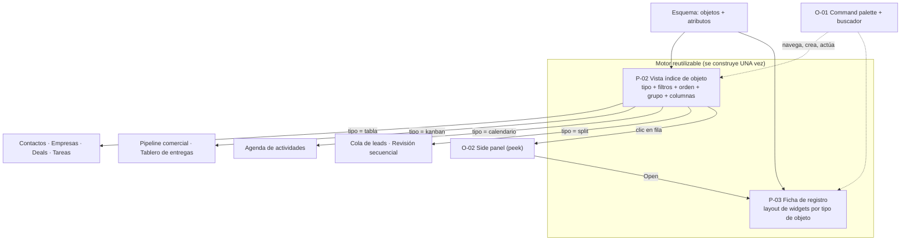

# 05 — Interfaces y pantallas

Documento de planificación de UI/UX para el CRM propio de la agencia. Define qué pantallas se construyen, cómo se comportan y qué patrones se adoptan o se descartan.

Base: `research_notes/CRM para agencias de IA/interfaces_y_ux.md` (estado a noviembre de 2026). Productos analizados: HubSpot, Salesforce Lightning, Attio, Pipedrive, Close, Folk y Twenty (open source).

Convención de este documento:
- Sin marca → dato verificado contra documentación de producto o guía de práctica citada en las notas.
- **(criterio propio)** → decisión o inferencia nuestra, no respaldada por fuente.
- **(evidencia débil)** → la fuente existe pero es marketing de vendor, reseña de competidor o cita de segunda mano.

Alcance: web de escritorio como superficie principal. Móvil se trata como hipótesis (§11). Autenticación, onboarding y facturación quedan fuera.

---

## 1. Insight de arquitectura: no son 12 pantallas, son 6 + 2 overlays

El hallazgo que gobierna todo lo demás.

Si se listan las "pantallas de un CRM" como hace un brief tradicional, salen doce o más: contactos, empresas, deals, pipeline kanban, actividades, tareas, notas, emails, llamadas, reportes, dashboard, configuración. Esa lista es una ilusión de nomenclatura. Attio y Twenty, por ser arquitecturas *schema-first*, no tienen "pantalla de contactos": tienen **una vista índice de un objeto**, que sirve a People, Companies, Deals y a cualquier objeto custom cambiando únicamente el esquema. En Twenty el área central aloja indistintamente objetos estándar y custom, y cada tipo de objeto tiene su propio layout de ficha sobre el mismo motor de widgets.

Dos consecuencias concretas:

**El kanban no es una pantalla, es un tipo de vista de un objeto.** En Twenty, un objeto admite vistas ilimitadas y cada vista elige su tipo (Table, Kanban, Calendar) y guarda sus propios filtros, orden y visibilidad de campos. El "pipeline" no es un módulo: es una vista guardada de tipo kanban del objeto Deal, agrupada por el campo Stage. Construir una pantalla de pipeline aparte duplica filtros, permisos, acciones de fila y estado de carga para ganar cero.

**El inventario real es ~6 pantallas únicas + 2 overlays.** Todo lo demás son instancias parametrizadas de esas seis.



Reglas derivadas que aplican al resto del documento:

1. Añadir un objeto nuevo (p. ej. "Proyecto" o "Modelo entrenado") **no debe requerir UI nueva**. Si la requiere, el motor está mal construido.
2. Cualquier número que aparezca en el dashboard debe hacer drill-down a **una vista guardada filtrada** del objeto, no a un informe nuevo. Eso reutiliza la tabla y hace navegable todo dato.
3. Separar **objeto** (todos los registros, visibles para el workspace) de **lista** (subconjunto de trabajo con atributos y permisos propios del proceso) es la segunda decisión arquitectónica de más impacto en la UI: evita contaminar el objeto global con campos de proceso. Las listas de Attio admiten permisos propios ("no access" para ciertos miembros) mientras los registros siguen visibles en la vista de objeto.

---

## 2. Inventario de pantallas

Prioridad MoSCoW para la v1 del producto.

| ID | Pantalla | Propósito | Objetos que muestra | Prioridad |
|----|----------|-----------|---------------------|-----------|
| **P-01** | Home / dashboard operativo | Responder "¿qué toca hoy y vamos bien?" en segundos; punto de entrada con drill-down a vistas guardadas | Agregados de Deal, Actividad, Lead; sin edición | **Should** |
| **P-02** | Vista índice de objeto | Superficie de trabajo masivo: listar, filtrar, ordenar, agrupar, editar inline y actuar en lote sobre cualquier objeto | Cualquiera (Contacto, Empresa, Deal, Tarea, Nota, objetos custom) | **Must** |
| **P-03** | Ficha de registro | Contexto completo de un registro: atributos, actividad, relaciones, acciones | Un registro de cualquier objeto + sus relacionados | **Must** |
| **P-04** | Bandeja (Inbox de trabajo) | Cola diaria del comercial: emails entrantes, llamadas perdidas, tareas vencidas y de hoy, borradores | Actividad, Tarea, Email, Llamada (heterogéneo) | **Should** |
| **P-05** | Reportes | Construcción y consulta de informes guardados más allá de las tarjetas del home | Agregados de cualquier objeto | **Could** |
| **P-06** | Configuración | Esquema (objetos y atributos), layouts por defecto de ficha, usuarios y permisos, integraciones, papelera | Metamodelo, no registros | **Must** |
| **O-01** | Command palette + buscador global *(overlay)* | Navegar, buscar, crear, importar/exportar y ejecutar acciones contextuales sin barra de herramientas por pantalla | Todos (resultados heterogéneos) | **Must** |
| **O-02** | Side panel de registro / creación rápida *(overlay)* | Ver o crear un registro sin perder el contexto de la lista | Un registro de cualquier objeto | **Should** |

Notas sobre el inventario:

- **P-04 está inspirada en el Inbox de Close**, que es la pantalla que los CRM clásicos no tienen como primera clase: agrupa emails entrantes, llamadas perdidas, buzones de voz y tareas abiertas del día, con las vencidas y de hoy en Inbox y las futuras en Inbox > Future, y etiqueta en la fila las tareas que pertenecen a un workflow. Close además marca automáticamente como Done un elemento cuando detecta respuesta.
- **P-04 puede implementarse como una instancia de P-02** con tipo de vista *split* y un filtro heterogéneo **(criterio propio)**. Si el motor de vistas soporta consultar varios objetos a la vez, P-04 deja de ser una pantalla y el inventario baja a 5 + 2. Es una decisión abierta (§14).
- **P-05 es Could y no Must** deliberadamente: es la sección peor sustentada de la investigación (§13, gap de dashboards) y las tarjetas de P-01 con drill-down cubren el 80% del caso de agencia.
- **El importador CSV no es una pantalla**: es un flujo modal lanzado desde O-01, como en Twenty, donde el command menu crea registros e importa/exporta CSV. Aviso: **la investigación no encontró documentación sobre el flujo de mapeo de columnas** (mapeo, detección de duplicados, previsualización, deshacer importación) en ninguna fuente consultada. Ese flujo hay que diseñarlo a ciegas.
- **La papelera (soft delete) no es una pantalla**: es un filtro del índice más una entrada del command palette, como en Twenty, que soporta soft y hard delete con acceso a los borrados desde el command menu.

### Navegación lateral

El inventario convergente del sidebar: selector de workspace + ajustes arriba, buscador, favoritos (vistas fijadas, **propias de cada usuario**), accesos a objetos, workflows, y personalización por arrastre con agrupación en carpetas y ocultación de ítems. El sidebar debe poder colapsarse desde un botón y desde el command menu (Twenty). Attio añade secciones de primer nivel: Home, notificaciones, Tasks, Notes, Emails, Reports, Calls, Sequences, Workflows, Favorites, Records, Lists y Chats, con las listas ordenables por "Most relevant", "Recently added", "Alphabetical" o Custom, mostrando 6 por defecto y un "All lists" buscable.

Para la agencia, el sidebar v1 **(criterio propio)**: Home · Bandeja · Registros (Contactos, Empresas, Deals) · Listas · Tareas · Notas · Reportes · Favoritos. Con el patrón de Attio de mostrar las 6 primeras y un "ver todas".

---

## 3. Anatomía de la ficha de registro

### 3.1 Cómo lo resuelven los cinco productos

Los cinco convergen en el mismo esqueleto: cabecera con nombre + campos destacados + acciones · panel lateral de propiedades en secciones colapsables · columna central con pestañas · panel de registros relacionados. Las diferencias reales son tres: cuántas columnas, quién configura, y si existe un modo side panel además de la página completa.

| Producto | Columnas / estructura | Límites documentados | Componentes y configuración |
|----------|----------------------|----------------------|----------------------------|
| **HubSpot** | 3 columnas: sidebar izq. con tarjeta "Information" (+ tarjetas condicionales), columna central con pestañas y tarjetas, sidebar der. con registros asociados | **Máx. 50 tarjetas** repartidas entre las tres regiones; **máx. 5 pestañas incluyendo Overview**; la pestaña Activities no se puede editar ni borrar | Tipos de tarjeta: Property list (ordenable, editable opcional), Associations, Report (informe embebido), Quick actions (botones por "Action types"), Activity, Custom cards (filtros avanzados o hasta 5 quick filters, visualización "summarized" o "expanded") y Custom sections (grupos colapsables en la central). Contenido condicional por criterios de propiedad (ej. de la doc: mostrar una tarjeta solo si el teléfono empieza por 617). Config en Settings → Record Customization → Default view; requiere permiso "Customize record page layout" o Super Admin |
| **Salesforce Lightning** | Región superior con **highlights panel** (vista at-a-glance), **Path** debajo, luego el cuerpo configurable por App Builder | Highlights panel clásico: **hasta los primeros 7 campos del compact layout**, menos en pantallas pequeñas; **Dynamic Highlights Panel hasta 12 campos**. SLDS `slds-page-header_record-home`: 4 campos además del título en la variante estándar, hasta 7 en la vertical *(doc de 2020, versión actual sin verificar)* | El highlights panel toma campos y orden del **compact layout, no del page layout**, y es **la única región no personalizable con el editor de page layout**; aloja también las acciones, que además aparecen en la pestaña Activity y en Chatter. Responde al ajuste de densidad del usuario vía tokens de fuente variables. Advertencia: páginas con muchos componentes degradan el rendimiento, sobre todo en dispositivos antiguos *(fuente terciaria)* |
| **Attio** | 2 regiones + cabecera: cabecera con nombre, acciones arriba izq. (añadir a lista, ejecutar workflow, componer email) y `⋮` arriba der. con "Configure page"; sidebar izq. de detalles; área central por pestañas | Widget **Highlights** del Overview: **hasta 6 atributos**. Los admins pueden añadir y reordenar pestañas (incl. pestañas para atributos de relación, p. ej. "Associated people" en Deals) pero **no eliminar las pestañas por defecto** | Pestañas: Overview (por defecto: resumen IA si está activo, última actividad, próximas reuniones y tareas, emails recientes, widgets Highlights arriba), Activity, Emails, Team/Company, Notes, Tasks, Files. Sidebar izq.: sección "Record Details" (renombrable, atributos editables, secciones adicionales) + sección "Lists" (listas a las que pertenece, con los atributos específicos de cada lista). Secciones reordenables por drag & drop; **los cambios solo se aplican al pulsar "Save changes"** |
| **Pipedrive** | Cabecera con **barra de progreso de pipeline** (etapa actual + días pasados en cada etapa completada; deja de actualizarse al marcar ganado) · sidebar con bloque Summary fijo · área de historial con pestañas | Sin límites numéricos documentados; el bloque **Summary está siempre arriba** y no se puede mover fuera del sidebar | Sidebar con **buscador de campos por nombre**; Summary con deal score, valor, productos, métricas de ingresos recurrentes, etiqueta, probabilidad, fecha esperada de cierre, persona y organización. Secciones colapsables que muestran **solo los campos con valor**. Historial con pestañas notes/activities/emails/files/documents/invoices + pestaña **Changelog** separada. Sección **Focus** colapsable con actividades, borradores y **notas fijadas**. **Hover cards** sobre contacto, organización y propietario. **App panels**: las integraciones inyectan paneles propios en el lateral |
| **Twenty** | **Side panel a la derecha al hacer clic** (resumen rápido) → botón **Open** lleva a la página completa. Página completa = pestañas + **widgets sobre una grilla** | Sin límites publicados. **Cada tipo de objeto tiene su propio layout** | Widgets: fields, related records, emails, timeline, tasks, notes, files, charts e **iframes**; se añaden, eliminan, reordenan y **redimensionan**. El layout se edita desde el command menu buscando "Edit record page layout" (`Cmd+K`). Desde julio de 2026, los **registros relacionados se renderizan dentro de la ficha como tabla, kanban, calendario o tabla agrupada**, no como lista de enlaces |

Lagunas de esta comparativa: **no existe documentación oficial de la ficha de Close ni de Folk** con detalle estructural; de Folk solo consta un diseño "table-first" en lugar de "pipeline-first" con columnas personalizables y edición inline, descrito en una reseña publicada por un competidor *(evidencia débil)*.

Señal de riesgo que conviene leer antes de decidir nada: tras el rediseño del deal view de Pipedrive, los usuarios del foro se quejaron de que campos clave se habían movido de la cabecera al sidebar ("el valor del deal estaba mucho mejor arriba en la cabecera"), y pidieron un toggle por sección y una forma de volver al layout anterior. Mover un campo de sitio en un CRM en producción es un evento de producto, no un ajuste de CSS.

### 3.2 Estructura propuesta para este CRM

**(criterio propio, derivado del patrón convergente)**

Decisiones de partida:

1. **Side panel primero, página completa bajo demanda** (modelo Twenty). Es lo que mejor preserva el contexto de la lista y lo que mejor combina con el split-view.
2. **Máximo 5 pestañas**, como HubSpot. Limitarlas evita la proliferación que luego nadie usa.
3. **Cabecera fija** con nombre + hasta ~6 campos destacados (alineado con el límite de 6 de Attio y con el rango 4-7 de Salesforce) + 3-4 acciones primarias + menú overflow.
4. **Sidebar de propiedades en secciones colapsables que ocultan campos vacíos** (Pipedrive), con buscador de campos por nombre cuando el objeto supere ~20 atributos.
5. **Panel derecho de relacionados renderizado como vista**, no como lista de enlaces (Twenty, jul-2026). Es la diferencia práctica más visible entre generaciones: convierte la ficha de empresa en un espacio de trabajo.
6. **Changelog separado del timeline** y **sección Focus**: dos componentes que los CRM nuevos suelen omitir y que resuelven problemas reales (auditoría y "qué toca hacer aquí").
7. **Presupuesto de componentes**: tope duro de ~20 widgets por ficha **(criterio propio)**, bastante por debajo de las 50 tarjetas de HubSpot, por la advertencia documentada de degradación de rendimiento con fichas sobrecargadas.

Layout de página completa:

```
┌──────────────────────────────────────────────────────────────────────────────┐
│ ← Deals / Acme Corp — Implantación RAG                    [⌘K]      👤 Ana   │  barra app
├──────────────────────────────────────────────────────────────────────────────┤
│  ACME CORP — Implantación RAG                        [✉ Email] [☎] [＋] [⋮]  │
│  ● Propuesta   24.000 €   Cierre: 12 dic   Owner: Ana   Prob. 60%   Fuente…  │  ≤6 campos
│  ┌───────┬──────────┬───────────┬──────────┬───────────┐                     │  destacados
│  │Lead ✓ │Reunión ✓ │Propuesta ●│Negoc.    │Cierre     │  ← Path (días/etapa)│
│  └───────┴──────────┴───────────┴──────────┴───────────┘                     │
├───────────────────────┬──────────────────────────────┬───────────────────────┤
│ DETALLES          [⌕] │ Overview │ Actividad │ Emails │ RELACIONADOS         │
│                       │ Notas    │ Archivos            │                     │
│ ▼ Resumen IA          ├──────────────────────────────┤ ▼ Contactos      (3)  │
│   3 líneas + "ver"    │                              │   ┌─ vista tabla ─┐   │
│                       │ ▼ FOCUS              [plegar]│   │ Nombre  Rol   │   │
│ ▼ Campos principales  │   📌 Nota fijada             │   │ …             │   │
│   Valor    24.000 €   │   ☐ Llamar martes 10:00      │   └───────────────┘   │
│   Etapa    Propuesta  │   ✉ Borrador sin enviar      │                       │
│   Owner    Ana        │                              │ ▼ Tareas         (2)  │
│   Cierre   12 dic     │ ┌──────────────────────────┐ │   vista lista         │
│                       │ │ Nota │ Email │ Llamada │+│ │                       │
│ ▼ Contrato            │ │ ┌──────────────────────┐ │ │ ▼ Proyectos      (1)  │
│   (campos con valor)  │ │ │ Escribe una nota…    │ │ │   vista kanban        │
│                       │ │ └──────────────────────┘ │ │                       │
│ ▼ Listas              │ └──────────────────────────┘ │ ▼ Archivos       (7)  │
│   • Q4 Enterprise     │  compositor anclado          │                       │
│     (atributos de la  │                              │ ─────────────────────│
│      lista, no del    │ ── 18 nov ───────── (sticky) │ ▼ Panel integración   │
│      objeto)          │ ✉ Email enviado a Carlos  ▸  │   (app panel)         │
│                       │ 📞 Llamada 12 min         ▸  │                       │
│ [Configurar sidebar]  │ 🔄 3 campos actualizados ▸   │                       │
└───────────────────────┴──────────────────────────────┴───────────────────────┘
   col. izq (admin+user)        col. central                col. der (widgets)
```

Side panel (interacción por defecto al hacer clic en una fila):

```
┌───────────────────────────────┐
│ ACME CORP — Implantación RAG  │
│ [Open ↗]              [✕]     │
├───────────────────────────────┤
│ ● Propuesta  24.000 €  12 dic │   ← mismos ≤6 campos destacados
│ Owner: Ana                    │
├───────────────────────────────┤
│ Resumen IA (3 líneas)         │
├───────────────────────────────┤
│ Campos principales (editables)│
│ …                             │
├───────────────────────────────┤
│ Últimas 5 interacciones       │
│ …                    [ver +]  │
├───────────────────────────────┤
│ [Nota] [Tarea] [Email]        │   ← mismo compositor, versión compacta
└───────────────────────────────┘
      ↑ navegable con ↑/↓ sin cerrar: la lista detrás sigue viva
```

El side panel es el **mismo componente** que el panel derecho del split-view (§6). Se construye una vez.

---

## 4. Los dos niveles de personalización

El mecanismo de mejor retorno del documento. HubSpot y Pipedrive lo resuelven igual, con ámbitos explícitamente distintos:

| Nivel | Quién lo toca | Qué alcanza | Equivalentes documentados |
|-------|---------------|-------------|---------------------------|
| **Nivel 1 — Default del workspace** | Admin | Layout por defecto de la ficha por tipo de objeto: qué widgets existen, qué pestañas, qué campos van en la cabecera, orden base de las secciones | HubSpot "Default view" (Settings → Record Customization, permiso "Customize record page layout"); Pipedrive **"Customize summary"**, que reordena campos y mueve algunos al área de detalles y **aplica a todos los usuarios de la empresa**; Attio `⋮` → "Configure page" para admins; Twenty "Edit record page layout" desde `Cmd+K` |
| **Nivel 2 — Preferencia de usuario** | Cada usuario, para sí | Reordenar y colapsar las secciones/tarjetas de los laterales, activar o desactivar secciones, personalizar sus listas de propiedades | HubSpot: **cada usuario puede reordenar tarjetas de los sidebars y personalizar sus property lists, afectando solo a su propia vista**; Pipedrive **"Manage sidebar sections"** (menú "..." arriba a la derecha), arrastra para reordenar y activa/desactiva secciones, **solo afecta a tu usuario**; ocultar una sección **no borra datos** |

HubSpot tiene además un nivel intermedio, las **team views**, que requieren Professional/Enterprise y son visibles solo para los miembros de los equipos asignados. Detalle operativo que conviene no repetir: al crear una team view se parte del default del sistema, **no** del default personalizado, por lo que la propia documentación recomienda clonar.

### Por qué es el mecanismo de mejor retorno

- **Resuelve el conflicto estructural de un CRM de equipo con una sola plantilla.** El admin necesita consistencia (reporting, onboarding, campos obligatorios); el usuario necesita que lo suyo esté arriba. Sin el nivel 2, cada petición de "quiero el valor del deal más arriba" se convierte en un ticket al admin o en una queja en el foro, que es exactamente lo que le pasó a Pipedrive en su rediseño.
- **Es la mitigación barata del riesgo de rediseño.** Lo que los usuarios de Pipedrive pidieron tras el cambio fue literalmente un toggle por sección. Si existe desde el día uno, un rediseño deja de ser traumático.
- **Si solo se puede implementar uno, implementar el nivel 2.** El reordenamiento por usuario de las tarjetas laterales da más valor percibido con menos esfuerzo que el constructor de layouts del admin.

### Decisiones de implementación

**(criterio propio)**

1. El nivel 2 **solo puede reordenar, colapsar y ocultar** lo que el nivel 1 ha puesto. No puede añadir widgets nuevos. Esto mantiene una sola fuente de verdad del layout y evita un segundo constructor.
2. **Ocultar nunca borra datos** (regla de Pipedrive), y un campo oculto que recibe un valor debe ser recuperable desde el buscador de campos del sidebar.
3. **Guardado explícito con "Save changes"** en el editor de layout del admin, como Attio, no autoguardado. Un layout que cambia para todo el workspace mientras alguien lo arrastra es inaceptable.
4. **Reset a default siempre visible y prominente** en ambos niveles, emparejado con la persistencia de preferencias. Es la recomendación general de las guías de tablas: persistir preferencias siempre acompañado de un reset para que el usuario explore sin miedo.
5. Nada de team views en v1. Si llega la necesidad, se modela como "default del workspace" parametrizado por rol, nunca clonando el default del sistema.

---

## 5. Tipos de vista de datos

Recordatorio del §1: estos no son pantallas, son **renderizadores alternativos sobre el mismo conjunto filtrado**. Se implementa un único componente de vista parametrizado (tipo + filtros + orden + agrupación + columnas) y se persiste como vista guardada. Eso ahorra la mayor parte del trabajo.

| Vista | Cuándo usarla | Cuándo NO usarla |
|-------|---------------|------------------|
| **Tabla editable inline** | Vista de trabajo por defecto. Trabajo masivo y comparación: limpieza de datos, asignación de owner, edición de muchos campos, revisión de un lote. Estilo hoja de cálculo con agrupación, edición inline y columnas configurables (Twenty, Attio) | Cuando el campo editado es de alto riesgo (valor del deal, etapa, propietario): ahí se añade fricción deliberada y se edita en fila expandible, modal o formulario lateral. Tampoco como lectura "de un vistazo" para alguien que no va a editar nada |
| **Kanban** | Solo cuando el objeto tiene un **campo de estado con pocos valores ordenados** y el **avance entre estados es la acción principal**: deals en pipeline, tareas de entrega. Tarjetas drag & drop agrupadas por un campo select | Cuando hay más de ~6 etapas visibles **(criterio propio)**, cuando el volumen por columna supera lo que se puede escanear, o cuando el trabajo real es editar campos (el kanban muestra 3-4 datos por tarjeta: para comparar, tabla). Nunca como la única vista de Deals |
| **Lista** | Densidad máxima de lectura en poco ancho: panel izquierdo de un split-view, bloque de relacionados dentro de la ficha, bandeja. Una línea por registro con 2-3 datos y un indicador de estado **(criterio propio: las fuentes documentan table/kanban/calendar, no "lista" como tipo nombrado)** | Como superficie de trabajo principal en escritorio: desperdicia el ancho y no permite comparar ni editar en lote |
| **Timeline** | **Solo dentro de la ficha**, como feed cronológico inverso de la actividad de un registro. Y como barra de progreso horizontal de etapas en la cabecera (Pipedrive Path / Salesforce Path) | **Nunca como vista índice.** Un timeline de todos los registros del workspace no es accionable: no se filtra bien, no se edita, no se compara |
| **Calendario** | Objetos con **fecha dominante** donde la pregunta es "¿cuándo?": actividades, reuniones, deadlines de entrega. Registros colocados por un campo de fecha (Twenty) | Objetos cuya fecha es un atributo más (un deal tiene fecha esperada de cierre, pero la pregunta real es "¿en qué etapa está?"). Tampoco para rangos largos: un calendario de deals a 6 meses no dice nada |
| **Split-view** (lista estrecha + panel de detalle) | **Flujos de revisión secuencial**: bandeja de entrada, cola de leads sin contactar, triage de tareas del día. Es el patrón que evita perder contexto, y combinado con el side panel es probablemente la mejor relación coste/beneficio para una app web nueva | Trabajo masivo (el detalle roba ancho a la tabla) y pantallas estrechas. Tampoco cuando el usuario no va a recorrer registro a registro sino a buscar uno concreto |

Nota de implementación: kanban, calendario y split son **renderizadores**, no consultas distintas. El cambio de tipo de vista no debe recargar datos ni perder los filtros aplicados.

Vistas dentro de la ficha: los **registros relacionados también admiten tipo** (tabla, kanban, calendario, tabla agrupada), como hace Twenty desde julio de 2026. El mismo componente, embebido.

---

## 6. Filtros y vistas guardadas

El modelo mejor documentado es el de Attio. Se adopta casi entero.

### 6.1 Modelo de filtros

```
Filtro ▾
┌─────────────────────────────────────────────────────────┐
│  Owner        is       Current user            ⋮        │
│  And ▾                                                  │
│  ┌─ grupo ──────────────────────────────────────────┐   │
│  │  Stage     was      Propuesta             ⋮      │   │
│  │  And ▾                                           │   │
│  │  Fecha     after    01/10/2026            ⋮      │   │
│  └──────────────────────────────────────────────────┘   │
│  And ▾                                                  │
│  Company > Categories   contains   "IA"        ⋮        │
│  [＋ Añadir condición]                                  │
└─────────────────────────────────────────────────────────┘
       Sorted by: Valor ↓ ·  Fecha cierre ↑   [:::]  ✕
```

Mecánica, siguiendo Attio:

- Botón **Filter** arriba de la vista (tabla o kanban) → atributo → condición (`is`, `is not`, `contains`…) → valor. `+` añade condiciones.
- El icono `⋮` junto a una condición permite **convertirla en condición avanzada, borrarla o convertirla en grupo**.
- Los **grupos** anidan condiciones con un conmutador **And/Or**: "Or" incluye los registros que cumplan cualquier condición; "And" excluye los que cumplan alguna.
- **Filtrado por relación**: se puede filtrar u ordenar por un atributo de relación o por un atributo del registro vinculado (p. ej. People filtrado por Company > Categories).
- **Filtros temporales de pipeline**: atributo Status con el operador **`was`**, más un segundo filtro de fecha añadido con "Convert to group". Esto es lo que permite preguntas como "deals que estuvieron en Propuesta durante octubre".
- **Pertenencia a lista**: atributo "List Entries" con `contains` / `not contains`.

### 6.2 El filtro "usuario actual"

El truco de mayor ROI del documento. En atributos que almacenan miembros del workspace (Owner, Assignee), la condición puede ser **"Current user"**, de modo que **una sola vista compartida muestra a cada persona sus propios registros**.

Consecuencia directa: desaparece la necesidad de duplicar "Mis deals" por cada comercial. Una vista "Mi pipeline activo" sirve al equipo entero y se mantiene en un solo sitio. Debe soportarse desde la v1, porque retrofitearlo implica borrar vistas duplicadas que la gente ya tiene en favoritos.

### 6.3 Orden multinivel

Se añaden varios criterios y se reordenan arrastrando el handle `:::`. El primero ordena y los siguientes desempatan. Se elimina pulsando "Sorted by" y la X. El orden es parte de la vista guardada, igual que los filtros.

### 6.4 Modelo de guardado de tres botones

Los cambios de filtro y orden son **temporales hasta que se guardan**:

```
⚠ Cambios sin guardar        [Save for everyone ▾]  [Discard changes]
                                    └─ Save as new view
```

- **Save for everyone**: aplica los cambios a la vista para todos los miembros con acceso.
- **Save as new view** (bajo la flecha del botón principal): deja la vista original intacta.
- **Discard changes**: revierte.
- Los cambios sin guardar **se revierten al recargar y nadie más los ve**.

Por qué este modelo y no autoguardado: comunica el estado sucio de forma explícita. El autoguardado silencioso es la fuente típica del problema "alguien cambió mi vista", que es un error de UX recurrente del catálogo (§12).

### 6.5 Compartición y permisos de vistas

Aquí los dos referentes divergen y hay que elegir:

- **Attio**: las vistas **no tienen ajuste de compartición propio**. Cualquiera con acceso a la lista ve sus vistas, y cualquiera que vea una vista puede cambiar sus filtros. La doc recomienda crear vistas separadas con nombres descriptivos para cada objetivo.
- **Twenty**: las vistas **se comparten con el workspace o se mantienen privadas**, y se marcan como favoritas para aparecer en el sidebar.

Propuesta: **modelo Twenty (privada / compartida) más el modelo de guardado de tres botones de Attio** **(criterio propio)**. Es la combinación que evita tanto el "no puedo tener una vista propia" como el "alguien pisó la vista del equipo". Los permisos de grano grueso siguen viviendo en la lista, no en la vista (las listas de Attio admiten "no access" por miembro).

Las vistas guardadas deben ser accesibles por API desde el principio: Attio expone un endpoint "list views for object" con scope `object_configuration:read`. Si el dashboard hace drill-down a vistas guardadas (§1), esa API es la que lo sostiene.

---

## 7. Command palette y atajos

Posición: **el command palette debe ser lo primero que se construya después de la tabla.** Absorbe navegación, creación, importación y acciones por registro sin exigir una barra de herramientas por pantalla. Es el modelo de Twenty, cuyo command menu crea registros, importa y exporta CSV, crea vistas, da acceso a los registros borrados (soft y hard delete) y muestra la lista de atajos.

Advertencias honestas antes de diseñarlo:

- La regla "la paleta merece la pena a partir de ~20 funcionalidades" que circula en las guías de patrones es **una regla empírica sin respaldo de investigación**.
- El patrón **aún no es universalmente conocido** y debe introducirse con cuidado: no puede ser la única forma de llegar a una acción.
- **Ninguna de las cifras de eficacia que circulan** (del tipo "89% menos errores") tiene fuente localizable. No usarlas para justificar nada.
- No hay documentación oficial de command palette en HubSpot, Salesforce ni Pipedrive: el patrón es propio de la generación Attio/Twenty/Linear.

### 7.1 Decisiones de diseño

Tomadas del equipo de Retool, que documentó el proceso de construir la suya:

| Decisión | Qué implica | Por qué |
|----------|-------------|---------|
| **Sección "Top result"** | Una sección fija arriba con la coincidencia más fuerte, independientemente de su categoría | La agrupación por categorías entierra la mejor coincidencia |
| **Una sola superficie, no dos modos** | Acciones y contenido en la misma lista, separados en secciones que reflejan la arquitectura de información existente | Rechazaron modos separados de búsqueda y de acción porque añadían carga mental y difuminaban la frontera entre acciones y contenido |
| **Ámbito contextual con "context pills"** | Los resultados se limitan al ámbito actual (global / objeto / registro). Se sube de nivel borrando pills y se baja seleccionando un elemento | Oculta comandos irrelevantes sin encerrar al usuario en un ámbito. Una lista única sin ámbito resulta abrumadora |
| **Enter de doble nivel** | Un Enter ejecuta y **mantiene la paleta abierta** (encadenar acciones); dos Enter seleccionan y cierran | Sirve a avanzados y a nuevos con el mismo gesto |
| **Descubribilidad explícita** | La primera acción bajo cada elemento es la obvia y visible ("abrir ficha", "seleccionar en la tabla") | Da a los menos experimentados un camino visible hacia la acción directa |
| **Menú contextual** | El contenido cambia según dónde estés en la aplicación (Attio: más de 30 atajos contextuales) | Es lo que permite que una sola superficie sustituya N barras de herramientas |
| **Estados vacío y sin resultados** | Paleta en blanco → recientes y acciones comunes. Sin coincidencias → explicación + siguiente paso, nunca un callejón sin salida | Pitfall documentado |
| **Alcanzable solo con teclado** | Todas las acciones, sin excepción | Requisito del patrón |

Descartado: el toggle global de búsqueda persistente, que a Retool le resultó innecesario.

### 7.2 Atajos iniciales propuestos

**(criterio propio, salvo los marcados, que son los de Attio y Twenty)**

| Atajo | Acción | Origen |
|-------|--------|--------|
| `Cmd/Ctrl + K` | Abrir command palette (contextual) | Attio, Twenty |
| `/` | Enfocar el buscador global | Attio, Twenty |
| `?` | Lista completa de atajos | Attio |
| `n` | Nueva nota vinculada al contexto actual | Attio |
| `t` | Nueva tarea vinculada al contexto actual | Attio |
| `c` | Componer email | Attio |
| `d` | Nuevo deal | criterio propio |
| `g` luego `d` / `c` / `e` / `i` | Ir a Deals / Contactos / Empresas / Bandeja | criterio propio |
| `↑` `↓` | Mover la selección de fila en tabla, lista y split | criterio propio |
| `Enter` | Abrir el side panel del registro enfocado | criterio propio |
| `Shift + Enter` | Abrir la ficha completa | criterio propio |
| `x` | Seleccionar/deseleccionar la fila enfocada | criterio propio |
| `e` | Editar la celda enfocada | criterio propio |
| `Esc` | Cerrar overlay, descartar edición inline | criterio propio |
| `Cmd/Ctrl + S` | Guardar la vista (abre el menú de tres botones) | criterio propio |

Regla: **ninguna acción destructiva** detrás de una tecla única. Borrar se hace desde la paleta o desde la barra de acciones masivas, y es soft delete.

La búsqueda global debe encontrar registros por **nombre, email, dominio, teléfono o ID**, y también devolver resultados por palabras clave en descripciones, handles sociales y campos de ubicación (alcance de Attio, que es el documentado).

---

## 8. Tablas de datos

La tabla es el componente más usado del CRM. Las recomendaciones concretas de esta sección provienen de guías de práctica profesional (Pencil & Paper, LogRocket, UXPin), **no de investigación**; el vídeo de NN/g sobre tablas de escritorio con mucho dato existe pero su contenido no fue accesible.

### 8.1 Densidad

Tres niveles, con el control **fuera de la tabla**, en un conmutador de iconos:

| Nivel | Altura de fila |
|-------|----------------|
| Condensed | **40 px** |
| Regular | **48 px** (por defecto) |
| Relaxed | **56 px** |

Contraintuitivo pero documentado: en **pantallas pequeñas usar filas más densas, no menos**, porque el usuario necesita comparar más datos a la vez.

### 8.2 Columnas y scroll

- Mostrar, ocultar y reordenar columnas con un control tipo "Columns showed".
- **Columna más a la izquierda sticky** durante el scroll horizontal; opcionalmente la más a la derecha para totales. En un CRM esto es especialmente importante: esa primera columna es el nombre del registro y además el enlace de navegación.
- Redimensionar con un **drag handle que aparece al hover** sobre los separadores, en tablas editables.
- **Cabeceras sticky** siempre; **pies sticky con totales o roll-ups** cuando aporte.
- Scroll suave en ambos ejes, evitando comportamientos que salten entre filas altas de varias líneas.
- **Sets de columnas por defecto bien elegidos**, priorizando lo que más importa al cargar. El orden por defecto debe reflejar la importancia del dato para el usuario y las columnas relacionadas deben ser adyacentes *(atribuido a NN/g por una fuente secundaria; no verificado contra el original)*.
- **Opción de reset prominente**, siempre. Las preferencias se persisten por usuario, pero sin reset el usuario no explora.
- Legibilidad: bordes horizontales ligeros entre filas; en tablas densas con filas bajas, fondos alternos (zebra); color contrastado para los enlaces para que se vea qué es clicable.

### 8.3 Selección múltiple y acciones masivas

```
┌─────────────────────────────────────────────────────────────┐
│ ☐ │ Nombre ▼ (sticky) │ Etapa │ Valor │ Owner │ Cierre │ …  │
├─────────────────────────────────────────────────────────────┤
│ ☑ │ Acme Corp         │ Prop. │ 24.0k │ Ana   │ 12 dic │ ⋯  │
│ ☑ │ Beta SL           │ Negoc.│ 11.5k │ Luis  │ 03 dic │ ⋯  │
│ ☐ │ Gamma Labs        │ Lead  │  5.0k │ Ana   │ —      │    │ ← ⋯ solo al hover
└─────────────────────────────────────────────────────────────┘
        ┌──────────────────────────────────────────────┐
        │ 2 seleccionados  [Asignar] [Etapa] [Exportar]│  ← barra fija abajo,
        │                  [Eliminar]            [✕]   │    solo tras seleccionar
        └──────────────────────────────────────────────┘
```

- **Revelar la casilla al hover** sobre la fila, para señalar que las filas son accionables.
- Mostrar las acciones masivas (Delete, Export, Duplicate, y en CRM: asignar owner, cambiar etapa, añadir a lista) **solo después** de seleccionar una o más filas.
- **Barra de acciones en posición fija**, por ejemplo abajo, para que el usuario no pierda contexto.
- **Acciones de fila reveladas al hover**, para no saturar tablas densas.
- Delete en masa es viable sin diálogos pesados **porque hay soft delete**: la papelera convierte borrar en una acción de bajo riesgo. Es un requisito de UX, no una feature avanzada.

### 8.4 Criterio para elegir el patrón de detalle

El detalle se dispara haciendo clic en la fila, en un enlace "View more" o en el menú de tres puntos. Cinco patrones, con coste y disrupción distintos:

| Patrón | Coste de construcción | Disrupción | Úsalo cuando | En este CRM |
|--------|----------------------|------------|--------------|-------------|
| **Tooltip / hover card** | Bajo | Nula | Previsualización rápida de 3-5 datos en escritorio | Sí: hover sobre contacto, empresa y owner, como Pipedrive |
| **Fila expandible inline** | **Alto** (lo más costoso técnicamente) | Nula, mantiene el contexto | Detalle corto que se compara entre filas; edición de alto riesgo sin salir de la tabla | Solo para edición de alto riesgo (valor, etapa, owner) **(criterio propio)** |
| **Modal** | **Bajo** (lo más fácil de construir) | **Alta** | Acción puntual que exige cerrar antes de seguir | Solo acciones destructivas o irreversibles y el importador CSV |
| **Sidebar / side panel** | Medio | Baja | **Mucho detalle que mostrar o editar**: es el patrón más escalable | **Por defecto.** Es O-02 y el panel del split-view |
| **Pantalla completa** | Medio | Alta (cambia de contexto) | Tablas densas y anchas; cuando el registro es el centro del trabajo | P-03, bajo demanda desde el botón "Open" del side panel |

---

## 9. Timeline de actividad

### 9.1 El patrón diferencial: separar interacciones de cambios de campo

Es la decisión más importante de esta sección. Pipedrive la implementa explícitamente: el área de historial tiene pestañas de notes, activities, emails, files, documents e invoices, y **una pestaña Changelog aparte** que lista los cambios por fecha incluyendo etapa, valor, etiqueta, contacto, fecha esperada de cierre y campos por defecto y custom.

Por qué importa: mezclar "Ana cambió Probabilidad de 50% a 60%" con "Email enviado a Carlos" hace ilegible el timeline en cuanto el registro tiene seis meses de vida. Son dos preguntas distintas —"¿qué ha pasado con este cliente?" y "¿quién tocó este campo y cuándo?"— y sólo la segunda es de auditoría.

Regla: **changelog separado**. Si por lo que sea se mezclan, los cambios de campo van **agrupados** ("3 campos actualizados por Ana") y **plegados por defecto**.

El Changelog es, junto con la sección Focus, uno de los dos componentes que los CRM nuevos suelen omitir y que resuelven problemas reales.

### 9.2 Estructura propuesta del feed

**(criterio propio sobre el patrón convergente)**

```
┌──────────────────────────────────────────────────────────┐
│ ┌────────────────────────────────────────────────────┐   │
│ │  Nota │ Email │ Llamada │ Tarea                    │   │  compositor
│ │  ┌──────────────────────────────────────────────┐  │   │  ANCLADO arriba
│ │  │ Escribe una nota…                            │  │   │
│ │  └──────────────────────────────────────────────┘  │   │
│ │                           [📌 Fijar]  [Guardar]    │   │
│ └────────────────────────────────────────────────────┘   │
│                                                          │
│ (Todo) (Emails) (Llamadas) (Notas) (Reuniones)           │  chips de filtro
│ (Tareas) (Cambios)                                       │  por tipo
├──────────────────────────────────────────────────────────┤
│ ── Hoy, 19 nov ──────────────────────────── (sticky)     │
│  ✉  Email de Carlos: "Re: propuesta"              ▸ 14:02│  colapsado
│  📞 Llamada saliente · 12 min · Ana               ▸ 11:30│  por defecto
│ ── 18 nov ───────────────────────────────── (sticky)     │
│  🔄 3 campos actualizados por Ana                 ▸ 17:45│  agrupado
│  📝 Nota: condiciones de pago acordadas           ▾ 09:10│  expandido
│      Acordamos 50/50 con hito de entrega…                │
└──────────────────────────────────────────────────────────┘
```

- Feed **cronológico inverso** con **chips de filtro por tipo** (Todo / Emails / Llamadas / Notas / Reuniones / Tareas / Cambios).
- **Agrupación por día con separadores sticky.**
- **Entradas colapsadas por defecto**, expandibles al clic: un email largo no debe empujar el resto del feed fuera de pantalla.
- **Compositor anclado arriba** con pestañas Nota / Email / Llamada / Tarea, para que registrar algo **nunca requiera abrir otra pantalla**. Esto conecta directamente con §10.
- La pestaña Overview enseña el resumen antes del timeline completo: última actividad, próximas reuniones y tareas, emails recientes (modelo Attio).

### 9.3 Notas fijadas y Focus

El timeline puro no resuelve un problema real: el contexto que **siempre** debe estar visible (condiciones acordadas, bloqueos, el "ojo con este cliente") se hunde cronológicamente a las dos semanas.

Pipedrive lo resuelve con la sección **Focus**: colapsable, arriba del historial, agrupa actividades pendientes, borradores de email y **notas fijadas** que requieren atención.

Se adopta: sección Focus en la columna central, encima del compositor, colapsable para llegar antes al historial. Una nota se fija desde el compositor o desde el menú de la propia nota.

### 9.4 Captura automática y visibilidad de emails

- **Captura automática**: Attio registra en el timeline el primer contacto del equipo con el registro, los cambios en listas, las notas creadas y las reuniones pasadas y futuras del calendario, **sin entrada manual**. Es la base de la jerarquía de captura de §10.
- **Visibilidad de emails como decisión explícita**: en Attio se puede **solicitar acceso** a ciertos emails y filtrar por adjunto. Señal clara de que en un CRM multiusuario la visibilidad del contenido de los emails debe decidirse a propósito, no ser un efecto colateral del sync. Decisión abierta (§14).
- **Barra de progreso de etapas** como timeline horizontal en la cabecera: etapa actual y días pasados en cada etapa completada, que deja de actualizarse al marcar ganado (Pipedrive); Salesforce usa el componente Path para lo mismo, bajo el highlights panel.

Laguna: **no se pudo recuperar la documentación de HubSpot sobre filtrado del timeline** (por tipo, usuario, fecha, asociación) ni sobre fijar actividades; la URL devolvía 404. El diseño de los chips de filtro es nuestro.

---

## 10. Captura rápida de datos

### 10.1 La fricción de entrada mata la adopción

La causa citada de forma consistente del abandono del CRM es la **fricción de entrada de datos frente a un beneficio percibido que recae en el manager, no en el comercial**. El mecanismo descrito: los comerciales hacen un cálculo coste-beneficio rápido cuando registrar una actividad lleva demasiado tiempo, y lo que impulsa el abandono es la fricción, no las funcionalidades del software. La **adopción**, no el número de funcionalidades, es el mejor predictor del éxito de un CRM.

> **Aviso sobre las cifras.** Las cifras de abandono y de carga de entrada de datos que circulan son de **segunda mano y direccionales**: tasas de fracaso de implantaciones entre el 30% y el 70%, con ~50% atribuido a Gartner, 47% a Forrester y una estimación independiente de 2025 del 55%; "alrededor del 32% de los comerciales dedican más de una hora diaria a entrada de datos" (G2, que lo atribuye a HubSpot); mediana de cinco horas semanales (Spotio) y seis horas semanales (Clari). **Ninguna está verificada contra un estudio primario.** Todas provienen de blogs de vendors de CRM o de automatización, con interés comercial en la conclusión. No se encontró investigación académica ni de NN/g sobre abandono de CRM. Úsense como dirección, nunca como objetivo numérico ni como argumento de venta interna. Además, "fracaso" en esos estudios suele significar que la implantación no cumplió sus objetivos originales, no que el software dejara de funcionar.

Lo que sí es sólido es la dirección: fricción alta → fuga a hojas de cálculo y apps de notas.

### 10.2 Jerarquía de captura, de menor a mayor fricción

| # | Nivel | Qué es | ¿v1? |
|---|-------|--------|------|
| 1 | **Automática** | Sync de email y calendario que registra primer contacto, reuniones pasadas y futuras, cambios de lista (Attio). Auto-cierre de pendientes cuando se detecta respuesta (Close). Enriquecimiento y deduplicación automáticos *(Folk, evidencia débil: marketing de producto)* | **Sí** |
| 2 | **Atajo de una tecla desde donde estés** | `n` nota, `t` tarea, `c` email, **sin abrir ninguna pantalla intermedia** (Attio). Creación contextual desde las quick actions: crear una nota de reunión **ya vinculada al registro** | **Sí** |
| 3 | **Edición inline en la tabla** | Editar celdas in situ: lo que menos fricción añade y mantiene visibles filas y columnas vecinas. Señalar editabilidad al hover con cursor de texto. Confirmar al salir (clic fuera, Enter) con check inline o Save explícito | **Sí** |
| 4 | **Side panel de creación** | Solo los campos obligatorios. Es el patrón más escalable cuando hay mucho detalle | **Sí** |
| 5 | **Modal** | Fácil de construir pero **disruptivo**. Reservado a acciones destructivas o irreversibles y al importador CSV | Limitado |
| 6 | **Formulario de página completa** | — | **No** |

### 10.3 Reglas de captura

1. **Fricción deliberada para campos sensibles.** Para datos de alto riesgo se añade fricción a propósito: permitir la edición solo en fila expandible, modal o formulario lateral. En este CRM: valor del deal, etapa y propietario **(criterio propio)**. Es la forma de conciliar edición inline con integridad de datos sin volver a formularios completos.
2. **Ningún campo obligatorio al crear un registro más allá del nombre** **(criterio propio, del catálogo de errores §12)**. Lo demás se completa después o lo rellena el enriquecimiento.
3. **Registrar una nota o una llamada nunca abre otra pantalla.** De ahí el compositor anclado del §9.
4. **Devolver valor inmediato a quien introduce el dato**: enriquecimiento que rellena campos solo, resumen del registro, siguiente acción sugerida. Como el beneficio del dato recae en el manager, la UI tiene que cerrar el bucle coste-beneficio para el comercial.
5. **Soft delete por defecto.** Hace que borrar sea de bajo riesgo y permite ofrecer Delete en acciones masivas sin diálogos pesados.
6. **Captura en el contexto del usuario**: extensión de navegador que importe y enriquezca leads sin salir de LinkedIn *(folkX; evidencia débil, es marketing de producto)*. Fuera de v1, pero el modelo de datos no debe impedirlo.

### 10.4 Indicador de diseño

**El tiempo para registrar una interacción desde cualquier pantalla.** Objetivo **(criterio propio, no medido en ninguna fuente): por debajo de ~10 segundos.** Por encima de eso, la herramienta se abandona en favor de notas y hojas de cálculo.

Contrapunto anecdótico útil pero no citable como evidencia: una reseña reporta un comercial nuevo creando deals y enviando emails con seguimiento a los 35 minutos de su primer login en Folk *(contenido de afiliación)*. Y el otro lado: en G2, 358 reseñas describen el diseño de Close como intuitivo mientras **92 señalan una curva de aprendizaje inicial pronunciada**. Incluso los productos elogiados por su diseño tienen curva.

---

## 11. Móvil: qué se recorta — **HIPÓTESIS, evidencia débil**

> **Aviso.** Toda esta sección descansa en marketing de vendors y un caso de estudio de agencia. **No se encontró ningún estudio de usabilidad ni documentación oficial de las apps móviles de Salesforce, HubSpot o Pipedrive** que detalle qué se recorta respecto al escritorio. Trátese como hipótesis de trabajo, no como evidencia. Antes de construir nada móvil, validar con los propios comerciales de la agencia.

Lo que las fuentes coinciden en señalar, con las reservas anteriores:

- El móvil **no replica el escritorio**: se reduce a dos o tres secciones orientadas a consulta rápida y registro de actividad en campo, con acceso offline. En un caso de estudio de CRM de campo, el equipo encontró funcionalidades inútiles en viaje de trabajo que solo complicaban la app, y tras entrevistar a los gestores **redujeron el CRM a tres secciones principales**.
- Diseñar primero la experiencia móvil centrándose solo en lo más crítico, de-enfatizando o eliminando lo que no es importante en móvil.
- **La profundidad de funcionalidades importa mucho menos que si el equipo abrirá la app entre reuniones.**
- El **acceso offline** figura entre las funcionalidades núcleo de un CRM móvil.
- Señal de fricción concreta *(vendor, cifra sin estudio primario)*: cuatro toques para encontrar la cuenta correcta, lo que empuja a los comerciales hacia hojas de cálculo y apps de notas.
- Restricción heredada verificable: en pantallas pequeñas el highlights panel de Salesforce **muestra menos campos**.
- Tablas en pantalla pequeña: filas **más densas**, no menos.

### Recorte propuesto **(criterio propio sobre lo anterior)**

**Se conserva:**

| # | Superficie | Por qué |
|---|------------|---------|
| 1 | Buscador global + registros recientes | Ataca directamente los "cuatro toques para encontrar la cuenta" |
| 2 | Ficha de registro **en modo lectura** con acciones de un toque: llamar, email, WhatsApp, añadir nota, crear tarea | Consulta antes de la reunión, acción inmediata después |
| 3 | Bandeja de tareas y actividades del día | La pregunta del comercial en movilidad es "¿qué tengo hoy?" |
| 4 | Pipeline como **lista agrupada por etapa**, no kanban arrastrable | El drag & drop en móvil es frágil y el kanban pide un ancho que no existe |

**Se elimina:** constructor de vistas, edición de layout, importación CSV, informes configurables, edición masiva.

**La pantalla móvil de más valor** si el objetivo es registro post-reunión: un **compositor de nota con dictado y vinculación automática al registro del evento de calendario más reciente**. Es el equivalente móvil de las quick actions de Attio.

---

## 12. Tendencias de la nueva generación

La ruptura de Attio, Twenty, Folk y Clay frente a HubSpot/Salesforce/Pipedrive **no está en pantallas nuevas**, sino en tres cambios estructurales más una capa de IA.

### Schema-first

Objetos y atributos custom tratados exactamente igual que los estándar. En Attio los objetos custom los crean los admins para datos que no encajan en los estándar, y comparten el mismo mecanismo de atributos, vistas y listas que People/Companies/Deals. En Twenty el área central aloja indistintamente objetos estándar y custom, y cada tipo de objeto tiene su propio layout de ficha.

Qué significa para nosotros: **añadir "Proyecto", "Entregable" o "Modelo" no requiere UI nueva.** Para una agencia de IA, cuyos objetos de trabajo no son los del CRM comercial estándar, esto no es un lujo arquitectónico: es el requisito.

### View-first

**La vista guardada sustituye a la pantalla fija.** Cada objeto admite vistas ilimitadas; cada vista guarda sus propios filtros, orden y visibilidad de campos; se comparten o se mantienen privadas; se marcan como favoritas para aparecer en el sidebar.

Esto es lo que convierte el inventario de 12 pantallas en 6 (§1).

### Keyboard-first

El **command palette como superficie de acción principal**: `Cmd/Ctrl+K` con más de 30 acciones contextuales en Attio y atajos de una tecla (`n`, `t`, `c`, `/`, `?`); command menu en Twenty que concentra creación, import/export CSV, creación de vistas, papelera y lista de atajos.

### Los tres puntos donde la IA entra en la interfaz

La tendencia **no es "un chatbot en una pestaña"**. Son tres puntos concretos, y son los que un CRM nuevo debería implementar primero:

| # | Punto | Evidencia | Por qué funciona |
|---|-------|-----------|------------------|
| 1 | **Resumen del registro** en la cabecera / Overview | Attio muestra un resumen generado por IA en la pestaña Overview de la ficha | Devuelve valor inmediato a quien abre el registro, sin pedirle nada (§10.3, regla 4) |
| 2 | **Chat lateral que no desplaza el contexto** | Twenty 2.52.0 (oct-2026) añadió "New chat" / "Open chat" en el command menu, que abren el chat **junto a la página actual** en lugar de sustituirla. Attio: escribir un prompt + `Tab` inicia "Ask Attio", y el sidebar tiene una sección **Chats** de primer nivel | El chat que ocupa la pantalla rompe el flujo de trabajo; el lateral lo acompaña |
| 3 | **Enriquecimiento que rellena campos** | Folk anuncia deduplicación automática y relleno de información faltante con "1-click Enrichment" *(evidencia débil: marketing de producto)* | Es el único de los tres que reduce entrada manual directamente |

### Otras señales de la nueva generación

- **Widgets en grilla redimensionable** en la ficha, incluyendo charts e **iframes** (Twenty). Los iframes son la vía barata para embeber herramientas de la agencia sin construir integraciones.
- **Registros relacionados renderizados como vistas completas** (tabla, kanban, calendario, tabla agrupada) dentro de la ficha. Es la diferencia práctica **más visible** entre generaciones.
- **Side panel antes que página completa** como interacción por defecto al abrir un registro.
- **Plataforma extensible en lugar de producto cerrado**: Twenty 2.0 se posiciona como plataforma, con record pages, widgets, command menu y navbar personalizables, y entradas de command menu registrables por apps.

### Lo que los nuevos pierden

Las reseñas de Folk señalan la ausencia de porcentajes de probabilidad integrados, vistas de pipeline ponderado y modelos de forecasting automatizados *(fuente: competidor)*. Los nuevos ganan en velocidad de entrada y pierden en forecasting/reporting.

**Implicación directa:** si la agencia necesita previsión de ingresos, hay que construir esa capa **explícitamente**. No viene gratis con el modelo view-first. Esto refuerza que P-05 sea Could y no Won't.

Contraste con los clásicos, por si hace falta justificar la elección: Salesforce sigue gobernando la cabecera mediante compact layouts separados del page layout, con el highlights panel como única región no editable; HubSpot limita la ficha a 50 tarjetas y 5 pestañas y condiciona la personalización por equipos a Professional/Enterprise; Pipedrive separa "Customize summary" (toda la empresa) de "Manage sidebar sections" (solo tu usuario).

### Catálogo de errores a evitar

Derivado del análisis de fricción **(criterio propio, inferido de las fuentes)**:

1. Campos obligatorios al crear un registro más allá del nombre.
2. Obligar a abrir una pantalla distinta para registrar una nota o una llamada.
3. Timelines que mezclan cambios de campo con interacciones y se vuelven ilegibles.
4. Fichas con decenas de componentes que tardan en cargar *(este sí documentado: Lightning degrada con muchos componentes)*.
5. Cambiar de sitio los campos clave en rediseños sin dar control al usuario *(documentado en vivo: foro de Pipedrive)*.
6. Vistas compartidas que cualquiera puede modificar sin aviso de estado sucio.
7. Pipelines con más de ~6 etapas visibles.
8. Obligar a elegir entre vista y filtro en lugar de guardar la combinación.

---

## 13. Lo que la investigación no pudo sustentar

Resumen explícito de las partes débiles, para que nadie las cite como si fueran sólidas.

| Área | Estado | Consecuencia práctica |
|------|--------|----------------------|
| **Dashboards y reporting** | **La peor sustentada.** No se obtuvo ningún artículo primario de NN/g; todo viene de blogs de vendors de BI y guías de práctica. Tampoco hay documentación sobre cómo HubSpot, Salesforce o Pipedrive diseñan sus constructores de informes | P-05 en Could. El home se diseña como 6-8 tarjetas con drill-down a vistas guardadas **(criterio propio)**, no como un constructor. Lo poco que sí consta: ejecutivos 5-8 métricas máximo y raramente hacen drill-down; operativos requieren alta interactividad; drill-down a un clic y heredando el mismo rango de fechas y filtros; cada KPI con valor, objetivo, tendencia, varianza y umbral, porque el color por sí solo es insuficiente |
| **Abandono y adopción de CRM** | **Ninguna cifra verificada** contra estudio primario. Todas de blogs de vendors con interés comercial, varias de segunda mano | §10.1. Dirección sí, números no |
| **Móvil** | Marketing de vendors + un caso de estudio de agencia | §11 entera marcada como hipótesis |
| **Tablas de escritorio** | Las tres directrices de NN/g sobre tablas grandes **no fueron accesibles**; las recomendaciones concretas vienen de Pencil & Paper, LogRocket y UXPin (práctica profesional, no investigación) | Los números del §8 (40/48/56 px) son buenas prácticas de industria, no resultados de estudio |
| **Paginación vs. scroll infinito** | No se encontró comparativa empírica en CRM | Decisión abierta sin respaldo |
| **Flujo de importación CSV** | **Sin documentación en ninguna fuente**: mapeo de columnas, detección de duplicados, previsualización, deshacer | Hay que diseñarlo desde cero |
| **Filtrado del timeline en HubSpot** | URL 404, no localizada | Los chips de filtro del §9.2 son nuestros |
| **Ficha de Close y de Folk** | Sin documentación oficial estructural | La comparativa del §3.1 es más débil en esos dos (por eso no están en la tabla) |
| **Clay** | **Sin documentación de producto en los resultados**, pese a estar en el encargo de investigación | No se puede describir su UI |
| **Números de SLDS (4 y 7 campos)** | De una versión de 2020 de la documentación; versión actual sin verificar | Usar como orden de magnitud |
| **Command palette** | Sin estudios de usabilidad citables; las cifras que circulan aparecen sin fuente; la regla de "~20 funcionalidades" es empírica | §7, decisiones basadas en el relato de un equipo (Retool), no en investigación |

---

## 14. Decisiones abiertas

1. **¿P-04 (Bandeja) es pantalla propia o una instancia de P-02 con vista split y consulta multi-objeto?** Si el motor de vistas soporta varios objetos a la vez, el inventario baja a 5 + 2. Depende del modelo de datos (ver documento de arquitectura).
2. **Permisos de vistas: modelo Attio (sin compartición propia, cualquiera cambia los filtros) o modelo Twenty (privada/compartida)?** Propuesta en §6.5: Twenty + guardado de tres botones de Attio. Falta validar contra el modelo de permisos del backend.
3. **Visibilidad del contenido de los emails entre miembros del equipo.** Attio implementa "request access" por email. En una agencia pequeña puede ser innecesario; en cuanto haya subcontratas o clientes en el workspace, no lo es. Decidir **antes** de activar el sync, porque retrofitear visibilidad sobre un histórico ya sincronizado es doloroso.
4. **¿Team views (nivel intermedio de personalización)?** Propuesta: no en v1 (§4). Revisar cuando haya más de dos roles comerciales distintos.
5. **Paginación vs. scroll infinito en P-02.** Sin evidencia disponible. Hipótesis: paginación con tamaño configurable, porque hace predecible la selección masiva **(criterio propio)**.
6. **Densidad por defecto: regular (48 px) o condensed (40 px)?** Depende del número medio de registros que la agencia maneje por vista. Medir tras tres meses.
7. **Número de etapas del pipeline.** El catálogo de errores sugiere un tope de ~6 visibles, pero es inferencia nuestra, no dato. Depende del proceso comercial real de la agencia.
8. **Flujo de importación CSV completo.** Sin referencia documental. Hay que especificarlo: paso de mapeo, detección de duplicados, previsualización y deshacer importación.
9. **Retención del changelog.** Cuánto histórico de cambios de campo se guarda y se muestra; ninguna fuente lo documenta.
10. **¿Capa de forecasting propia?** Los CRM de nueva generación no la traen. Si la agencia necesita previsión de ingresos, es desarrollo explícito y probablemente la justificación para subir P-05 de Could a Should.
11. **Alcance de la IA en v1.** Los tres puntos del §12 tienen coste muy distinto: el resumen del registro es barato, el enriquecimiento depende de fuentes de datos externas. Priorizar resumen + chat lateral, dejar enriquecimiento para v2 **(criterio propio)**.
12. **Validación del recorte móvil** con los comerciales de la agencia antes de escribir una línea de código móvil (§11).

---

## 15. Fuentes

Documentación de producto (primaria y fiable para describir UI):

- HubSpot — [Customize records](https://knowledge.hubspot.com/object-settings/customize-records)
- Salesforce — [Trailhead: Customize the User Interface](https://trailhead.salesforce.com/modules/lex_migration_customization/units/lex_migration_customization_layouts_ui); [Trailhead: Lightning App Builder record page](https://trailhead.salesforce.com/modules/lightning_app_builder/units/lightning_app_builder_recordpage); [SLDS: Page Headers](https://summer-20.lightningdesignsystem.com/components/page-headers) *(versión 2020)*; [Configure Record Highlights in Lightning App Builder](https://www.asagarwal.com/?p=32027)
- Attio — [Navigating your workspace](https://attio.com/help/reference/productivity-collaborating/navigating-your-workspace.md); [Understanding records](https://attio.com/help/reference/attio-101/attios-data-model/understanding-records.md); [Data model: objects, lists and views](https://attio.com/help/reference/attio-101/attios-data-model/define-your-data-model-objects-lists-and-views.md); [Filter and sort views](https://attio.com/help/reference/managing-your-data/views/filter-and-sort-views.md); [API: list views for object](https://docs.attio.com/rest-api/endpoint-reference/objects/list-views-for-object.md)
- Pipedrive — [Deal detail view](https://support.pipedrive.com/en/article/deal-detail-view); [Detail view sidebar](https://support.pipedrive.com/en/article/detail-view-sidebar); [App panels](https://support.pipedrive.com/article/app-panels)
- Twenty — [Layout](https://docs.twenty.com/getting-started/core-concepts/layout); [Record pages](https://docs.twenty.com/user-guide/layout/capabilities/record-pages.md); [Command menu items](https://docs.twenty.com/developers/extend/apps/layout/command-menu-items); [Releases](https://twenty.com/releases)
- Close — [Inbox](https://help.close.com/docs/inbox)

Guías de práctica profesional (no investigación):

- [Pencil & Paper: Enterprise data tables](https://www.pencilandpaper.io/articles/ux-pattern-analysis-enterprise-data-tables) — fuente principal del §8 y de los patrones de detalle
- [Retool: Designing the command palette](https://retool.com/blog/designing-the-command-palette) — fuente principal del §7.1
- [LogRocket: data table design best practices](https://blog.logrocket.com/ux-design/data-table-design-best-practices/); [UXPin: table UX](https://uxpin.com/studio/blog/table-ux) *(cita de NN/g de segunda mano, no verificada)*
- [UX Patterns: Command Palette](https://outdraw-academy.gitbook.io/ux-patterns/command-palette)
- [NN/g: Designing Tables for Desktop Apps](https://www.nngroup.com/videos/designing-tables-desktop-apps/) *(contenido no accesible)*

Dashboards (sección peor sustentada, toda de blogs de vendors de BI):

- [Basedash: dashboards that drive decisions](https://www.basedash.com/blog/how-to-build-dashboards-that-drive-decisions-a-practical-guide); [InetSoft](https://inetsoft.com/company/creating_report_metrics); [Cursa](https://cursa.app/en/page/dashboards-that-answer-questions-kpis-breakdowns-and-filters); [Fuselab](https://fuselabcreative.com/kpis-and-data-dashboard-design/); [agentpedia: KPI dashboard design](https://agentpedia.codes/agent-skills/ui-design/kpi-dashboard-design) *(terciaria)*; [Clicdata](https://www.clicdata.com/?p=3085743) *(atribución a NN/g no verificada)*

Adopción y abandono (**todas direccionales, sin verificar contra estudio primario**):

- [Databar: CRM adoption challenges](https://databar.ai/blog/article/crm-adoption-challenges-in-large-enterprises-why-big-companies-struggle-and-what-really-works); [Databar: get your sales team to really use the CRM](https://databar.ai/blog/article/how-to-get-your-sales-team-to-really-use-the-crm); [G2: CRM adoption](https://learn.g2.com/crm-adoption); [Spotio: CRM adoption for field sales](https://spotio.com/blog/crm-adoption-field-sales/); [Clari](https://integration.clari.com/blog/why-your-sales-teams-crm-adoption-is-low/); [DevRev: why sales reps hate CRM](https://devrev.ai/blog/sales-reps-hate-crm.md); [G2: Close reviews](https://g2.com/products/close/reviews)

Móvil (**hipótesis, evidencia débil**):

- [Purrweb: field CRM case study](https://purrweb.com/blog/how-we-developed-a-field-crm-system-for-agricultural-machinery); [Upstack Studio](https://upstackstudio.com/blog/custom-crm-mobile-app-development/); [eSEOspace](https://eseospace.com/blog/crm-design-for-mobile-adaptive-and-responsive-strategies/); [Bitrix24](https://www.bitrix24.com/articles/essential-mobile-crm-apps-for-agile-businesses-2024-guide.php); [Creatio: mobile CRM](https://www.creatio.com/glossary/mobile-crm)

Fuentes con sesgo declarado (afiliación, SEO o competidor directo):

- [Folk: AI landing](https://www.folk.app/crm-for-x/lp/ai); [Folk: pipelines](https://folk.app/pipelines-management); [reseña hands-on de Folk — dupple](https://dupple.com/reviews/folk) *(afiliación)*; [reseña de Folk — lightfield](https://lightfield.app/blog/folk-crm-review) *(competidor)*
- [Pipedrive Community: New Details screen for Deals](https://community.pipedrive.com/discussion/12010/new-details-screen-for-deals); [New Pipedrive UX Issues](https://community.pipedrive.com/discussion/11877/new-pipedrive-ux-issues) *(foro de usuarios; útil como señal de riesgo, no como medida)*
- [Guía de patrones Lightning App Builder](https://pranavnagrecha.github.io/Salesforce-RAG/rag/development/lightning-app-builder.html) *(terciaria)*

---

*Fuente: `research_notes/CRM para agencias de IA/interfaces_y_ux.md`. Documento de planificación, no especificación de implementación.*
