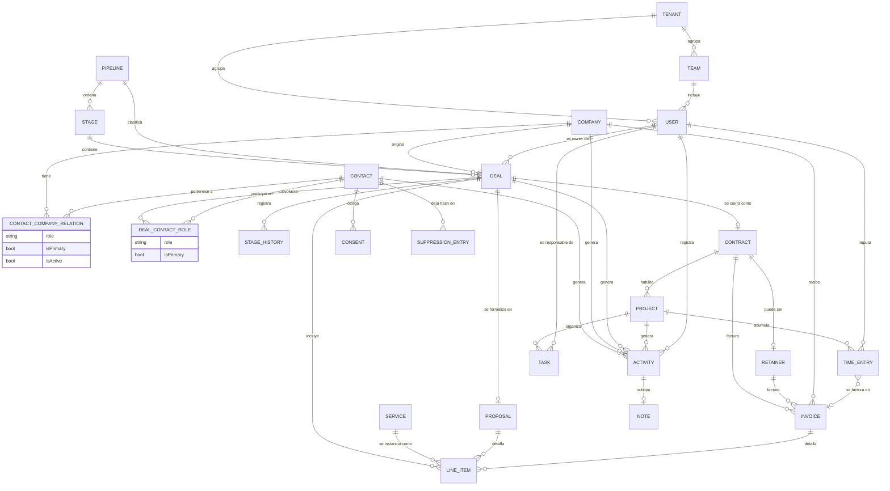

# 06 — Modelo de datos

> Base documental: `research_notes/CRM para agencias de IA/modelo_datos_e_integraciones.md` (estado: noviembre de 2026). Las cifras de Firestore proceden de la documentación oficial vigente en esa fecha. Todo lo marcado **(criterio propio)** es inferencia de diseño, no hallazgo documentado.

---

## 1. Entidades canónicas

No existe un estándar formal de entidades CRM. HubSpot y Salesforce convergen en un núcleo estable (Cuenta/Empresa, Contacto, Lead, Oportunidad con pipeline y etapas, Actividades, Producto + Línea de pedido, Presupuesto, Contrato y Campaña), y ese núcleo es el punto de partida. La cadena de entrega propia de una agencia —`Deal → Contract → Project → TimeEntry → Invoice`— **no** aparece en los CRM de ventas puros y hay que diseñarla sin referencia directa de HubSpot/Salesforce; su parentesco más cercano son las herramientas PSA (Teamwork, Productive, Scoro).

### Núcleo del CRM

| Entidad | Qué representa | Relaciones principales |
|---|---|---|
| `Company` | Cuenta: organización cliente o prospecto | 1–N `Contact` vía `ContactCompanyRelation`; 1–N `Deal`; 1–N `Project`; 1–N `Invoice` |
| `Contact` | Persona física con la que se mantiene relación | N–N `Company` vía `ContactCompanyRelation`; N–N `Deal` vía `DealContactRole`; 1–N `Activity`; 1–N `Consent` |
| `Lead` | Contacto aún no cualificado | Modelado como `Contact` con `lifecycleStage: "lead"` (modelo HubSpot), no como entidad separada — ver §1.3 |
| `Deal` | Oportunidad de venta con importe y fecha de cierre | N–1 `Pipeline`, N–1 `Stage`, N–1 `Company`, N–1 `User` (owner); N–N `Contact` vía `DealContactRole`; 1–N `LineItem`; 1–N `StageHistory`; 1–1 `Proposal`; 1–1 `Contract` |
| `Activity` | Interacción registrada: email, llamada, reunión, nota | N–1 polimórfica hacia `Contact`, `Company`, `Deal` o `Project`; N–1 `User` (autor) |
| `Task` | Acción pendiente con responsable y vencimiento | N–1 `User` (asignado); N–1 polimórfica hacia `Deal`, `Contact`, `Company`, `Project` |
| `Note` | Texto libre adjunto a un registro | N–1 polimórfica (es un subtipo de `Activity`; ver §1.3) |
| `Pipeline` | Embudo: conjunto ordenado de etapas | 1–N `Stage`; 1–N `Deal` |
| `Stage` | Etapa de un pipeline, con probabilidad y orden | N–1 `Pipeline`; 1–N `Deal`; 1–N `StageHistory` |

### Catálogo comercial y documentos

| Entidad | Qué representa | Relaciones principales |
|---|---|---|
| `Service` | Servicio del catálogo de la agencia (equivalente a `Product` de HubSpot) | 1–N `LineItem`. **No se asocia directamente a un `Deal`**: se materializa siempre como `LineItem` |
| `LineItem` | Instancia vendida de un `Service`, con precio y cantidad congelados | N–1 `Deal` (o `Proposal`/`Invoice`); N–1 `Service` por referencia + *snapshot* de nombre y precio |
| `Proposal` | Propuesta/presupuesto enviado al cliente | N–1 `Deal`; 1–N `LineItem`; 1–N `Activity` (envío, apertura, firma) |
| `Contract` | Acuerdo firmado que habilita la entrega | 1–1 `Deal`; N–1 `Company`; 1–N `Project`; 1–1 `Retainer` opcional |
| `Retainer` | Acuerdo recurrente: bolsa de horas o cuota mensual | N–1 `Contract`; 1–N `Invoice`; consume `TimeEntry` |

### Entrega y facturación

| Entidad | Qué representa | Relaciones principales |
|---|---|---|
| `Project` | Trabajo entregable derivado de un contrato | N–1 `Contract`; N–1 `Company`; 1–N `TimeEntry`; 1–N `Task`; N–N `User` (equipo asignado) |
| `TimeEntry` | Horas imputadas por una persona a un proyecto | N–1 `Project`; N–1 `User`; opcional N–1 `Invoice` (cuando se factura) |
| `Invoice` | Factura emitida, con numeración correlativa | N–1 `Company`; N–1 `Contract` o `Retainer`; 1–N `LineItem`; agrega `TimeEntry` |

### Organización y acceso

| Entidad | Qué representa | Relaciones principales |
|---|---|---|
| `User` | Persona de la agencia con acceso al CRM | N–1 `Tenant`; N–N `Team`; 1–N `Deal` (como owner); 1–N `TimeEntry` |
| `Team` | Agrupación de usuarios para permisos y reparto | 1–N `User`; referenciado por `teamId` en `Deal` y `Project` |
| `Tenant` | Organización que usa el CRM (raíz de aislamiento) | Contiene todas las entidades anteriores |

### Entidades-puente y soporte justificadas por las notas

| Entidad | Qué representa | Relaciones principales |
|---|---|---|
| `ContactCompanyRelation` | Junction contacto↔empresa con `role`, `isPrimary`, `isActive` | N–1 `Contact`; N–1 `Company`. Réplica de `AccountContactRelation` de Salesforce |
| `DealContactRole` | Junction contacto↔deal con `role` e `isPrimary` | N–1 `Deal`; N–1 `Contact`. Réplica de `OpportunityContactRole` de Salesforce |
| `StageHistory` | Registro inmutable de cada cambio de etapa de un deal | N–1 `Deal`. Base de las métricas de duración en etapa y win-rate |
| `Consent` | Prueba de consentimiento por canal y finalidad | N–1 `Contact`. Obligatorio para GDPR (ver documento 07) |
| `AuditLog` | Historial de cambios con actor y diff | Apunta a cualquier entidad por `(entity, entityId)` |
| `SuppressionList` | Hash de emails que nunca deben volver a recibir comunicación | Sobrevive al borrado del `Contact` |

Las dos relaciones que **obligan** a entidad-puente en cualquier backend, Firestore incluido, son contacto↔empresa y contacto↔deal con rol: Salesforce y HubSpot convergieron en ello de forma independiente, y replicarlo es la decisión más defendible.

### 1.1 Asociaciones: por qué junction y no array embebido

HubSpot modela las asociaciones como un grafo tipado: cada par (objeto origen → objeto destino) tiene un `typeId` **direccional** (contact→company es `279`, company→contact es `280`), y sobre cada arista cuelgan cero, una o varias *labels*. Las labels `HUBSPOT_DEFINED` son de sistema (contact→primary company es typeId `1`, company→primary contact es `2`) y las `USER_DEFINED` son personalizadas. Un detalle operativo que vale la pena copiar como advertencia: en HubSpot, para **conservar** las labels existentes hay que reenviarlas todas; enviar solo la nueva las reemplaza.

El modelo de arista con labels múltiples es traducible a Firestore con un documento `{ fromType, fromId, toType, toId, labels: [...] }`, porque los arrays sí son indexables (`array-contains`). **(criterio propio)** Para un CRM de agencia es más barato y más legible usar dos junctions explícitas y tipadas (`ContactCompanyRelation`, `DealContactRole`) que un grafo genérico de asociaciones: el grafo genérico solo gana cuando el usuario final puede definir tipos de objeto arbitrarios, que no es el caso aquí.

El límite de HubSpot de **50.000 asociaciones por registro** (caso ilustrativo de su documentación: una empresa puede asociarse hasta 50.000 contactos) es un aviso de diseño directo: una colección de relaciones escala; un array embebido dentro de `Company` choca con los límites de documento de Firestore (§4).

### 1.2 El concepto de "primario"

HubSpot garantiza que "si un registro tiene más de una empresa asociada, solo una puede ser la primaria". Firestore no puede garantizar esa invariante de forma declarativa. Hay dos salidas: una Cloud Function transaccional que desmarque la anterior, o desnormalizar `primaryCompanyId` en el propio documento `Contact`. **(criterio propio)** La segunda es preferible: convierte una invariante global en un campo escalar, se valida en una sola escritura y además sirve directamente a los listados.

### 1.3 Decisiones de modelado heredadas de las notas

- **`Lead` no es entidad propia.** Se modela como `Contact` con `lifecycleStage: "lead"` (modelo HubSpot) en lugar de objeto separado con conversión explícita (modelo Salesforce). Reduce duplicación y es más barato en Firestore. El coste: no hay un momento de "conversión" auditable por sí mismo, hay que registrarlo como transición de `lifecycleStage` en el `AuditLog`.
- **`Note` es un subtipo de `Activity`**, no una colección aparte **(criterio propio)**: comparte los mismos campos de vínculo polimórfico, autor y timestamp, y mantenerlas juntas permite un único timeline por registro con una sola consulta.
- **`Service` nunca se asocia a un `Deal` directamente.** La distinción HubSpot entre `Product` (catálogo) y `LineItem` (instancia vendida) debe replicarse, y el `LineItem` debe **denormalizar precio y nombre en el momento de la venta** para que editar el catálogo no reescriba el histórico de deals.
- **`Retainer` y `Project`** son la parte sin referencia en HubSpot/Salesforce; su diseño es criterio propio apoyado en el patrón PSA.

### 1.4 Diagrama entidad-relación

---

## 2. Estructura propuesta en Firestore

### 2.1 Rutas

Raíz de aislamiento: `/tenants/{tid}`. Bajo ella, una subcolección por entidad que necesite consultas transversales, y subcolecciones de segundo nivel solo para datos que *siempre* se leen en el contexto de su padre.

**Colecciones de primer nivel bajo el tenant** (consultables transversalmente):

- `/tenants/{tid}/contacts/{contactId}`
- `/tenants/{tid}/companies/{companyId}`
- `/tenants/{tid}/deals/{dealId}`
- `/tenants/{tid}/activities/{activityId}`
- `/tenants/{tid}/tasks/{taskId}`
- `/tenants/{tid}/projects/{projectId}`
- `/tenants/{tid}/timeEntries/{entryId}`
- `/tenants/{tid}/invoices/{invoiceId}`
- `/tenants/{tid}/contracts/{contractId}`
- `/tenants/{tid}/proposals/{proposalId}`
- `/tenants/{tid}/services/{serviceId}`
- `/tenants/{tid}/pipelines/{pipelineId}`
- `/tenants/{tid}/users/{uid}`
- `/tenants/{tid}/teams/{teamId}`
- `/tenants/{tid}/contactCompanyRelations/{relId}`
- `/tenants/{tid}/dealContactRoles/{roleId}`
- `/tenants/{tid}/auditLog/{autoId}`
- `/tenants/{tid}/suppressionList/{emailHash}`

**Subcolecciones** (siempre leídas en contexto del padre, nunca entre padres):

- `/tenants/{tid}/deals/{dealId}/stageHistory/{entryId}`
- `/tenants/{tid}/deals/{dealId}/lineItems/{itemId}`
- `/tenants/{tid}/deals/{dealId}/private/financials` — documento único con coste y margen (ver §6.2)
- `/tenants/{tid}/contacts/{contactId}/consents/{consentId}`
- `/tenants/{tid}/invoices/{invoiceId}/lines/{lineId}`
- `/tenants/{tid}/pipelines/{pipelineId}/stages/{stageId}`
- `/tenants/{tid}/projects/{projectId}/members/{uid}`

**Infraestructura operativa** (detallada en el documento 07):

- `/tenants/{tid}/integrations/{provider}` — configuración; **nunca** refresh tokens
- `/tenants/{tid}/syncState/{provider}` y `/tenants/{tid}/syncChannels/{channelId}`
- `/tenants/{tid}/inbox/{eventId}` — eventos entrantes crudos
- `/tenants/{tid}/outbox/{id}` — acciones salientes pendientes
- `/tenants/{tid}/workflows/{wid}` y `/tenants/{tid}/workflowRuns/{runId}`
- `/tenants/{tid}/stats/{docId}` + `/tenants/{tid}/stats/{docId}/shards/{shardId}`
- `/tenants/{tid}/sequences/{name}` — contadores correlativos (facturas)
- `/tenants/{tid}/trash/{id}` — papelera con `purgeAt` y política TTL

### 2.2 Razonamiento

La documentación de Firestore sobre estructuración de datos plantea tres opciones con trade-offs explícitos:

- **Datos anidados en el documento**: simple para listas fijas y pequeñas; no escala, y las listas que crecen agrandan el documento y ralentizan su recuperación.
- **Subcolecciones**: el tamaño del documento padre no cambia al crecer la lista, soportan consultas completas y *collection group queries*; a cambio, "no se pueden borrar subcolecciones fácilmente".
- **Colecciones raíz**: buenas para relaciones muchos-a-muchos y consultas potentes dentro de cada colección; recuperar datos jerárquicos se complica a medida que la base crece.

Para un CRM, todas las entidades de primer nivel necesitan consultas transversales del tipo "todos los deals en etapa X con owner Y" y relaciones muchos-a-muchos, así que ninguna puede vivir anidada. Las subcolecciones quedan reservadas a `stageHistory`, `lineItems`, `consents` y líneas de factura, que solo se consultan dentro de su padre; y si algún día hace falta transversalidad puntual sobre ellas (p. ej. "todos los line items de un servicio concreto"), las *collection group queries* la cubren sin rediseñar.

**Desnormalización obligatoria.** En cada `deal` hay que guardar `companyName`, `ownerName`, `stageName` y `primaryContactName` para que la vista de pipeline cueste 1 lectura por deal en vez de 4. El precio es un fan-out de escrituras cuando cambia el nombre de una empresa, resuelto con una Cloud Function de propagación y consistencia eventual. **Las notas señalan un hueco aquí**: no hay documentación oficial que cuantifique la latencia de ese fan-out, por lo que la ventana de inconsistencia no se puede dimensionar a priori.

**IDs de documento aleatorios, siempre.** La documentación de buenas prácticas prohíbe los IDs monotónicamente crecientes (`Customer1`, `Customer2`) porque causan hotspots, y recomienda IDs automáticos, que Firestore dispersa. Si el negocio exige numeración correlativa —facturas, obligatorio en España— se genera como **campo** `invoiceNumber` mediante un contador transaccional en `/tenants/{tid}/sequences/invoices`, manteniendo el ID del documento aleatorio. Ese contador **no se puede shardear**, porque la correlatividad es justamente el requisito, así que su tasa de emisión queda limitada por la tasa de escritura de un único documento (ver §4.2).

**Excepción deliberada al ID aleatorio**: los documentos de `activities` originados en email usan como ID el `Message-Id` RFC 5322 del correo (o el `iCalUId` del evento), para que un reprocesamiento sea un `set()` idempotente en lugar de un duplicado. Estos identificadores no son secuenciales, así que no generan hotspot.

### 2.3 El argumento decisivo: los índices

Hay dos formas de separar tenants dentro de una misma base: ruta jerárquica (`/tenants/{tid}/deals/{dealId}`) o colecciones raíz distintas por tenant (`deals_acme`, `deals_globex`). **Los índices deciden la cuestión.**

Los índices compuestos se definen **por ruta de colección**, y un *collection group index* cubre todas las subcolecciones que comparten el mismo ID de colección. Con `/tenants/{tid}/deals/{dealId}`, un único índice de collection group sobre `deals` sirve a **todos** los tenants: el número de índices no crece con el número de clientes.

Con colecciones raíz nombradas por tenant, cada tenant necesita su propio juego de índices. Firestore permite **200 índices compuestos por base de datos sin facturación y 1.000 con facturación**. Un CRM con, pongamos, 8 índices por entidad y 6 entidades indexadas consume ~48 índices por tenant: con el patrón de colección raíz por tenant el tope de 1.000 se agota alrededor de los 20 clientes. Con el patrón jerárquico, esos 48 índices sirven a todos.

Conclusión: **`/tenants/{tid}/<entidad>` con collection group indexes.** La alternativa superviviente es colecciones planas con `tenantId` como primer campo de cada índice compuesto, que también acota el número de índices; sus inconvenientes se discuten en §3.

Queda un hueco documental: **no se encontró cifra oficial sobre si los collection group indexes consumen cupo distinto del de los índices compuestos normales.** El dimensionamiento anterior asume que comparten cupo, que es el supuesto prudente **(criterio propio)**.

---

## 3. Multi-tenancy

Firestore **no tiene multi-tenancy nativa a nivel de datos**. El aislamiento siempre se escribe a mano en las Security Rules, y conviene recordar que **las reglas no son filtros**: una consulta debe incluir restricciones que garanticen que sus resultados satisfacen la regla, o la petición falla.

### 3.1 Opciones y trade-offs

| Opción | Aislamiento | Índices | Coste operativo | Consultas cross-tenant |
|---|---|---|---|---|
| **Proyecto (o base) por cliente** | Máximo, a nivel de infraestructura | Independientes por base | Alto: reglas, índices y funciones × N | Imposibles sin ETL |
| **Ruta jerárquica `/tenants/{tid}/...`** | Alto: una regla en el nivel `/tenants/{tid}` | Un collection group index por entidad, compartido | Bajo | Posibles vía collection group (con cuidado) |
| **Colecciones planas con campo `tenantId`** | Depende de que cada índice y cada consulta lleven `tenantId` | Cada índice compuesto debe empezar por `tenantId` | Bajo | Triviales (y ese es el riesgo) |

**Proyecto por cliente** tiene techo duro: **100 bases de datos por proyecto** (ampliable vía soporte). Más allá del número, multiplica el coste operativo —despliegue de reglas, índices y funciones × N proyectos— y rompe cualquier consulta cross-tenant interna, como las métricas agregadas de la propia agencia. Solo se justifica con requisitos de residencia de datos por cliente o aislamiento de facturación/SLA contractual. No es el patrón por defecto.

**Campo plano `tenantId`**: funcional, pero deja una superficie de error. Cada consulta cliente debe incluir el filtro por `tenantId` porque las reglas no filtran; olvidarlo no produce fuga (la regla rechaza) pero sí un fallo en runtime. Y olvidar el `tenantId` en una **escritura** sí puede crear datos huérfanos si la regla no lo valida.

### 3.2 Recomendación

**Patrón jerárquico `/tenants/{tid}/<entidad>`**, por cuatro razones:

1. La regla de aislamiento es una sola línea en el nivel `/tenants/{tenantId}`.
2. No hay riesgo de consulta cross-tenant por olvido: la ruta ya acota.
3. El borrado completo de un tenant —derecho al olvido, offboarding— es el recorrido de un subárbol conocido.
4. Un único collection group index por entidad, independientemente del número de clientes.

El `tenantId` viaja en un custom claim (`tid`), de modo que la comprobación de aislamiento no cuesta ninguna lectura adicional. El enfoque alternativo —leer el perfil del usuario con `get()` en cada petición— sí la cuesta, y en un CRM con listados paginados eso se nota en la factura (§6).

**Tenancy de identidad ≠ tenancy de datos.** Con Identity Platform multi-tenant, el `tenantId` está disponible en las reglas como `auth.token.tenantId`, y según un hilo oficial de Firebase "no hay otros cambios de comportamiento más allá de eso": el aislamiento de Firestore hay que escribirlo igual. Usar tenants de Identity Platform da aislamiento de identidades (un mismo email puede existir en dos tenants). **(criterio propio)** Para un CRM B2B cuyos usuarios son empleados de la agencia más invitados puntuales, un único tenant de Auth con `tid` en custom claims es suficiente y más simple.

Para pruebas, `firebase/rules-unit-testing` permite inicializar una app con `initializeTestApp` pasando un tenant ID, de modo que el aislamiento es testeable localmente.

### 3.3 Advertencia documental

**No existe una página oficial de Firebase sobre multi-tenancy en Firestore** con un patrón recomendado. Toda la orientación disponible es de terceros o de hilos de foro. Es una laguna documental real: las decisiones de esta sección se apoyan en los límites publicados (índices, bases de datos) y en el comportamiento documentado de las reglas, no en una guía canónica de Firebase.

---

## 4. Límites de Firestore que condicionan el diseño

### 4.1 Límites duros

| Límite | Valor | Qué implica para este CRM |
|---|---|---|
| Tamaño máximo de documento | **1 MiB (1.048.576 bytes)** | Holgado para un registro CRM; letal para listas embebidas. Las notas y el cuerpo de emails largos no caben indefinidamente: guardar snippet en Firestore y el cuerpo completo en el proveedor |
| Tamaño máximo de valor de campo | **1.048.487 bytes** | Un campo `description` o `body` no puede ser el vertedero de un hilo de correo completo |
| Entradas de índice por documento | **40.000** | El límite que realmente muerde antes que el de 1 MiB. Un array `contactIds` indexado dentro de `Company` revienta aquí mucho antes de llegar a 1 MiB: **nunca embeber la relación contacto↔empresa como array** |
| Tamaño total de entradas de índice por documento | **8 MiB** | Refuerza lo anterior: documentos con muchos campos indexados y arrays largos son caros en índice, no solo en almacenamiento |
| Tamaño máximo de entrada de índice | **7,5 KiB** | Limita qué se puede indexar de campos de texto largos |
| **Valor de campo indexado** | **1.500 bytes** | Los valores más largos **se truncan, lo que puede hacer inconsistentes los resultados de consulta**. Afecta a cualquier intento de indexar texto libre: razón adicional para no improvisar búsqueda sobre campos largos (§6.1) |
| Profundidad máxima de subcolecciones | **100 niveles** | Irrelevante en la práctica; el diseño propuesto usa 3 |
| Profundidad de anidamiento de maps/arrays | **20 niveles** | Suficiente; conviene no anidar más de 2–3 por legibilidad |
| Tamaño de nombre de documento | 6 KiB | Sin impacto |
| Tamaño de nombre de campo y *field path* | 1.500 bytes cada uno | Sin impacto |
| Tamaño de ID de colección/documento | 1.500 bytes | Permite usar `Message-Id` de email como ID de documento sin riesgo |
| Tamaño máximo de petición API | **10 MiB** | Acota los lotes de importación masiva de contactos |
| Límite de transacción | **270 segundos**, expiración por inactividad de **60 s** | Las migraciones y recálculos masivos no caben en una transacción: hay que trocearlos |
| Transformaciones de campo por documento en commit/transacción | **500** | Acota los incrementos atómicos simultáneos sobre un mismo documento agregado |
| Índices compuestos por base de datos | **200 sin facturación / 1.000 con facturación** | El presupuesto real de "vistas con filtro y orden" del CRM (§6.2). Decide también el patrón de multi-tenancy (§2.3) |
| Configuraciones de índice de campo único | **200 / 1.000** | Mismo cupo que lo anterior |
| Configuraciones TTL de campo único | **200 / 1.000**, **compartiendo cupo con las configuraciones de indexación** | La retención automática (§7, documento 07) compite por el mismo presupuesto que los índices. No es un recurso ilimitado |
| Campos por índice compuesto | 100 | Sin impacto |
| Bases de datos por proyecto | **100** (ampliable vía soporte) | Techo duro del patrón "base por cliente" (§3.1) |
| Llamadas de acceso a documentos en reglas | **10** por petición de documento único o consulta; **20** para lecturas multi-documento, transacciones y batched writes | Limita cuánto `get()` se puede poner en las reglas (§5.3) |
| Expresiones evaluadas por petición en reglas | **1.000** | Un ruleset con 15 entidades × 5 roles se acerca más de lo que parece |
| Tamaño del ruleset | **256 KB** fuente / **250 KB** compilado | Obliga a factorizar en funciones reutilizables desde el principio |
| Profundidad de `match` anidados / segmentos de ruta / variables de captura | 10 / 100 / 20 | Holgado para el diseño propuesto |
| Profundidad de llamadas a función en reglas / argumentos / `let` | 20 / 7 / 10 | `let` solo en reglas v2; recursión **no permitida** |
| Cuotas gratuitas diarias | 1 GiB almacenado, **50.000 lecturas/día**, 20.000 escrituras/día, 20.000 borrados/día, 10 GiB de salida/mes | El plan gratuito no cubre un CRM con dashboards: 50.000 lecturas se consumen rápido con listados paginados y agregaciones |

### 4.2 Límites blandos y hotspotting

| Límite | Valor | Qué implica para este CRM |
|---|---|---|
| Escrituras en colección con campo indexado secuencial | **500 escrituras/segundo** | Afecta a `createdAt` indexado durante importaciones masivas de contactos. Eximir el campo de indexación elimina el límite **si no se consulta por él** |
| Tasa de actualización de un único documento | **Conflicto de fuentes — ver abajo** | Condiciona el contador de numeración correlativa de facturas y el documento agregado de métricas |
| *Split boundaries* | Firestore los añade tras "unos minutos de carga sostenida"; con operaciones uniformemente distribuidas el throughput puede duplicarse cada pocos minutos | Un pico de importación no rinde al máximo desde el primer segundo: conviene *ramp-up* gradual |
| Contadores en documento único | Firestore "no permite tasas de actualización ilimitadas en un solo documento" | Un contador de métricas del tenant acabará sufriendo contención |
| Shards de contador distribuido | "El throughput de escritura crece linealmente con el número de shards": 10 shards ≈ 10× | La vía para los contadores de pipeline del dashboard |
| Timeout de consultas de agregación | **60 segundos** (`DEADLINE_EXCEEDED`) | Los dashboards sobre datasets grandes necesitan agregados materializados, no `count()` en vivo |
| Facturación de agregaciones | **1 lectura por cada lote de hasta 1.000 entradas de índice leídas** | Un dashboard de 12 tarjetas sobre 50.000 deals factura 12 × 50 lecturas **por carga** |

#### El supuesto límite de 1 escritura/segundo por documento: conflicto de fuentes

Conviene ser explícito porque esta cifra circula por todas partes y condiciona decisiones de diseño reales (contador de facturas, contadores de métricas):

- **La documentación oficial actual NO publica el clásico "1 escritura/segundo por documento".** Dice que la tasa máxima de actualización de un único documento "depende en gran medida de la carga de trabajo" y recomienda hacer pruebas de carga.
- **Fuentes secundarias siguen citando 1 QPS.** Un hilo de Firebase Talk lo describe como el límite máximo de escrituras sostenidas que cabe esperar que siempre funcione, añadiendo que las ráfagas cortas de varias escrituras en un segundo normalmente se encolan.
- **La página de cuotas vigente no enumera** "escrituras por segundo por documento" como límite. No hay un número oficial vigente.

**Cómo tratarlo en este proyecto:** como **regla de diseño prudente, no como límite documentado**. Es decir: diseñar el contador de numeración de facturas asumiendo del orden de 1 escritura/s sostenida, y si se necesita más, medirlo con pruebas de carga antes de asumir que escala. Presentarlo como hecho verificado sería incorrecto; ignorarlo sería imprudente.

### 4.3 Riesgos de hotspot específicos de este CRM

El riesgo real no son los contadores de "likes", sino dos casos concretos:

1. **El documento agregado de métricas del tenant** (`/tenants/{tid}/stats/current`) si cada cambio de deal lo incrementa. Mitigación: contador shardeado, con documento *roll-up* actualizado con menor frecuencia que los clientes leen, aceptando que el total vaya con retraso. El trade-off documentado: pocos shards → reintentos de transacción que ralentizan escrituras; muchos shards → lecturas más lentas y caras, porque leer el total carga toda la subcolección.
2. **Colecciones con `createdAt` indexado durante importaciones masivas** (límite 500/s). Mitigación: exención de índice sobre `createdAt` si no se consulta por él, o *sharded timestamps*.

Las buenas prácticas oficiales añaden dos recomendaciones aplicables directamente: usar **cursores en lugar de offsets** (los documentos saltados siguen costando latencia y lecturas facturadas) y **bulk writer en lugar de batch atómico** para grandes volúmenes. Y una que afecta a migraciones: evitar consultas que escaneen entradas de índice recién borradas, usando `start_at` para saltarlas; al migrar a una colección nueva, copiar documentos en lugar de confiar en lecturas paralelas de documentos inexistentes, con ramp-up gradual.

### 4.4 Presupuesto de exenciones de índice

La documentación recomienda eximir de indexación: campos string grandes no consultados (ahorro de almacenamiento), campos secuenciales en colecciones de alta escritura (evitar el límite de 500/s), campos TTL (que están indexados por defecto) y arrays/maps grandes no consultados. También sugiere **desactivar por defecto la indexación Descending y Array a nivel de colección** y activarlas solo donde hagan falta. **(criterio propio)** En este CRM eso se traduce en eximir desde el principio: `notes`/`description`/`body` de las actividades, `retentionUntil` y `purgeAt` (TTL), y los maps de *snapshot* denormalizados que solo se leen, nunca se filtran.

---

## 5. Roles y permisos

Cinco roles: `owner`, `admin`, `comercial`, `delivery`, `viewer` (solo lectura).

- **owner**: todo, incluida facturación de la cuenta y borrado del tenant.
- **admin**: todo el CRM y gestión de usuarios; no toca la facturación de la propia cuenta.
- **comercial**: CRUD sobre sus deals y contactos, lectura del resto del pipeline, sin acceso a costes ni márgenes.
- **delivery**: CRUD sobre proyectos y time entries, lectura de deals ganados, sin acceso al pipeline abierto.
- **viewer**: solo lectura.

### 5.1 Matriz Rol × Entidad × Operación

Leyenda: **C** crear · **R** leer · **U** actualizar · **D** borrar (lógico) · **—** sin acceso · **R\*** lectura restringida al subconjunto indicado en la nota · **CRUD\*** solo sobre registros propios (`ownerId == uid`) o de su equipo (`teamId ∈ claims.tms`).

| Entidad | owner | admin | comercial | delivery | viewer |
|---|---|---|---|---|---|
| `Contact` | CRUD | CRUD | CRUD | R | R |
| `Company` | CRUD | CRUD | CRU | R | R |
| `ContactCompanyRelation` | CRUD | CRUD | CRUD | R | R |
| `Deal` (campos públicos) | CRUD | CRUD | CRUD\* + R del resto | R\* (solo `stage == won`) | R |
| `Deal` → `private/financials` (coste, margen) | CRUD | CRUD | — | — | — |
| `DealContactRole` | CRUD | CRUD | CRUD\* | — | R |
| `StageHistory` | R | R | R | R\* | R |
| `Pipeline` / `Stage` | CRUD | CRUD | R | R | R |
| `Activity` / `Note` | CRUD | CRUD | CRU (D solo propias) | CRU (D solo propias) | R |
| `Task` | CRUD | CRUD | CRUD\* | CRUD\* | R |
| `Service` (catálogo) | CRUD | CRUD | R | R | R |
| `LineItem` | CRUD | CRUD | CRUD\* (dentro de sus deals) | — | R |
| `Proposal` | CRUD | CRUD | CRUD\* | R\* (aceptadas) | R |
| `Contract` | CRUD | CRUD | CR + R | R | R |
| `Retainer` | CRUD | CRUD | R | R | R |
| `Project` | CRUD | CRUD | R | CRUD\* | R |
| `TimeEntry` | CRUD | CRUD | — | CRUD\* (propias) + R del equipo | R\* |
| `Invoice` | CRUD | CRUD | R\* (sin coste) | — | R\* |
| `User` | CRUD | CRUD | R | R | R |
| `Team` | CRUD | CRUD | R | R | R |
| `AuditLog` | R | R | — | — | — |
| `Consent` | CRUD | CRUD | CR | — | R |
| `SuppressionList` | CRUD | CRUD | CR | — | — |
| `Workflow` | CRUD | CRUD | R | R | — |
| `Integration` / `SyncState` | CRUD | CRUD | — | — | — |
| Configuración del tenant | CRUD | RU | — | — | — |
| Borrado definitivo del tenant | D | — | — | — | — |

Nada de esta matriz se escribe como reglas en este documento: aquí se fija la política. **(criterio propio)** La asignación concreta de cada celda es decisión de diseño, no hallazgo documentado; solo el mecanismo (claims + campos de documento + partición del documento) procede de la documentación.

### 5.2 Custom claims: diseño y límites

Los custom claims son el vehículo barato para rol y tenant, porque viajan en el ID token y no cuestan ninguna lectura adicional. Tres restricciones gobiernan su uso:

**Límite de 1.000 bytes.** "Pasar un payload de custom claims mayor de 1000 bytes lanzará un error." Los claims deben ser serializables a JSON (`Date`, `undefined` o funciones provocan error) y los nombres reservados de OIDC y Firebase no están permitidos.

**(criterio propio)** Diseño propuesto, que cabe holgadamente: `{ tid: "<tenantId>", r: "owner"|"admin"|"sales"|"delivery"|"viewer", tms: ["teamA","teamB"] }`. Nombres de campo cortos porque el presupuesto es de bytes. **No meter listas de IDs de registros ni permisos por recurso**: eso rebosa el límite en cuanto crece la cartera de clientes. La dimensión "qué tipo de operación" la resuelve el claim de rol; la dimensión "sobre qué registros" se resuelve con campos `ownerId` y `teamId` en el propio documento, comparados en la regla contra `request.auth.uid` y `request.auth.token.tms`.

**Cada escritura reemplaza todos los claims.** Solo el Admin SDK en un servidor de confianza debe establecerlos, y **cada llamada reemplaza los claims existentes del usuario**: para un cambio incremental hay que leer los actuales primero y reescribir el objeto completo. Pasar `null` los elimina. Consecuencia operativa directa: cambiar el rol de un usuario sin leer antes sus claims le borra el `tid` y lo deja fuera de su tenant. Toda modificación de claims debe pasar por una función única que lea-modifique-escriba.

**Retraso de propagación.** Los claims nuevos llegan al ID token cuando el usuario inicia sesión o se re-autentica, cuando la sesión refresca el token tras expirar el anterior, o cuando el cliente fuerza con `getIdToken(true)`. **Sin refresco forzado, el usuario conserva los claims antiguos hasta que expire el token actual.** En un CRM esto es un problema operativo real, no teórico: revocar el acceso de un comercial que se marcha de la agencia **no surte efecto inmediato**. Mitigaciones:

1. Mantener `/tenants/{tid}/users/{uid}` con `revokedAt` / `disabled` y, **solo para operaciones destructivas**, validarlo en reglas con `get()` (asumiendo su coste, §5.3).
2. Revocar los refresh tokens del usuario con el Admin SDK y deshabilitar la cuenta.
3. Forzar `getIdToken(true)` en el cliente tras un cambio de permisos conocido.

**Hueco documental:** la documentación no cuantifica la latencia de propagación más allá de "hasta que expire el token actual", y la duración por defecto del ID token (habitualmente citada como 1 hora) **no se confirmó** en las fuentes consultadas. Tampoco se verificó si Firebase Auth expone hoy un mecanismo de revocación de sesión comprobable desde las Security Rules sin `get()`, más allá de `auth.token.auth_time`.

Buenas prácticas oficiales aplicables: usar claims **solo** para control de acceso (los datos de perfil van en la base de datos), mantenerlos pequeños, aplicar la autorización en backend y en reglas —las comprobaciones de UI en cliente son solo cosméticas— y contar con que habrá claims obsoletos circulando.

### 5.3 El coste de `get()` en las reglas

Las reglas pueden consultar otros documentos con `get()`, `exists()` y `getAfter()` (esta última da el estado posterior a la escritura durante batches y transacciones). Dos datos que condicionan el diseño:

- **Cada llamada de acceso ejecuta una lectura de base de datos y se factura, incluso cuando la regla rechaza la petición.** En un CRM con listados paginados, meter un `get()` en el camino caliente puede duplicar la factura de lecturas.
- El tope es **10 llamadas** por petición de documento único o consulta, y **20** para lecturas multi-documento, transacciones y batched writes (cada operación individual sigue topada a 10). Superarlo devuelve `permission-denied`.

Por eso el aislamiento multi-tenant va en el claim `tid` y no en un `get()` del perfil. `get()` queda reservado a comprobaciones raras: validar pertenencia a un proyecto concreto, o comprobar `revokedAt` antes de un borrado.

Las funciones personalizadas de reglas se limitan a una única sentencia `return`, no pueden recursar y tienen profundidad de llamada 10; rules v2 añade `let` (hasta 10 por función). Con el tope de **1.000 expresiones evaluadas por petición** y **250 KB de ruleset compilado**, un ruleset que modele ~20 entidades × 5 roles se acerca más de lo que parece: hay que factorizar con funciones reutilizables y `let` desde el primer día, no después.

### 5.4 Lo que las reglas no pueden hacer: seguridad a nivel de campo

**Firestore no soporta seguridad a nivel de campo**: las reglas conceden o deniegan documentos completos. Que un `comercial` no vea `cost` ni `margin` en un deal no se puede expresar en una regla. Las dos salidas son:

- **(a) Partir el documento**: `/tenants/{tid}/deals/{dealId}` visible al equipo y `/tenants/{tid}/deals/{dealId}/private/financials` restringido a owner y admin.
- **(b)** Servir esos campos a través de una Cloud Function con lógica propia.

La opción (a) es la idiomática y **conviene decidirla al diseñar el esquema, no después**: mover campos financieros fuera del documento principal una vez hay datos y vistas construidas es una migración, no un ajuste. Por eso `deals/{id}/private/financials` aparece ya en la estructura de §2.1.

Dos notas finales sobre la superficie de seguridad: **las librerías cliente de servidor, REST y RPC ignoran las Security Rules** y se rigen por IAM; y **las escrituras del Admin SDK saltan las reglas**, de modo que una Cloud Function "puede alcanzar cualquier parte de la base de datos". Esto es exactamente lo que hace viable el audit log inmutable (§7), pero también significa que cualquier bug en una función tiene alcance total.

---

## 6. Lo que Firestore no hace bien

### 6.1 Búsqueda de texto completo

**Estado actual de la búsqueda nativa:** Firestore tiene búsqueda de texto, pero **"la búsqueda de texto requiere una base de datos de edición Firestore Enterprise"**. Hay que crear índices de texto sobre los campos a buscar, y la operación solo busca en esos campos. Por defecto los resultados se ordenan por fecha de creación descendente; ordenar por score de búsqueda es posible, pero "requiere más cómputo para calcular y comparar el score exacto de cada documento". Además, no está soportada en paquetes de control de Assured Workloads que imponen residencia de datos en uso, donde la restricción `constraints/firestore.managed.disableEnhancedTextSearch` se aplica por defecto.

El requisito de edición Enterprise es una **decisión de plataforma con implicaciones de coste**, no una casilla que se activa. **Hueco:** no se obtuvo el precio ni los requisitos concretos de la edición Enterprise frente a Standard, así que esa decisión no se puede cerrar con los datos actuales.

**Vía externa.** Sincronizar hacia Algolia, Typesense o Elastic. La extensión de Typesense sincroniza documentos de una colección Firestore a una colección Typesense para búsqueda full-text difusa, reaccionando a creaciones, actualizaciones y borrados; solo sincroniza cambios posteriores a la instalación y ofrece una función de backfill para los datos existentes; requiere plan Blaze y un clúster Typesense previamente creado. **Pero Firebase Extensions está deprecado y cierra el 31 de marzo de 2027**, y en el caso concreto de Typesense el publisher **no ha provisto function kit de reemplazo**: la propia página recomienda hacer fork de la extensión y mantenerla uno mismo. Es decir: la vía externa hoy implica escribir y mantener la Cloud Function de sincronización como código propio (ver documento 07).

**Vía pragmática para volúmenes pequeños (criterio propio).** Para una agencia con pocos miles de contactos por tenant, un índice invertido simple en Firestore: campo `searchTokens: string[]` con prefijos o n-gramas normalizados, y consulta `array-contains-any`. Funciona para autocompletado por nombre, email y dominio, y no añade infraestructura. El coste: infla las entradas de índice del documento, con el tope de **40.000 por documento** vigilando, y no da *typo tolerance* ni facetas.

**Hueco documental:** la página oficial de Firestore sobre búsqueda **ya no recomienda soluciones de terceros** (solo documenta la búsqueda nativa Enterprise), lo que deja sin fuente oficial la comparativa Algolia/Typesense/Elastic que existía en versiones anteriores. Tampoco se pudo confirmar si existe hoy una extensión o function kit oficial de Algolia para Firestore ni su estado de mantenimiento.

### 6.2 Filtros complejos y ordenaciones múltiples

Firestore exige **un índice compuesto por cada combinación de filtro + orden**, con un tope de **1.000 índices compuestos por base de datos con facturación**. Un CRM con filtros libres sobre 20 propiedades es combinatoriamente inviable: no es cuestión de esfuerzo, es que no caben.

La salida idiomática es doble:

1. **Fijar un conjunto cerrado de vistas** con sus índices declarados: pipeline por etapa, mis deals, deals por cerrar este mes, contactos por empresa, proyectos activos, horas sin facturar. Cada vista es un índice conocido y presupuestado.
2. **Delegar el "filtro avanzado arbitrario"** al motor de búsqueda externo (Typesense y Algolia soportan facetado y filtros numéricos arbitrarios sin declarar índices) o a BigQuery.

A ese presupuesto hay que sumarle el coste del borrado lógico: si todas las consultas llevan `where('deletedAt','==',null)`, **`deletedAt` tiene que entrar en todos los índices compuestos de esa colección** (§7.2).

### 6.3 Reporting agregado

Firestore tiene agregaciones nativas `count()`, `sum()` y `average()`, calculadas en servidor, que devuelven solo el valor y ahorran lecturas facturadas y bytes transferidos. Para el 80 % de los KPIs de pipeline (`count()` de deals por etapa, `sum(amount)`) bastan sin mantener agregados propios. Además, **las Security Rules se aplican a las agregaciones igual que a las consultas de documentos**: si un cliente puede ejecutar la consulta, puede agregarla, y no hay mecanismo de reglas separado que haya que escribir.

Sus límites, en cambio, son los que empujan a una segunda capa:

- **Facturación: se cobra una lectura por cada lote de hasta 1.000 entradas de índice leídas**, no por documentos devueltos. Un dashboard con 12 tarjetas que recorren 50.000 deals factura 12 × 50 lecturas **por carga de la página**.
- **No funcionan con listeners en tiempo real ni offline**: solo se soportan mediante respuesta directa del servidor. Un dashboard "en vivo" no se construye con ellas.
- Fallan con `DEADLINE_EXCEEDED` si no terminan en **60 segundos**; la documentación sugiere contadores para datasets grandes.
- **Solo leen campos indexados.**
- `sum()` y `average()` ignoran valores no numéricos, mientras que `count()` sí los incluye; y al combinar varias agregaciones, los documentos a los que les falte alguno de los campos agregados **quedan excluidos** — un deal sin `amount` desaparece del recuento combinado sin avisar.

**Separación de cargas recomendada:** Firestore como sistema **operacional** (lecturas por ID y consultas acotadas por tenant + estado + owner); BigQuery como sistema **analítico** (cohortes, forecast, win-rate por etapa y por comercial, duración media en etapa, facturación). Para dashboards de alta frecuencia, materializar agregados con Cloud Functions (contadores shardeados sobre `/tenants/{tid}/stats/`) en lugar de recalcular en cada carga.

La exportación a BigQuery crea una **tabla changelog cruda** con el historial completo de cambios y metadatos (`timestamp`, `document_name`, `operation`) y una **vista "latest"** con el estado actual de cada documento. Esa tabla changelog resuelve de paso dos requisitos de §7: el historial de cambios a largo plazo y las métricas de SLA calculadas a posteriori. Tres advertencias operativas de su documentación:

- **Solo observa cambios de documentos de nivel superior, no subcolecciones**; para cubrirlas hay que instalar otra instancia o usar rutas con `{wildcard}`, que añaden una columna STRING con los valores del wildcard. En el diseño de §2.1, esto afecta a `stageHistory`, `lineItems`, `consents` y `private/financials`.
- **Los documentos existentes no se exportan automáticamente**: hay un script de import externo que debe ejecutarse *después* de instalar, porque si no pueden perderse escrituras durante el import.
- **La partición no se puede cambiar en una tabla existente** (obliga a crear tabla nueva); el **clustering sí** se puede añadir o cambiar sin recrearla. Las vistas materializadas no soportan ni partición ni clustering.

A diferencia de Typesense, esta pieza **sí tiene function kit de reemplazo** (`@firebase-function-kits/firestore-bigquery-export`), lo que la hace viable más allá del cierre de Extensions. Y tiene una consecuencia de cumplimiento grave que se trata en el documento 07: **un borrado en Firestore solo añade una operación `DELETE` a la changelog; los datos personales siguen en BigQuery.**

---

## 7. Historial de cambios y borrado lógico

Firestore **no tiene historial de versiones ni *soft delete* nativos**: ambos son patrones de aplicación. Las dos piezas de infraestructura que ayudan son los triggers de Cloud Functions (que entregan el estado `before` y `after` del documento) y las políticas **TTL de campo único**, que permiten purga automática de registros marcados.

### 7.1 Audit log

**Patrón recomendado:** una Cloud Function `onDocumentWritten` por entidad auditada que escriba en `/tenants/{tid}/auditLog/{autoId}` un registro con entidad, ID, operación, actor (uid y email), timestamp, campos cambiados y los valores anterior y posterior **de esos campos**.

Tres detalles que deciden si el log sirve o no:

- **Usar las variantes `...WithAuthContext` es imprescindible.** Los triggers normales solo ven el dato, no quién lo cambió; las variantes `WithAuthContext` añaden información sobre el *principal* que disparó el evento. Sin ellas el audit log no responde a la única pregunta que justifica su existencia.
- **Guardar el diff, no los documentos completos.** Guardar `before` y `after` enteros duplica el almacenamiento y puede acercarse al límite de 1 MiB en documentos grandes.
- **El log debe ser inmutable para el cliente**: lectura solo para admin, escritura denegada a todos. Encaja perfectamente con el hecho de que las Cloud Functions escriben con Admin SDK **saltándose las reglas**.

**Dos niveles de retención (criterio propio):** `auditLog` en Firestore para los últimos ~90 días, consultable desde la UI del CRM y purgado automáticamente por TTL; y la tabla changelog de BigQuery como histórico completo y barato a largo plazo.

Dos comportamientos de los triggers que afectan a la fidelidad del log: **las escrituras sin cambio real ("no-op writes") no generan evento** de update ni de write, y **no se puede disparar sobre campos específicos** — el filtrado por campo hay que hacerlo dentro de la función comparando `before` y `after`.

**Hueco documental:** no existe una página canónica de Firebase sobre patrones de audit log para Firestore, ni documentación del **comportamiento exacto de la purga TTL** (la ventana de latencia entre el `purgeAt` y el borrado efectivo). Ese segundo dato es necesario para demostrar cumplimiento de plazos de retención, y hoy no se tiene.

### 7.2 Borrado lógico

**Opción A — campo `deletedAt`.** Campo `deletedAt: Timestamp|null` más `deletedBy`. Dos consecuencias que suelen olvidarse:

1. Todas las consultas deben añadir `where('deletedAt','==',null)`, lo que obliga a incluir `deletedAt` en **todos** los índices compuestos de esa colección. Es un coste de índices que hay que presupuestar contra el tope de 1.000 (§4.1).
2. Las Security Rules deberían impedir que los roles no admin lean documentos borrados, pero **las reglas no filtran**: la restricción tiene que estar en la consulta, y la regla solo puede validar que la consulta la lleva (patrón de validación de `request.query`).

**Opción B — papelera con TTL.** Mover el documento a `/tenants/{tid}/trash/{id}` con un campo `purgeAt` y una política TTL. Ventajas: las consultas normales no necesitan filtro ni índices extra, y la purga definitiva —requisito GDPR— es automática y demostrable. Desventajas: restaurar exige reescribir el documento en su ruta original, y **las subcolecciones no se mueven con él**.

**(criterio propio) Recomendación: Opción A para las entidades consultadas en listados** (`contacts`, `companies`, `deals`, `tasks`), donde la restauración debe ser trivial y el usuario espera una papelera visible en la UI; **Opción B para datos operativos de alto volumen** (`activities`, `inbox`, `workflowRuns`, `auditLog`), donde no hay restauración y la purga automática es lo que se quiere. No elegir una sola para todo.

Nota sobre el TTL: los campos TTL **están indexados por defecto** y la documentación recomienda añadirles exenciones de índice; y el cupo de políticas TTL (200/1.000 por base) **comparte presupuesto con las configuraciones de indexación**.

### 7.3 Borrado en cascada

**El borrado en cascada es manual.** Borrar una `Company` no borra sus deals, actividades ni subcolecciones, y la documentación de Firestore es explícita: "no se pueden borrar subcolecciones fácilmente". Hacen falta una Cloud Function de cascada o el cliente de *recursive delete*, y una decisión de política explícita por cada relación: ¿borrar los deals de la empresa, desvincularlos, o bloquear el borrado si hay deals abiertos?

**(criterio propio) Política propuesta:** bloquear el borrado de una `Company` con deals abiertos o facturas emitidas; en el resto de casos, borrado lógico en cascada con registro único en el audit log que enumere lo afectado. El borrado físico solo llega por la vía de retención (TTL) o por una solicitud GDPR tramitada explícitamente, nunca como efecto secundario de un clic en la UI.

### 7.4 Anonimización en vez de borrado

El derecho al olvido en un CRM de agencia casi nunca es un borrado total, porque hay bases legales para conservar facturas y contratos (se detalla en el documento 07). Eso impone un requisito al modelo de datos de este documento: **debe ser posible anonimizar un `Contact` sin romper las referencias desde `Invoice` y `Contract`.**

Esto refuerza dos decisiones ya tomadas: referenciar siempre por ID (nunca por email o nombre), y denormalizar nombres como *snapshots* históricos dentro de los documentos financieros. Un `Invoice` que conserva `billedToSnapshot` sobrevive intacta a la anonimización del contacto que la originó; un `Invoice` que lee el nombre del `Contact` en tiempo de render, no.

---

## 8. Decisiones abiertas

1. **Edición de Firestore: Standard o Enterprise.** La búsqueda de texto nativa requiere Enterprise. No se dispone del precio ni de los requisitos concretos de Enterprise frente a Standard, así que la decisión no se puede cerrar hoy. Bloquea: §6.1.
2. **Estrategia de búsqueda definitiva.** Tres candidatas: Enterprise nativa, Typesense con sincronización propia (sin function kit disponible, hay que forkear y mantener), o índice invertido `searchTokens` en Firestore. Depende de (1) y del volumen real de contactos por tenant.
3. **Grafo genérico de asociaciones vs junctions tipadas.** El diseño propuesto usa dos junctions explícitas. Si en el futuro el CRM debe permitir objetos personalizados al estilo HubSpot (`2-XXX`), habría que migrar a un grafo genérico. Decidir si eso entra en el alcance antes de escribir el esquema.
4. **Región de Firestore.** La elección se toma al crear la base y **no se puede cambiar después**. Opciones: regional (menor coste y latencia de escritura) o multi-región (disponibilidad), y en Europa `europe-west1` o la multi-región `eur3`. Tiene implicaciones de cumplimiento (documento 07).
5. **Umbral de sharding del documento de métricas.** Pocos shards causan reintentos de transacción; muchos encarecen la lectura del total. Hay que fijar un número inicial y medir, no deducirlo.
6. **Tasa real de emisión de numeración correlativa de facturas.** Depende del límite de escritura por documento, que hoy es un conflicto de fuentes (§4.2). Requiere prueba de carga antes de comprometer un volumen.
7. **Política de cascada por relación.** La propuesta de §7.3 es criterio propio; hay que validarla contra el flujo real de trabajo de la agencia antes de implementarla.
8. **Nomenclatura de campos.** Las notas señalan que el esquema de EspoCRM (entityDefs JSON) queda como fuente pendiente para validar nombres de campos; no se consultó por límite de llamadas.
9. **Ventana de inconsistencia del fan-out de desnormalización.** No hay documentación oficial que cuantifique la latencia de propagación de las Cloud Functions, así que no se puede prometer un SLA de consistencia eventual: hay que medirlo en el entorno real.
10. **¿Consumen los collection group indexes cupo distinto del de los índices compuestos normales?** Sin cifra oficial. El presupuesto de índices de §2.3 asume que comparten cupo.

---

## 9. Fuentes

**Firestore — documentación oficial**

- [Firestore, Quotas and limits](https://firebase.google.com/docs/firestore/quotas) — todos los límites duros de §4.1
- [Firestore, Best practices](https://firebase.google.com/docs/firestore/best-practices) — hotspotting, 500 escrituras/s, IDs de documento, exenciones de índice, ubicación de la base
- [Firestore, Structure data](https://firebase.google.com/docs/firestore/manage-data/structure-data) — trade-offs de datos anidados, subcolecciones y colecciones raíz
- [Firestore, Distributed counters](https://firebase.google.com/docs/firestore/solutions/counters) — contención, patrón de shards, documento roll-up
- [Firestore, Aggregation queries](https://firebase.google.com/docs/firestore/query-data/aggregation-queries) — `count()`/`sum()`/`average()`, facturación por lotes de 1.000 entradas de índice, timeout de 60 s
- [Firestore, Rules conditions](https://firebase.google.com/docs/firestore/security/rules-conditions) — las reglas no son filtros, `get()`/`exists()`/`getAfter()`, límites de llamadas, facturación de accesos
- [Firestore, Text search](https://firebase.google.com/docs/firestore/solutions/search) — requisito de edición Enterprise, índices de texto, ordenación por score

**Firebase — documentación oficial**

- [Firebase, Custom claims](https://firebase.google.com/docs/auth/admin/custom-claims) — límite de 1.000 bytes, reemplazo total en cada escritura, propagación
- [Firebase, Firestore triggers](https://firebase.google.com/docs/functions/firestore-events) — `before`/`after`, variantes `WithAuthContext`, no-op writes, Admin SDK salta las reglas

**Firebase — hilos oficiales y foros**

- [Firebase Talk, Write rate limit per document](https://groups.google.com/g/firebase-talk/c/sXmPclfystk) — fuente secundaria del 1 QPS por documento (ver conflicto en §4.2)
- [Firebase Talk, multi-tenancy](https://groups.google.com/g/firebase-talk/c/0POxgDoQgVA) — `auth.token.tenantId` en reglas
- [Firebase Talk, Firebase Testing with Multi-Tenancy](https://groups.google.com/g/firebase-talk/c/14kVJrdKLFI) — `initializeTestApp` con tenant ID

**Modelos de datos CRM de referencia**

- [HubSpot, Understanding the CRM](https://developers.hubspot.com/docs/guides/api/crm/understanding-the-crm) — objetos estándar y sus `objectTypeId`, properties, Products vs Line items, objetos personalizados
- [HubSpot, Associations API](https://developers.hubspot.com/docs/guides/api/crm/associations/associations-v4) — `typeId` direccional, labels, asociaciones primarias, límite de 50.000 asociaciones por registro
- [Salesforce Object Reference, AccountContactRelation](https://developer.salesforce.com/docs/atlas.en-us.object_reference.meta/object_reference/sforce_api_objects_accountcontactrelation.htm) — junction contacto↔cuenta
- [Salesforce API Objects, OpportunityContactRole](https://developer.salesforce.com/docs/atlas.en-us.254.0.api.meta/api/sforce_api_objects_opportunitycontactrole.htm) — junction contacto↔oportunidad con rol
- [Salesforce Ben, Account Contact Relationship](https://www.salesforceben.com/salesforce-account-contact-relationship-fields-relate-a-contact-to-multiple-accounts/) y [Opportunity Contact Roles](https://www.salesforceben.com/introduction-to-salesforce-opportunity-contact-roles/)
- [ApexHours, Account Contact Relationship](https://www.apexhours.com/salesforce-account-contact-relationship/) — roles en ACR
- [Twenty docs, Data model](https://docs.twenty.com/getting-started/core-concepts/data-model) — Companies, People, Opportunities y relation fields

**Terceros (multi-tenancy, sin fuente oficial equivalente)**

- [Leyaa, Firebase multitenancy patterns](https://leyaa.ai/codefly/learn/firebase/part-3/firebase-multitenancy-patterns)

**Nota sobre las fuentes:** no se pudo acceder al diagrama oficial del modelo Sales Cloud (`architect.salesforce.com` y `developer.salesforce.com/docs/platform/data-models/...` devuelven 403/404 a fetchers automatizados), por lo que no hay enumeración oficial con tipos de relación (lookup vs master-detail) por objeto. Tampoco se obtuvo la lista canónica completa de objetos estándar de Twenty CRM.
