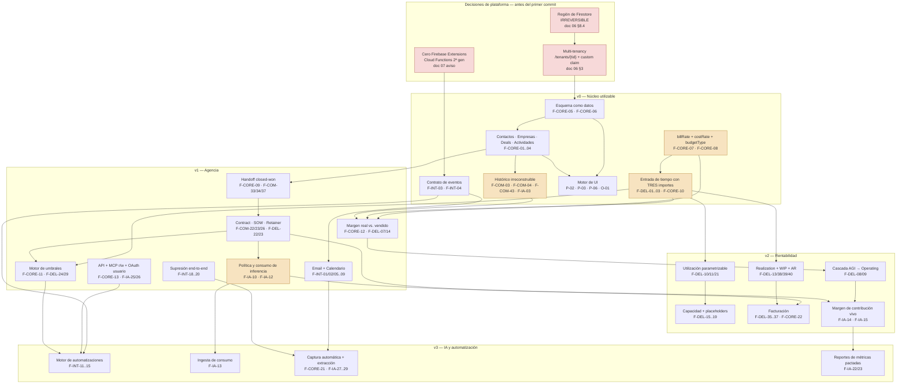

# 08 — Roadmap y priorización

> **Advertencia de apertura.** Los documentos [01](01-funcionalidades-core.md), [02](02-workflows-comerciales.md), [03](03-delivery-y-rentabilidad.md), [04](04-especifico-agencias-ia.md) y [07](07-integraciones-y-automatizaciones.md) catalogan **198 funcionalidades**. Eso es un inventario de lo posible, **no un plan de construcción**. Construirlas todas sería un error: equivaldría a reimplementar Scoro End-to-end, que una agencia de 10 personas puede alquilar por $3.000–6.800 al año ([01](01-funcionalidades-core.md), §"Qué implica todo esto para el build"). Este documento propone el corte.
>
> Todo lo que sigue —fases, criterio de corte, MVP, umbrales— es **(criterio propio)**. Las fuentes documentan mecánicas, no prioridades de roadmap; eso lo dicen explícitamente los propios catálogos.

---

## 1. El problema de la suma

Los cinco catálogos se escribieron en paralelo, por agentes distintos, sin verse entre sí. Consecuencias medibles:

- **96 de las 198 funcionalidades están marcadas `Must`** por su propio documento. Un `Must` que afecta a la mitad del inventario no prioriza nada.
- Cada documento asignó MoSCoW **con un criterio distinto**: 01 priorizó por "sin esto el margen es invisible"; 02 por dependencia estructural ("es Must lo que, si falta, invalida otra funcionalidad"); 03 declaró abiertamente que las fuentes no dan prioridades; 04 priorizó por especificidad del negocio de IA; 07 por "sin esto la integración se rompe o se incumple la ley". Las cuatro escalas no son comparables.
- Hay **la misma funcionalidad descrita en dos o tres documentos con prioridad distinta**, y en un caso con modelo de datos incompatible.

### 1.1 Solapamientos y conflictos detectados

| Tema | IDs implicados | Conflicto |
|---|---|---|
| **Facturación** | `F-CORE-22` (Could) · `F-DEL-35`, `F-DEL-36`, `F-DEL-37` (Must/Should) · `F-INT-31` (Could) | 01 la aplaza por caro; 03 la da por Must porque sin los cuatro disparadores de factura no hay WIP ni AR. Y 07 recuerda que la normativa española condiciona la pieza y **no se verificó**. Resolución: la decisión "¿factura el sistema o solo alimenta a contabilidad?" es previa y bloquea los tres |
| **Aprobación de timesheets** | `F-CORE-23` (Could) · `F-DEL-05` (Must) | 03 la hace Must porque la máquina de estados de la entrada de tiempo no cierra sin el checkpoint; 01 la ve accesoria. Gana 03: sin paso de aprobación, `importe_facturado` nunca se puede separar de `importe_listado` |
| **Gastos y pass-through** | `F-CORE-24` (Could) · `F-DEL-08` (Must) · `F-IA-12` (Must) | Tres documentos, tres prioridades. 03 y 04 coinciden en Must por la misma razón: sin marcar el coste como pass-through o delivery, el AGI y el margen salen mal. El `Could` de 01 queda invalidado |
| **Entrada de tiempo** | `F-CORE-10` (Must, "captura de tarifas vigentes") · `F-DEL-01`, `F-DEL-02`, `F-DEL-03`, `F-DEL-04` (Must) | 01 describe un solo importe; 03 exige **tres** (listado, facturado, cobrado). Son modelos de datos distintos para la misma tabla. Gana 03, y es irreversible (§6) |
| **Utilización** | `F-CORE-17` (Should) · `F-DEL-10`, `F-DEL-11`, `F-DEL-21` (Must) · `F-DEL-12`, `F-DEL-19` (Should) | 03 insiste en que la utilización no es un número sino una función parametrizable y que toda cifra mostrada debe etiquetar numerador y denominador. `F-CORE-17` ("objetivo configurable") es un subconjunto de `F-DEL-10` |
| **Margen y rentabilidad** | `F-CORE-12` (Must) · `F-COM-13` (Must) · `F-DEL-09`, `F-DEL-14` (Must) · `F-IA-14` (Must) | Cuatro vistas del mismo cálculo en cuatro momentos: previsto en la propuesta (02), real al cierre (01), por escalón de cascada (03) y vivo mes a mes (04). No se solapan en el tiempo pero sí en las tablas base; hay que construir **un** motor de margen con cuatro consultas, no cuatro módulos |
| **Alertas de consumo y burn** | `F-CORE-11` (Must) · `F-DEL-24` (Must) · `F-DEL-29` (Should) · `F-COM-29` (Should) · `F-IA-15` (Should) | Cinco alertas sobre el mismo mecanismo (consumo acumulado vs. comprometido) con umbrales distintos: ≤60 %/≥140 % de retainer, 25 %/50 % de burn vs. calendario, >15 % de MRR en modelos. Es **un** motor de umbrales configurables, no cinco |
| **Rate cards** | `F-CORE-07` (Must) · `F-COM-14` (Should) · `F-DEL-07` (Must) | `F-DEL-07` (ACPH = (salario+beneficios) ÷ capacidad anual) es la fórmula que `F-CORE-07` deja sin definir; `F-COM-14` añade el versionado. Una sola pieza |
| **Retainers** | `F-CORE-08`, `F-CORE-20` · `F-COM-26`, `F-COM-29` · `F-DEL-22`..`F-DEL-25` · `F-IA-09` | Cuatro documentos modelan el retainer. 03 da el conjunto mínimo de 12 campos que cubre los seis modelos; 02 añade preaviso y escalado; 04 añade cap, mínimo comprometido y markup de consumo. Son capas del mismo objeto, no objetos distintos |
| **Handoff closed-won** | `F-CORE-09` (Must) · `F-COM-33`, `F-COM-34`, `F-COM-37` (Must) · `F-IA-01` (Must) | 01 da los cinco campos que deben cruzar; 02 el gate bloqueante y las promesas verbales; 04 la cadena de deals por fase. Compatibles, pero hay que decidir si el handoff crea `Project` directamente (01) o pasa por `Contract` (06) |
| **Scope creep y change orders** | `F-COM-22`, `F-COM-25` · `F-DEL-27`, `F-DEL-31`, `F-DEL-32` | 02 lo plantea desde el SOW (jerarquía MSA→SOW→Change Order); 03 desde la detección (umbrales, `scope_locked_at`, caducidad del pendiente). Son las dos mitades de un proceso |
| **Scoping accuracy** | `F-COM-12`, `F-COM-15`, `F-COM-16` (Must/Must/Should) · `F-DEL-33` (Should) | `F-DEL-33` calcula lo mismo que `F-COM-16` pero por tarea en vez de por rol. El dato de entrada es el mismo `estimate_baseline` |
| **Captura automática de actividad** | `F-CORE-21` (Should) · `F-IA-27`, `F-IA-28`, `F-IA-29` (Should) · `F-INT-01`, `F-INT-02`, `F-INT-09` (Must) | 07 la hace Must ("es el sistema nervioso del CRM: sin él las actividades se registran a mano y el CRM muere"); 01 y 04 la dejan en Should. Gana 07 en cuanto a importancia, pero arrastra un bloqueante de calendario ajeno: la verificación de app de Google y el security assessment anual, **de coste y plazo desconocidos** |
| **API y MCP** | `F-CORE-13` (Must) · `F-IA-25`, `F-IA-26` (Must) | No hay conflicto, hay refuerzo: 04 añade que el MCP debe tener escritura y OAuth con permisos a nivel de usuario, y que va **antes** que cualquier UI de IA embebida |
| **Catálogo de servicios** | `F-CORE-18` (Should) · `F-COM-30` (Should) · `F-IA-05` (Should) | Tres nombres para `Service` + `LineItem` del documento [06](06-modelo-de-datos.md) |
| **Health score** | `F-COM-32` (Could) · `F-DEL-46` (Won't) | Contradicción directa. Y ninguna fuente propone la fórmula ([02](02-workflows-comerciales.md) D-07). Resolución: fuera de las cuatro fases |
| **Contratos y firma** | `F-CORE-31` (Won't v1) · `F-COM-22`, `F-COM-26` (Must) · `F-INT-26` (Should) | 01 descarta el objeto `Contract` para v1; 02 lo necesita como Must para la jerarquía documental y las renovaciones; 06 lo coloca en el centro de la cadena `Deal → Contract → Project`. Gana 02/06: el objeto `Contract` sí entra; lo que se aplaza es la **firma electrónica**, que es otra cosa |
| **Forecasting** | `F-CORE-14` (Should) · `F-CORE-29` (Won't v1) · `F-COM-40`, `F-COM-44` (Should) · `F-DEL-18` (Must) · `F-DEL-44` (Could) | `F-CORE-29` (forecast de ingresos y escenarios) está descartado para v1 mientras `F-DEL-18` (forecast de capacidad) es Must. Son cosas distintas con el mismo nombre: uno proyecta dinero, el otro horas |
| **Leads** | `F-CORE-16` (Should: "objeto separado del deal") · [06](06-modelo-de-datos.md) §1 ("`Lead` modelado como `Contact` con `lifecycleStage: lead`, no como entidad separada") | **Conflicto de modelo de datos, no de prioridad.** Hay que elegir uno antes de escribir la primera colección |
| **Permisos** | `F-CORE-28` (Could) · `F-IA-26` (Must) · [05](05-interfaces-y-pantallas.md) §6.5 (permisos de vistas) · [06](06-modelo-de-datos.md) §5 (matriz rol × entidad × operación) | 01 aplaza los permisos granulares; 06 ya diseña la matriz y advierte del coste de `get()` en las reglas; 04 exige OAuth por usuario para el MCP de escritura. Los permisos **de base** no son opcionales; lo que se aplaza son los grupos de visibilidad |
| **Portal de cliente** | `F-CORE-25` (Could) · `F-DEL-37` (Should: extracto de retainer para el cliente) | Un extracto de retainer que ve el cliente **es** un portal de cliente mínimo, con todo el modelo de permisos que arrastra |

**Conclusión del apartado.** Donde dos documentos chocan, la regla aplicada en este roadmap es: **gana el documento que posee el dato**. 03 decide sobre tiempo, coste y facturación; 02 sobre pipeline y documentos comerciales; 04 sobre fases de IA, inferencia y superficie de agentes; 06 sobre forma de las entidades; 07 sobre integraciones y cumplimiento; 01 sobre el núcleo CRM y nada más. **(criterio propio)**

---

## 2. Criterio de corte propuesto **(criterio propio)**

Una funcionalidad entra en la v1 si cumple **al menos una** de estas cuatro condiciones, y ninguna de las dos exclusiones.

**Entra si:**

1. **Es irreversible.** Si no se captura ahora, el dato no se puede reconstruir después: tres importes por entrada de tiempo, `costRate` vigente en el momento del registro, histórico de etapas, motivo de pérdida tipificado, go/no-go con fecha. La funcionalidad puede ser fea; el campo tiene que existir.
2. **Bloquea estructuralmente a otra.** Sin ella, otra funcionalidad posterior es imposible o exige migración: `budgetType` antes del retainer, junction contacto↔empresa antes de la segunda empresa de un contacto, `/tenants/{tid}` antes de la segunda colección.
3. **Hace visible una pérdida que hoy es invisible.** El criterio de valor del documento [01](01-funcionalidades-core.md): la alerta semanal de burn vale más que el informe mensual bonito. Una funcionalidad que solo presenta mejor un dato que ya se conoce no entra.
4. **Es específica de esta agencia y ningún PSA la cubre.** Coste de inferencia atribuido, política de repercusión por cliente, cadena discovery→PoC→producción, registro de artefactos de IA, MCP con escritura. Es la única justificación defendible del build; si se recorta esto, el proyecto pierde su razón de ser.

**No entra si:**

5. **Replica lo que un PSA comercial ya hace bien y la agencia no echa de menos hoy.** Forecast de ingresos con escenarios, cálculo de overhead, multi-divisa, multi-entidad, gestión de ausencias.
6. **Depende de un bloqueante externo de coste o plazo desconocido.** No puede estar en el camino crítico: verificación de app de Google y security assessment para los scopes restringidos de Gmail, normativa española de facturación electrónica, edición Enterprise de Firestore. Se diseña el contrato de datos ahora y se construye cuando el bloqueante se resuelva.

**Y una regla transversal:** nada que tenga un `(no verificado)` o una laguna declarada en su documento de origen puede entrar como lógica automática. Entra como campo informativo. Aplica a los umbrales de utilización, a los benchmarks de margen, a las fechas del AI Act y a los plazos de retención.

---

## 3. Fases

Cuatro fases. Los IDs listados son los de los catálogos originales; los que no aparecen en ninguna fase están fuera (§3.5).

### Fase v0 — Núcleo utilizable

**Objetivo:** que la agencia pueda llevar su pipeline y sus horas en el sistema en lugar de en una hoja de cálculo, sin tomar ninguna decisión irreversible mal.

**Qué se puede hacer al terminarla que antes no:** ver en un sitio quién es cada cliente, qué se está vendiendo y en qué etapa, cuántas horas ha consumido cada proyecto y a qué coste — y sobre todo, **empezar a acumular el histórico que después hará falta** (cambios de etapa, motivos de pérdida, tres importes por hora, coste vigente).

| Documento | IDs incluidos |
|---|---|
| [01](01-funcionalidades-core.md) | `F-CORE-01` `F-CORE-02` `F-CORE-03` `F-CORE-04` `F-CORE-05` `F-CORE-06` `F-CORE-07` `F-CORE-08` `F-CORE-10` |
| [02](02-workflows-comerciales.md) | `F-COM-01` `F-COM-03` `F-COM-04` `F-COM-08` `F-COM-09` `F-COM-43` |
| [03](03-delivery-y-rentabilidad.md) | `F-DEL-01` `F-DEL-02` `F-DEL-03` |
| [04](04-especifico-agencias-ia.md) | `F-IA-01` `F-IA-02` `F-IA-03` `F-IA-30` `F-IA-31` |
| [05](05-interfaces-y-pantallas.md) | `P-02` `P-03` `P-06` `O-01` |
| [07](07-integraciones-y-automatizaciones.md) | `F-INT-03` `F-INT-04` `F-INT-16` `F-INT-17` |

Notas: `F-INT-03` y `F-INT-04` entran aquí **como contrato de datos**, no como integración: el ID de documento idempotente (`Message-Id` / `iCalUId`) y la colección `inbox` de eventos crudos hay que decidirlos antes de que exista la primera actividad, porque cambiarlos después implica reprocesar. `F-IA-31` es una no-funcionalidad (ausencia deliberada de modelo de créditos propio) y entra como decisión declarada.

**Qué deliberadamente NO entra:** facturación de ningún tipo, utilización, capacidad y asignaciones, retainers, alertas, motor de automatizaciones, informes (`P-05`), bandeja (`P-04`), sincronización de email y calendario, móvil, portal de cliente, y toda la IA dentro del producto salvo la deduplicación de `F-IA-30`.

### Fase v1 — Agencia

**Objetivo:** que el dinero vendido y el dinero entregado vivan en el mismo sistema y que la deriva se vea en la semana en que ocurre.

**Qué se puede hacer al terminarla que antes no:** cerrar un deal y que el proyecto, el contrato y el presupuesto nazcan solos con los cinco campos del handoff; recibir una alerta cuando un retainer va camino de pasarse; ver el margen real de un proyecto contra el que se vendió; operar el CRM desde Claude o ChatGPT vía MCP; y tener el email y el calendario registrando actividad sin tecleo.

| Documento | IDs incluidos |
|---|---|
| [01](01-funcionalidades-core.md) | `F-CORE-09` `F-CORE-11` `F-CORE-12` `F-CORE-13` `F-CORE-14` |
| [02](02-workflows-comerciales.md) | `F-COM-02` `F-COM-05` `F-COM-06` `F-COM-07` `F-COM-12` `F-COM-13` `F-COM-15` `F-COM-22` `F-COM-23` `F-COM-26` `F-COM-27` `F-COM-33` `F-COM-34` `F-COM-37` `F-COM-39` |
| [03](03-delivery-y-rentabilidad.md) | `F-DEL-04` `F-DEL-05` `F-DEL-07` `F-DEL-14` `F-DEL-22` `F-DEL-23` `F-DEL-24` `F-DEL-29` |
| [04](04-especifico-agencias-ia.md) | `F-IA-04` `F-IA-09` `F-IA-10` `F-IA-12` `F-IA-17` `F-IA-20` `F-IA-25` `F-IA-26` |
| [05](05-interfaces-y-pantallas.md) | `P-01` `O-02` |
| [07](07-integraciones-y-automatizaciones.md) | `F-INT-01` `F-INT-02` `F-INT-05` `F-INT-06` `F-INT-07` `F-INT-08` `F-INT-09` `F-INT-10` `F-INT-18` `F-INT-19` `F-INT-20` |

Notas: `F-IA-20` (banderas de cumplimiento) entra **informativa, sin lógica asociada**, porque las fechas del AI Act no se verificaron. `F-INT-18` (supresión GDPR end-to-end) no es opcional en cuanto haya datos reales de personas. Si el security assessment de Google resulta caro o lento, `F-INT-02` sale de esta fase y el resto de la fase sigue en pie: por eso se construye el `inbox` antes que el conector.

**Qué deliberadamente NO entra:** la cascada financiera completa (AGI → operating profit), utilización, capacidad y placeholders, WIP y AR aging, facturación, el motor de automatizaciones configurable, y la ingesta automática de consumo desde APIs de proveedores (`F-IA-13`): en v1 el consumo de inferencia se carga a mano o por CSV.

### Fase v2 — Rentabilidad

**Objetivo:** cerrar la cascada financiera y convertir el sistema en la fuente de verdad de si la agencia gana dinero y con quién.

**Qué se puede hacer al terminarla que antes no:** leer la cascada completa Ingresos → AGI → Delivery Profit → Operating Profit con el margen de cada escalón; saber qué parte del trabajo valioso no se facturó y qué parte facturada no se cobró (realization en dos etapas); ver el WIP y el AR envejecidos; planificar capacidad con placeholders alimentados por pipeline ponderado; emitir facturas; y calcular el margen de contribución vivo de un cliente de IA mes a mes.

| Documento | IDs incluidos |
|---|---|
| [01](01-funcionalidades-core.md) | `F-CORE-17` `F-CORE-19` `F-CORE-20` `F-CORE-22` `F-CORE-23` `F-CORE-24` |
| [02](02-workflows-comerciales.md) | `F-COM-10` `F-COM-11` `F-COM-16` `F-COM-21` `F-COM-28` `F-COM-29` `F-COM-40` `F-COM-44` |
| [03](03-delivery-y-rentabilidad.md) | `F-DEL-06` `F-DEL-08` `F-DEL-09` `F-DEL-10` `F-DEL-11` `F-DEL-12` `F-DEL-13` `F-DEL-15` `F-DEL-16` `F-DEL-17` `F-DEL-18` `F-DEL-19` `F-DEL-21` `F-DEL-25` `F-DEL-27` `F-DEL-28` `F-DEL-31` `F-DEL-33` `F-DEL-34` `F-DEL-35` `F-DEL-36` `F-DEL-37` `F-DEL-38` `F-DEL-39` `F-DEL-40` `F-DEL-42` `F-DEL-43` |
| [04](04-especifico-agencias-ia.md) | `F-IA-11` `F-IA-14` `F-IA-15` `F-IA-19` `F-IA-22` |
| [05](05-interfaces-y-pantallas.md) | `P-05` |
| [07](07-integraciones-y-automatizaciones.md) | `F-INT-21` `F-INT-25` `F-INT-27` |

Notas: es la fase más grande y la más fácil de sobredimensionar. El orden interno recomendado **(criterio propio)** es: realization y WIP/AR primero (`F-DEL-13`, `F-DEL-38`, `F-DEL-39`), porque son dinero atascado hoy; cascada y utilización después; capacidad y placeholders al final, porque son los que más dependen de que el time tracking ya tenga adopción real. `F-DEL-35`..`F-DEL-37` (facturación) solo entran si la respuesta a la decisión D-01 de §7 es "el sistema factura".

**Qué deliberadamente NO entra:** el cálculo de overhead y la consolidación multi-entidad (`F-CORE-30`, descartado), el forecast de ingresos con escenarios (`F-CORE-29`, descartado), los dashboards de forecast de capacidad de AGI (`F-DEL-44`) y el health score.

### Fase v3 — IA y automatización

**Objetivo:** que el sistema actúe, no solo registre; y que lo específico de la agencia de IA esté modelado del todo.

**Qué se puede hacer al terminarla que antes no:** definir automatizaciones como datos sin tocar código; recibir en Slack lo que antes había que ir a mirar; que el consumo de los proveedores de modelos entre solo; generar el reporte de métricas pactadas de un cliente sin montarlo a mano; y cerrar un proyecto de IA con su checklist de transferencia de artefactos y revocación de credenciales.

| Documento | IDs incluidos |
|---|---|
| [01](01-funcionalidades-core.md) | `F-CORE-15` `F-CORE-16` `F-CORE-18` `F-CORE-21` `F-CORE-25` `F-CORE-26` `F-CORE-27` `F-CORE-28` |
| [02](02-workflows-comerciales.md) | `F-COM-14` `F-COM-17` `F-COM-18` `F-COM-19` `F-COM-20` `F-COM-24` `F-COM-25` `F-COM-30` `F-COM-31` `F-COM-32` `F-COM-35` `F-COM-36` `F-COM-38` `F-COM-41` `F-COM-42` |
| [03](03-delivery-y-rentabilidad.md) | `F-DEL-20` `F-DEL-26` `F-DEL-30` `F-DEL-32` `F-DEL-41` `F-DEL-44` `F-DEL-45` |
| [04](04-especifico-agencias-ia.md) | `F-IA-05` `F-IA-06` `F-IA-07` `F-IA-08` `F-IA-13` `F-IA-16` `F-IA-18` `F-IA-21` `F-IA-23` `F-IA-24` `F-IA-27` `F-IA-28` `F-IA-29` |
| [05](05-interfaces-y-pantallas.md) | `P-04` |
| [07](07-integraciones-y-automatizaciones.md) | `F-INT-11` `F-INT-12` `F-INT-13` `F-INT-14` `F-INT-15` `F-INT-22` `F-INT-23` `F-INT-24` `F-INT-26` `F-INT-28` `F-INT-29` `F-INT-30` `F-INT-31` `F-INT-32` `F-INT-33` `F-INT-34` |

Notas: `F-INT-13` (versionado `rev` y descarte de eventos fuera de orden) y `F-INT-14` (guardas anti-bucle) están aquí porque el motor de automatizaciones es lo que los hace necesarios — pero el campo `rev` conviene escribirlo desde v0, que cuesta nada. `P-04` (bandeja) puede desaparecer del inventario si el motor de vistas soporta consulta multi-objeto: es decisión abierta de [05](05-interfaces-y-pantallas.md). `F-COM-32` (health score) entra solo si antes se ha definido la fórmula, que ninguna fuente propone.

### 3.5 Lo que queda fuera de las cuatro fases

Los 16 `Won't` de los catálogos originales, confirmados: `F-CORE-29` `F-CORE-30` `F-CORE-31` `F-CORE-32` `F-CORE-33` `F-CORE-34` `F-CORE-35` · `F-COM-45` `F-COM-46` · `F-DEL-46` `F-DEL-47` · `F-IA-32` `F-IA-33` · `F-INT-35` `F-INT-36` `F-INT-37`.

Tres merecen comentario:

- **`F-IA-32` (UI de IA embebida) y `F-IA-33` (lead scoring predictivo)** no son "para más adelante": son la decisión estratégica del documento [04](04-especifico-agencias-ia.md). Construir el MCP es construir para donde ya está el 45 % de los usuarios; la UI embebida es construir para el 19 %.
- **`F-INT-36` (depender de una Firebase Extension sin function kit)** no es un aplazamiento, es una prohibición: cierra el 31 de marzo de 2027.
- **`F-CORE-31` (firma electrónica)** queda fuera, pero el **objeto `Contract` sí entra en v1**: son cosas distintas que 01 agrupó (§1.1).

---

## 4. El MVP mínimo defendible **(criterio propio)**

La lista más corta con la que la agencia ya puede dejar la hoja de cálculo. Es un subconjunto de v0, no una fase aparte.

| ID | Por qué está en la lista más corta |
|---|---|
| `F-CORE-01` `F-CORE-02` | Sin contacto y empresa no hay nada. La identidad única por email es la clave natural de toda importación posterior |
| `F-CORE-06` | La junction contacto↔empresa. Un `companyId` escalar parece suficiente hasta el primer contacto que cambia de empresa; convertirlo luego es una migración |
| `F-CORE-03` | Deal con pipeline y etapas **como datos**. Si las etapas se codifican, el primer cambio de proceso comercial es un deploy |
| `F-CORE-05` | Esquema de campos como datos. Es lo que evita que cada campo nuevo que pida la agencia sea desarrollo |
| `F-CORE-04` | Actividades polimórficas. Es donde cae todo lo que hoy está en el correo y en la cabeza de la gente |
| `F-CORE-07` | `billRate` **y** `costRate` con vigencia temporal. Sin coste no hay margen, y el coste de hace seis meses no se puede reconstruir |
| `F-CORE-08` | `budgetType` ∈ {retainer, fixed_fee, T&M}. Es un enum; añadirlo después obliga a reclasificar el histórico a mano |
| `F-CORE-10` + `F-DEL-01` `F-DEL-02` `F-DEL-03` | Registro de tiempo contra **tarea**, con los **tres importes**, y facturabilidad heredada con reason code en la excepción. Los tres importes son el punto de no retorno de todo el documento [03](03-delivery-y-rentabilidad.md) |
| `F-COM-03` | `stage_change_log`. La duración por etapa y el win rate histórico no existen si no se registra el cambio cuando ocurre |
| `F-COM-04` | Motivo de pérdida tipificado y obligatorio. Un campo de texto libre aquí es un dato perdido |
| `F-COM-43` | `lead_source` / `channel` como dimensión de primer nivel. Es un campo; ponerlo después deja un agujero permanente en la serie |
| `F-IA-03` | Go/no-go explícito con fecha y motivo. Es el único requisito del KPI más valioso del sistema ([04](04-especifico-agencias-ia.md) §A.7), y cuesta un enum y una fecha |
| `P-02` `P-03` `P-06` `O-01` | Vista índice, ficha, configuración y command palette. Son el motor entero: con esas cuatro, cualquier objeto nuevo ya tiene interfaz |

**Quince funcionalidades y cuatro pantallas.** La justificación de la lista: cada entrada está ahí por la condición 1 (irreversible) o la condición 2 (bloquea estructuralmente), no por utilidad percibida. Lo que no está —alertas, informes, retainers, facturación, email— se puede añadir después sin tocar lo ya escrito. Lo que está, no.

**Lo que este MVP explícitamente no hace:** no avisa de nada, no calcula margen agregado, no factura, no sincroniza email, no reporta utilización y no tiene automatizaciones. Es un sustituto de la hoja de cálculo que, a diferencia de la hoja de cálculo, **acumula el dato correcto**.

---

## 5. Dependencias

Lectura del diagrama: en rojo las decisiones de plataforma que condicionan todo y no se revierten; en ámbar los cuatro nodos cuya ausencia hace irreconstruible un dato. Todo lo demás se puede reordenar.

Tres cadenas que conviene no romper:

1. **`costRate` → entrada de tiempo → margen → cascada → margen vivo.** Cada eslabón consume el anterior. Si el primero falta, los cuatro siguientes nacen con un agujero histórico.
2. **`inbox` → email → captura automática → extracción con aprobación.** La idempotencia por `Message-Id` es la base; sin ella, cada reproceso duplica actividades.
3. **Handoff → contrato/retainer → alertas → facturación.** El retainer no existe sin contrato, y el contrato no existe sin un handoff que lo cree.

---

## 6. Riesgos de secuencia

Decisiones caras de revertir si se toman tarde. Ordenadas por coste de corrección.

| Riesgo | Por qué es caro después | Cuándo hay que decidirlo |
|---|---|---|
| **Modelo multi-tenant** | Firestore no tiene multi-tenancy nativa y no existe guía oficial de Firebase. Las tres opciones —proyecto por cliente, ruta jerárquica `/tenants/{tid}`, campo plano `tenantId`— tienen implicaciones distintas en reglas, índices y consultas cross-tenant. Migrar de campo plano a ruta jerárquica significa reescribir **todas** las rutas, **todos** los índices compuestos y **todas** las reglas. Y el patrón plano deja una superficie de error permanente: olvidar el filtro no produce fuga pero sí fallo en runtime; olvidarlo en una escritura puede crear datos huérfanos. [06](06-modelo-de-datos.md) §3 | Antes de la primera colección |
| **Región de Firestore** | **Se elige al crear la base y no se puede cambiar.** Afecta a coste, latencia de escritura, disponibilidad y cumplimiento (residencia de datos en la UE). [06](06-modelo-de-datos.md) §8.4 | Antes del primer `firebase init` |
| **Deprecación de Firebase Extensions** | Cierra el **31 de marzo de 2027**, a 16 meses de hoy. Después de esa fecha, una extensión instalada no se puede actualizar, reconfigurar, desinstalar **ni descargar su configuración**: se convierte en una caja negra. Y no todas tienen function kit de reemplazo: BigQuery sí, Typesense no (su publisher recomienda forkear y mantener). Instalar una extensión ahora es comprometerse a migrarla antes de marzo de 2027 de todas formas. [07](07-integraciones-y-automatizaciones.md), aviso de plataforma | Desde el primer commit: cero dependencias, 2ª generación sin excepciones. Y si se va por la vía Typesense, clonar el código al repositorio propio **ahora**, porque no se verificó si `extensions.dev` sigue sirviendo código después del cierre |
| **Tres importes por entrada de tiempo** | `importe_listado`, `importe_facturado` e `importe_cobrado` no son un informe: son columnas. Con un solo importe, billing realization, collection realization y effective billable rate son **incalculables para siempre**, incluido retroactivamente, porque la información de qué se descontó y qué no se cobró no está en ningún otro sitio. El revenue leakage de referencia (≈4,5 % del AGI ⚠️ partner comercial) es, en la mayoría de agencias, entre un cuarto y un tercio del beneficio operativo. [03](03-delivery-y-rentabilidad.md) §3 | Con la primera entrada de tiempo que se guarde |
| **Decisión sobre coste de inferencia** | Las cuatro políticas de mercado (repercusión medida, incluido a coste, absorbido, pass-through sin margen) exigen **campos distintos**: colchón presupuestado y % consumido en una, markup y conciliación en otra, markup fijado a 0 y traza del traslado al cliente en la tercera. Si no se registra qué política se aplicó a cada cliente, el margen de ese contrato no se puede recalcular después: el dato de contexto se pierde. Y si el coste de inferencia no se marca como pass-through o como coste de delivery, el AGI sale hinchado o deprimido según el mix de cada cuenta. **No existe ninguna fuente pública sobre cómo tratan las agencias este coste**: la decisión es propia y hay que documentarla | Antes del primer contrato con consumo de modelos |
| **Lead: entidad separada o `lifecycleStage` del contacto** | Conflicto abierto entre `F-CORE-16` y [06](06-modelo-de-datos.md) §1. Convertir de un modelo al otro con histórico ya cargado implica rehacer conversiones, claves naturales de importación y toda métrica de embudo anterior al cambio | Antes de la primera colección |
| **Multi-divisa** | Afecta simultáneamente a `deals`, `budgets`, `timeEntries` e `invoices`. Retrofitearlo obliga a decidir a posteriori qué tipo de cambio aplicaba a cada registro histórico, dato que no está guardado. [01](01-funcionalidades-core.md), decisión abierta 8 | Antes del primer deal en otra divisa |
| **Visibilidad del contenido de los emails** | [05](05-interfaces-y-pantallas.md), decisión abierta 3: "retrofitear visibilidad sobre un histórico ya sincronizado es doloroso". Decidir **antes** de activar el sync, no después | Antes de `F-INT-02` |
| **Nomenclatura de campos y convención de idioma** | Cambiarla después rompe integraciones, campos derivados y cualquier dato ya importado. Importa menos la elección que la consistencia. [01](01-funcionalidades-core.md), decisión abierta 10 | Antes del primer esquema |
| **Grafo genérico de asociaciones vs. junctions tipadas** | El diseño propuesto usa dos junctions explícitas. Si en el futuro hace falta soportar objetos personalizados al estilo HubSpot (`2-XXX`), habría que migrar a un grafo genérico. [06](06-modelo-de-datos.md), decisión abierta 3 | Antes de escribir el esquema |
| **Presupuesto de índices y exenciones** | Los límites de índices de Firestore son duros y el presupuesto de §2.3 de [06](06-modelo-de-datos.md) asume que los collection group indexes comparten cupo con los compuestos, **sin cifra oficial que lo confirme**. Descubrir el techo con el esquema ya en producción obliga a desnormalizar a la carrera | Al diseñar las primeras consultas, no cuando falle una |
| **Verificación de app de Google y security assessment** | Los scopes restringidos de Gmail la requieren. **Coste y plazo desconocidos, no investigados.** Es un bloqueante de calendario externo que no puede estar en el camino crítico de ninguna fase. [07](07-integraciones-y-automatizaciones.md), decisión abierta 2 | Iniciar el trámite en v0, construir el conector cuando responda |

---

## 7. Decisiones que el dueño del proyecto debe tomar antes de escribir la primera línea de código

Consolidación de las decisiones abiertas de los siete documentos, deduplicadas y ordenadas por urgencia. Las primeras seis son irreversibles o condicionan el esquema; a partir de la D-14 se pueden tomar cuando toque construir la pieza, pero hay que saber que están pendientes.

| # | Decisión | Qué bloquea | Documento |
|---|---|---|---|
| D-01 | **Región de Firestore**: regional (`europe-west1`) o multi-región (`eur3`) | No se puede cambiar después. Coste, latencia de escritura, disponibilidad y residencia de datos en la UE | [06](06-modelo-de-datos.md) |
| D-02 | **Patrón multi-tenant**: ruta jerárquica `/tenants/{tid}`, campo plano `tenantId` o proyecto por cliente | Todas las rutas, todos los índices compuestos y todas las reglas de seguridad | [06](06-modelo-de-datos.md) |
| D-03 | **¿El sistema factura o solo alimenta a contabilidad?** | `F-CORE-22` `F-CORE-24` `F-CORE-34` `F-DEL-35`..`F-DEL-37` `F-INT-31`, y de rebote WIP y AR. Es la decisión que más alcance mueve, y la facturación es, junto a permisos e informes, la parte cara de construir | [01](01-funcionalidades-core.md) · [03](03-delivery-y-rentabilidad.md) · [07](07-integraciones-y-automatizaciones.md) |
| D-04 | **Política de coste de inferencia**: repercutido medido, incluido a coste, con markup, absorbido o pass-through sin margen — y si es configurable por cliente o única de la casa | `F-IA-09` `F-IA-10` `F-IA-12` `F-IA-14` `F-IA-15`, el cálculo de AGI y el margen de todo contrato con consumo. Sin fuente externa: decisión propia obligada | [04](04-especifico-agencias-ia.md) · [03](03-delivery-y-rentabilidad.md) |
| D-05 | **`Lead`: entidad separada o `Contact` con `lifecycleStage`** | `F-CORE-16`, las claves naturales de importación y toda métrica de embudo | [01](01-funcionalidades-core.md) · [06](06-modelo-de-datos.md) |
| D-06 | **Multi-divisa desde el inicio: sí o no** | `deals`, `budgets`, `timeEntries`, `invoices` a la vez | [01](01-funcionalidades-core.md) |
| D-07 | **¿Cuántas personas registrarán tiempo, y lo hará todo el equipo de delivery?** | `F-CORE-10` y, en cascada, todo el documento [03](03-delivery-y-rentabilidad.md): si la adopción va a ser parcial, el margen nace contaminado y conviene replantear la secuencia entera | [01](01-funcionalidades-core.md) |
| D-08 | **Nomenclatura de campos e idioma del esquema** (HubSpot tal cual vs. traducido) | Integraciones, campos derivados y cualquier importación | [01](01-funcionalidades-core.md) · [06](06-modelo-de-datos.md) |
| D-09 | **Junctions tipadas o grafo genérico de asociaciones** | Soporte futuro de objetos personalizados; migrar después es reescribir el esquema | [06](06-modelo-de-datos.md) |
| D-10 | **Edición de Firestore: Standard o Enterprise**, y en consecuencia la estrategia de búsqueda (nativa, Typesense forkeado o `searchTokens`) | `F-INT-28`, el presupuesto de mantenimiento de la sincronización de búsqueda, y toda la UX de buscador global de `O-01` | [06](06-modelo-de-datos.md) · [07](07-integraciones-y-automatizaciones.md) |
| D-11 | **Alcance del registro de email: selectivo o completo**, y la regla exacta de matching | `F-INT-02`, el volumen de Firestore y la superficie GDPR | [07](07-integraciones-y-automatizaciones.md) |
| D-12 | **Visibilidad del contenido de los emails entre miembros del equipo** | Hay que decidirlo **antes** de activar el sync: retrofitear visibilidad sobre histórico sincronizado es doloroso | [05](05-interfaces-y-pantallas.md) |
| D-13 | **Nivel de autonomía de los agentes sobre el CRM vía MCP**: lectura, escritura con revisión o escritura directa | `F-IA-25` `F-IA-26` y el diseño del audit log desde el inicio. Un agente con escritura y permisos de servicio en vez de permisos de usuario es un incidente esperando a ocurrir | [01](01-funcionalidades-core.md) · [04](04-especifico-agencias-ia.md) |
| D-14 | **¿Habrá clientes o subcontratas con acceso al sistema?** | `F-CORE-25` `F-CORE-28` `F-DEL-37`, la matriz de permisos de [06](06-modelo-de-datos.md) §5 y el coste de `get()` en las reglas | [01](01-funcionalidades-core.md) · [06](06-modelo-de-datos.md) |
| D-15 | **Granularidad de las fases de IA**: deals hijos reales con su pipeline o fases como atributo de un deal padre | `F-IA-01` `F-IA-04` — y por tanto el cálculo del KPI más valioso del sistema | [04](04-especifico-agencias-ia.md) |
| D-16 | **Retainer y proyecto puntual: mismo objeto `project` con distinto `budgetType` o entidades separadas** | `F-CORE-08` `F-COM-26` `F-DEL-22`, y la detección de churn de retainers | [01](01-funcionalidades-core.md) |
| D-17 | **Tarifas por persona, por rol, o ambas con precedencia** (y qué gana en conflicto) | `F-CORE-07` `F-DEL-07` `F-COM-14` y todo cálculo de coste | [01](01-funcionalidades-core.md) |
| D-18 | **Denominador de utilización: bruto (2.080 h) o neto**, y objetivo por rol | `F-DEL-10` `F-DEL-21` `F-CORE-17`. Las fuentes del sector discrepan 25 puntos (65 % vs. 75–90 %): el número tiene que salir de la propia agencia | [03](03-delivery-y-rentabilidad.md) · [01](01-funcionalidades-core.md) |
| D-19 | **Taxonomía de razones de pérdida** | `F-COM-04`. **Ninguna fuente propone un catálogo validado para agencias de servicios**; hay que definirlo desde cero y antes de la primera pérdida registrada | [02](02-workflows-comerciales.md) |
| D-20 | **Procedimiento de supresión en BigQuery** (borrado por `document_name`, reescritura de tabla, o no exportar campos personales) | `F-INT-18` `F-INT-21`. Sin él no se cumple el art. 17: BigQuery conserva los datos tras borrarlos en Firestore | [07](07-integraciones-y-automatizaciones.md) |
| D-21 | **Normativa española**: Verifactu / Ley Crea y Crece, LOPDGDD art. 19, LSSI, y plazos de retención para prospección B2B | `F-INT-31`, la base de licitud de toda la prospección y los valores de `retentionUntil`. **Sin verificar en fuente oficial**: no diseñar el módulo de facturación antes | [07](07-integraciones-y-automatizaciones.md) |
| D-22 | **¿Quién es encargado y quién responsable del tratamiento** cuando la agencia opera un agente en nombre del cliente? | `F-IA-20`. Es un **gap de investigación**, no solo una decisión: hay que resolverlo antes de implementar las banderas de cumplimiento | [04](04-especifico-agencias-ia.md) |
| D-23 | **Quién recibe cada alerta y con qué umbrales** (burn, retainer ≤60 %/≥140 %, >15 % de MRR en modelos) | `F-CORE-11` `F-DEL-24` `F-DEL-29` `F-IA-15`. Una alerta sin destinatario claro no cambia ningún comportamiento | [01](01-funcionalidades-core.md) · [03](03-delivery-y-rentabilidad.md) |
| D-24 | **Build vs. integrar el tracking de propuestas** | `F-COM-17` `F-COM-19` `F-COM-20`. Coste de desarrollo alto, y el dato que justifica la funcionalidad viene del proveedor que la vende | [02](02-workflows-comerciales.md) |
| D-25 | **Alcance de la ingesta de coste de proveedores**: manual/CSV en v1 o automática desde APIs | `F-IA-13`. La automática es la que hace útil el margen vivo; también la más cara y la que más se rompe cuando el proveedor cambia la API | [04](04-especifico-agencias-ia.md) |
| D-26 | **`P-04` (bandeja): pantalla propia o instancia de `P-02` con vista multi-objeto** | Si el motor soporta varios objetos a la vez, el inventario baja a 5 + 2 pantallas | [05](05-interfaces-y-pantallas.md) |
| D-27 | **Estrategia de importación del histórico** (si hay datos en una herramienta actual) | Condiciona las claves naturales (email, dominio) y el mapeo de campos personalizados. Y el flujo de importación CSV **no está documentado en ninguna fuente**: hay que diseñarlo desde cero | [01](01-funcionalidades-core.md) · [05](05-interfaces-y-pantallas.md) |
| D-28 | **Horizonte máximo de esperas y política de reintentos del `outbox`** | `F-INT-10` `F-INT-15`. Dependen de límites de Cloud Tasks y de Eventarc no investigados | [07](07-integraciones-y-automatizaciones.md) |
| D-29 | **Criterio de abandono del build** | Nada técnico, pero conviene fijar de antemano qué evidencia haría parar el proyecto. La única "señal de momento de comprar" que recogen las notas viene de una agencia que vende builds a medida ⚠️ | [01](01-funcionalidades-core.md) |

Decisiones que **no** hay que tomar antes de empezar, porque no se pueden decidir bien a priori y los documentos lo dicen: umbral de sharding del documento de métricas, densidad por defecto de las tablas, paginación vs. scroll infinito, número de etapas del pipeline, umbral de ticket que activa MEDDPICC, fórmula del health score y rangos O/M/P para proyectos LLM. Todas se calibran midiendo, no deduciendo.

---

## 8. Qué medir desde el día uno

Las métricas que no se pueden reconstruir si no se capturan cuando ocurren. No es una lista de dashboards: es una lista de **escrituras**.

| Qué capturar | Por qué no se puede reconstruir después | ID |
|---|---|---|
| **Cambio de etapa con `from` / `to` / `timestamp` / `reason`** | La duración en etapa, el win rate histórico y el pipeline coverage se derivan del log, no del estado actual. El estado actual solo dice dónde está el deal hoy | `F-COM-03` |
| **Motivo de pérdida tipificado** | Un deal cerrado hace seis meses no se vuelve a analizar. Si el motivo no se recogió entonces, no existe | `F-COM-04` |
| **Go/no-go de PoC con fecha y motivo** | Es el único insumo del KPI de conversión PoC → producción, que **ningún CRM estándar mide** y para el que **no hay benchmark externo**: todo su valor está en la serie temporal propia, que empieza el día uno o no empieza | `F-IA-03` `F-IA-04` |
| **Los tres importes de cada entrada de tiempo** | Billing realization, collection realization y effective billable rate son incalculables con un solo importe, incluso retroactivamente | `F-DEL-02` |
| **`costRate` / ACPH vigente en el momento del registro**, no el actual | Las tarifas cambian; recalcular el margen histórico con la tarifa de hoy da un número falso que parece bueno | `F-CORE-07` `F-DEL-07` |
| **Horas vendidas por rol y `budgetType` en el momento del cierre** | Sin lo vendido no hay "vendido vs. entregado", que es el hallazgo central del documento [01](01-funcionalidades-core.md). Reconstruirlo exige leer propuestas antiguas a mano | `F-CORE-09` `F-CORE-08` |
| **`estimate_baseline` congelada al ganar, separada de `estimate_current`** | Si la estimación se sobrescribe al replanificar, la scoping accuracy desaparece y con ella la única vía de calibrar estimaciones de proyectos LLM, para los que **no existe literatura** | `F-COM-15` `F-COM-16` |
| **`scope_locked_at` y horas estimadas por tarea** | Sin la marca de cuándo se cerró el alcance, no hay forma de distinguir scope creep de replanificación legítima | `F-DEL-27` |
| **`lead_source` / `channel` en todo registro, desde el primero** | Es una dimensión de primer nivel de todos los informes comerciales. Un agujero en los primeros meses es un agujero permanente | `F-COM-43` |
| **Consumo de inferencia e infraestructura atribuido a cuenta/proyecto y periodo, con la política aplicada** | Las facturas de los proveedores no vienen desglosadas por cliente. Si la atribución no se hace en el periodo, después es imposible: solo quedará un total | `F-IA-10` `F-IA-12` |
| **Fecha de aceptación del hito por el cliente** (entregado → aceptado → facturable) | Es el reloj real de la facturación de precio fijo; la fecha de entrega interna no sirve | `F-DEL-34` |
| **Consentimiento con el texto exacto mostrado y su timestamp** | La prueba del consentimiento es el texto que se mostró entonces, no el que está publicado hoy. Y no se puede recrear | `F-INT-16` |
| **Audit log con actor y diff, y `rev` en todo documento** | El changelog es la base de la trazabilidad de la IA (`F-IA-29`) y del descarte de eventos fuera de orden. Activarlo después deja un hueco ciego en el periodo más caótico del sistema | [06](06-modelo-de-datos.md) §7.1 · `F-INT-13` |

**Regla corta:** cualquier campo de esta tabla que la primera versión no sepa mostrar, debe aun así escribirlo. Mostrarlo es barato en cualquier momento; haberlo escrito no se puede hacer a posteriori.
